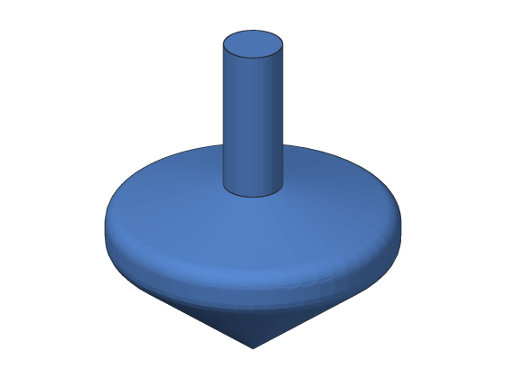
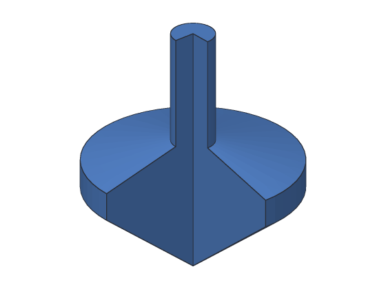

# Tutorial 4: Spinning top

You'll make a spinning top you can print and spin on a table. A top is round all
the way round, so you don't build it from blocks: you draw **half of its side
view** in a sketch, and **revolve** it, turning it all the way round its middle
like a part on a lathe.



**You'll learn:** sketching on a standing plane, revolve, the axis it turns
about, a cutaway to see inside, rounding corners. **Time:** about 15 minutes.

**Before you start:** do [Tutorial 3](03-name-tag.md) first. [Revolve](../user-guide/revolve.md)
in the user's guide has more about every step.

## The plan

The top takes two steps:

1. **Profile:** a sketch of half the top's side view, from its point up the middle
   to the top of the stem, and back out round the rim.
2. **Top:** the profile turned 360° about the middle line.

These are the sizes, in mm. Each point is how far out from the middle (x) and
how high (up):

| Point | Out from the middle | Up |
| --- | --- | --- |
| The tip | 0 | 0 |
| The bottom of the rim | 15 | 12 |
| The top of the rim | 15 | 16 |
| The bottom of the stem | 3 | 19 |
| The top of the stem | 3 | 35 |
| The top, in the middle | 0 | 35 |

## Step 1: A sketch that stands up

A top spins about an upright line, so draw it on a plane that stands up: the
**XZ** plane, facing the front. On it, the sketch's x goes right and its y goes
up, so its y axis is the upright line through the middle.

<!-- cli-example -->
```console
$ sketchbillet_cli run --save top.sb feature.add_sketch plane=xz name=Profile
top: 1 step
  Profile      ok  empty
wrote top.sb
```

## Step 2: Draw half the side view

Draw six lines through the points in the table, each starting where the last
one ended. The last one runs down the middle, on the y axis, back to the tip:

<!-- cli-example -->
```console
$ sketchbillet_cli run --open top.sb --save top.sb sketch.add_line sketch=Profile from=0,0 to=15,12
top: 1 step
  Profile      ok  1 line, 0 constraints, free to move 4 ways
wrote top.sb
$ sketchbillet_cli run --open top.sb --save top.sb sketch.add_line sketch=Profile from=15,12 to=15,16
top: 1 step
  Profile      ok  2 lines, 0 constraints, free to move 8 ways
wrote top.sb
$ sketchbillet_cli run --open top.sb --save top.sb sketch.add_line sketch=Profile from=15,16 to=3,19
top: 1 step
  Profile      ok  3 lines, 0 constraints, free to move 12 ways
wrote top.sb
$ sketchbillet_cli run --open top.sb --save top.sb sketch.add_line sketch=Profile from=3,19 to=3,35
top: 1 step
  Profile      ok  4 lines, 0 constraints, free to move 16 ways
wrote top.sb
$ sketchbillet_cli run --open top.sb --save top.sb sketch.add_line sketch=Profile from=3,35 to=0,35
top: 1 step
  Profile      ok  5 lines, 0 constraints, free to move 20 ways
wrote top.sb
$ sketchbillet_cli run --open top.sb --save top.sb sketch.add_line sketch=Profile from=0,35 to=0,0
top: 1 step
  Profile      ok  6 lines, 0 constraints, free to move 24 ways
wrote top.sb
```

The six lines go all the way round, so they make a closed shape: half of the
top, cut down the middle.

## Step 3: Revolve it

Turn the shape all the way round the sketch's y axis. That's what
`feature.add_revolve` does unless you tell it otherwise: `axis=y` and
`angle=360`.

<!-- cli-example -->
```console
$ sketchbillet_cli run --open top.sb --save top.sb feature.add_revolve sketch=Profile name=Top
top: 2 steps
  Profile      ok  6 lines, 0 constraints, free to move 24 ways
  Top          ok  volume 6983.76 mm^3  mass 8.66 g (PLA)
wrote top.sb
```

Check the volume yourself: the top is a cone (π × 15² × 12 ÷ 3 = 900π), the rim
(π × 15² × 4 = 900π), a sloping shoulder (279π) and the stem (π × 3² × 16 =
144π). That's 2223π = 6983.76 mm³.

The line down the middle lies on the axis, so it doesn't make a face: turning a
line about itself makes nothing. The shape may touch the axis like this, but it
must not cross it, or the top would turn through itself.

## Step 4: Look inside

Turn it only 270° (three quarters of the way round) and you can see the shape
it was made from, in the gap:

<!-- cli-example -->
```console
$ sketchbillet_cli run --open top.sb --save top.sb feature.set_value feature=Top setting=angle value=270
top: 2 steps
  Profile      ok  6 lines, 0 constraints, free to move 24 ways
  Top          ok  volume 5237.82 mm^3  mass 6.49 g (PLA)
wrote top.sb
```



Three quarters of the volume, as it should be. Put it back to 360°:

<!-- cli-example -->
```console
$ sketchbillet_cli run --open top.sb --save top.sb feature.set_value feature=Top setting=angle value=360
top: 2 steps
  Profile      ok  6 lines, 0 constraints, free to move 24 ways
  Top          ok  volume 6983.76 mm^3  mass 8.66 g (PLA)
wrote top.sb
```

## Step 5: Round the rim

The rim's edges are sharp. Round them in the sketch: each rounded corner in the
profile becomes a rounded ring on the top. A corner can only be rounded where two
lines are held together, so join them first with `coincident`, then round each
corner by 2 mm:

<!-- cli-example -->
```console
$ sketchbillet_cli run --open top.sb --save top.sb sketch.constrain sketch=Profile kind=coincident on=Line1.end,Line2.start
top: 2 steps
  Profile      ok  6 lines, 1 constraint, free to move 22 ways
  Top          ok  volume 6983.76 mm^3  mass 8.66 g (PLA)
wrote top.sb
$ sketchbillet_cli run --open top.sb --save top.sb sketch.constrain sketch=Profile kind=coincident on=Line2.end,Line3.start
top: 2 steps
  Profile      ok  6 lines, 2 constraints, free to move 20 ways
  Top          ok  volume 6983.76 mm^3  mass 8.66 g (PLA)
wrote top.sb
$ sketchbillet_cli run --open top.sb --save top.sb sketch.round_corner sketch=Profile at=Line1.end radius=2
top: 2 steps
  Profile      ok  6 lines, 1 arc, 1 point, 8 constraints, free to move 20 ways
  Top          ok  volume 6971.60 mm^3  mass 8.64 g (PLA)
wrote top.sb
$ sketchbillet_cli run --open top.sb --save top.sb sketch.round_corner sketch=Profile at=Line2.end radius=2
top: 2 steps
  Profile      ok  6 lines, 2 arcs, 2 points, 14 constraints, free to move 20 ways
  Top          ok  volume 6928.13 mm^3  mass 8.59 g (PLA)
wrote top.sb
```

The rounding took a little off the rim, so the volume went down a little.

## Step 6: Export it for printing

<!-- cli-example -->
```console
$ sketchbillet_cli open top.sb --export top.stl --step Top
top: 2 steps
  Profile      ok  6 lines, 2 arcs, 2 points, 14 constraints, free to move 20 ways
  Top          ok  volume 6928.13 mm^3  mass 8.59 g (PLA)
wrote top.stl
```

Print it standing on the flat top of its stem, with supports turned on in your
slicer (the rim hangs out over nothing). Spin it by the stem between your thumb
and finger.

## Try this

- Make the rim wider (move the points at 15 mm out to 20 mm). A wider, heavier
  rim spins for longer.
- Change the angle to 180° and print half a top, flat side down, as a stand-up
  model of how it's made.
- Do it in the desktop app: draw the lines in a sketch on XZ, pick the sketch,
  and click **Revolve** on the toolbar. Change the **Axis** and **Angle** in
  Properties.

## What you learned

- A sketch on **XZ** stands up: its y axis is upright, the line a round part
  turns about.
- Draw **half the side view** of a round part, from the middle out, and
  `feature.add_revolve` turns it into the whole part.
- The shape may touch the axis (a line on it makes no face) but not cross it.
- An angle less than 360° makes a cutaway, to see the shape inside.
- Rounding a corner of the profile rounds a whole ring of the part.

Next: [Tutorial 5](05-mounting-plate.md) drills holes for screws.
