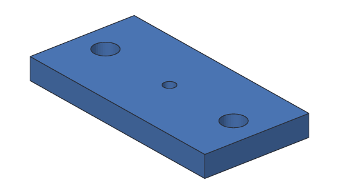

# Tutorial 5: Mounting plate

You'll make a plate that screws to a wall or a box, and holds something in its
middle: two counterbored holes, so the screw heads sit below the surface, and a
tapped hole in the middle for a small M4 screw to grip. On the way you'll use
both ways of placing holes.



**You'll learn:** holes for screws, screw sizes, counterbores, tapped holes,
placing a hole from two edges, placing holes at a sketch's points. **Time:**
about 15 minutes.

**Before you start:** do [Tutorial 3](03-name-tag.md) first. [Holes](../user-guide/holes.md)
in the user's guide has more about every step.

## The plan

1. **Plate:** a 60 × 30 × 6 mm block.
2. **Mount:** an M4 tapped hole, 5 mm deep, in the middle of the top: placed in
   from two edges.
3. **Sketch1** on the top, with a point at each end.
4. **Screws:** a counterbored M3 hole at each point.

## Step 1: The plate

<!-- cli-example -->
```console
$ sketchbillet_cli run --save plate.sb feature.add_box size=60,30,6 name=Plate
plate: 1 step
  Plate        ok  volume 10800.00 mm^3  mass 13.39 g (PLA)
wrote plate.sb
```

## Step 2: A tapped hole in from two edges

The middle hole is 15 mm in from the front edge of the top (half of 30 mm) and
30 mm in from its left edge (half of 60 mm). List the plate's edges to find
their numbers:

<!-- cli-example -->
```console
$ sketchbillet_cli open plate.sb --edges Plate
plate: 1 step
  Plate        ok  volume 10800.00 mm^3  mass 13.39 g (PLA)
edges of Plate: 12
   1  line           60.00 mm  at 30.00,0.00,0.00  between bottom of Plate and front side of Plate
   2  line           30.00 mm  at 0.00,15.00,0.00  between bottom of Plate and left side of Plate
   3  line           30.00 mm  at 60.00,15.00,0.00  between bottom of Plate and right side of Plate
   4  line           60.00 mm  at 30.00,30.00,0.00  between back side of Plate and bottom of Plate
   5  line            6.00 mm  at 0.00,0.00,3.00  between front side of Plate and left side of Plate
   6  line            6.00 mm  at 60.00,0.00,3.00  between front side of Plate and right side of Plate
   7  line            6.00 mm  at 0.00,30.00,3.00  between back side of Plate and left side of Plate
   8  line            6.00 mm  at 60.00,30.00,3.00  between back side of Plate and right side of Plate
   9  line           60.00 mm  at 30.00,0.00,6.00  between front side of Plate and top of Plate
  10  line           30.00 mm  at 0.00,15.00,6.00  between left side of Plate and top of Plate
  11  line           30.00 mm  at 60.00,15.00,6.00  between right side of Plate and top of Plate
  12  line           60.00 mm  at 30.00,30.00,6.00  between back side of Plate and top of Plate
```

Edge 9 is between the front side and the top, and edge 10 between the left side
and the top. Drill an M4 hole there, the tap size (so the screw's thread grips
the plastic), 5 mm deep:

<!-- cli-example -->
```console
$ sketchbillet_cli run --open plate.sb --save plate.sb feature.add_hole body=Plate edges=9,10 distances=15,30 size=M4 fit=tap depth=5 name=Mount
plate: 2 steps
  Plate        ok  volume 10800.00 mm^3
  Mount        ok  volume 10757.24 mm^3  mass 13.34 g (PLA)
wrote plate.sb
```

An M4 tap hole is 3.3 mm across, so it takes π × 1.65² × 5 = 42.76 mm³ out. It
stops 1 mm above the bottom, so nothing shows from underneath.

## Step 3: Points where the screws go

The two screws go 8 mm in from each end, across the middle. Sketch on the top of
the plate, which is now Mount's body. List its faces to find the top:

<!-- cli-example -->
```console
$ sketchbillet_cli open plate.sb --faces Mount
plate: 2 steps
  Plate        ok  volume 10800.00 mm^3
  Mount        ok  volume 10757.24 mm^3  mass 13.34 g (PLA)
faces of Mount: 8
   1  flat       1800.00 mm^2  at 30.00,15.00,0.00  bottom of Plate
   2  flat          8.55 mm^2  at 30.00,15.00,1.00  floor of Mount
   3  flat        360.00 mm^2  at 30.00,0.00,3.00  front side of Plate
   4  flat        180.00 mm^2  at 0.00,15.00,3.00  left side of Plate
   5  flat        180.00 mm^2  at 60.00,15.00,3.00  right side of Plate
   6  flat        360.00 mm^2  at 30.00,30.00,3.00  back side of Plate
   7  cylinder     51.84 mm^2  at 30.00,15.00,3.50  wall of Mount
   8  flat       1791.45 mm^2  at 30.00,15.00,6.00  top of Plate
```

Face 8 is the top (the middle hole made two new faces, so it isn't face 6 any
more). Sketch on it, and add a point for each screw:

<!-- cli-example -->
```console
$ sketchbillet_cli run --open plate.sb --save plate.sb feature.add_sketch body=Mount face=8
plate: 3 steps
  Plate        ok  volume 10800.00 mm^3
  Mount        ok  volume 10757.24 mm^3  mass 13.34 g (PLA)
  Sketch1      ok  empty
wrote plate.sb
$ sketchbillet_cli run --open plate.sb --save plate.sb sketch.add_point sketch=Sketch1 at=8,15
plate: 3 steps
  Plate        ok  volume 10800.00 mm^3
  Mount        ok  volume 10757.24 mm^3  mass 13.34 g (PLA)
  Sketch1      ok  1 point, 0 constraints, free to move 2 ways
wrote plate.sb
$ sketchbillet_cli run --open plate.sb --save plate.sb sketch.add_point sketch=Sketch1 at=52,15
plate: 3 steps
  Plate        ok  volume 10800.00 mm^3
  Mount        ok  volume 10757.24 mm^3  mass 13.34 g (PLA)
  Sketch1      ok  2 points, 0 constraints, free to move 4 ways
wrote plate.sb
```

## Step 4: Counterbored screw holes

One Hole step drills at every point of the sketch. An M3 counterbore is 6.5 mm
across and 3.5 mm deep, for a socket head screw, with the 3.4 mm clearance hole
going on through:

<!-- cli-example -->
```console
$ sketchbillet_cli run --open plate.sb --save plate.sb feature.add_hole sketch=Sketch1 kind=counterbore name=Screws
plate: 4 steps
  Plate        ok  volume 10800.00 mm^3
  Mount        ok  volume 10757.24 mm^3
  Sketch1      ok  2 points, 0 constraints, free to move 4 ways
  Screws       ok  volume 10479.56 mm^3  mass 12.99 g (PLA)
wrote plate.sb
```

Each hole takes π × 3.25² × 3.5 + π × 1.7² × 2.5 = 138.84 mm³, so the two take
277.68 mm³: 10757.24 − 277.68 = 10479.56 mm³.

## Step 5: Export it for printing

<!-- cli-example -->
```console
$ sketchbillet_cli open plate.sb --export plate.stl --step Screws
plate: 4 steps
  Plate        ok  volume 10800.00 mm^3
  Mount        ok  volume 10757.24 mm^3
  Sketch1      ok  2 points, 0 constraints, free to move 4 ways
  Screws       ok  volume 10479.56 mm^3  mass 12.99 g (PLA)
wrote plate.stl
```

Print it flat side down. If an M3 screw is tight in its hole, make the hole
0.2 mm bigger: printers often make holes a little small.

## Try this

- Make the screw holes countersunk instead: delete Screws and add it again with
  `kind=countersink`, for flat head screws that sit flush.
- Drag the points in the desktop app (pick Sketch1, then **Sketch > Edit
  sketch**): the holes follow.
- In the app, pick Screws and change **Screw** to M4 in Properties. The
  counterbores get bigger too.

## What you learned

- **Hole** drills holes for screws; a screw size like M3 sets every diameter.
- **Clearance** holes let a screw slide through; **tap** holes are smaller, so its
  thread grips.
- A **counterbore** sinks a screw head below the face; a **countersink** makes a
  flat head flush.
- Holes go at a sketch's points (one step drills them all), or in from two edges
  of a face.

Next: [Tutorial 6](06-fan-cover.md) makes many holes from one, with patterns.
