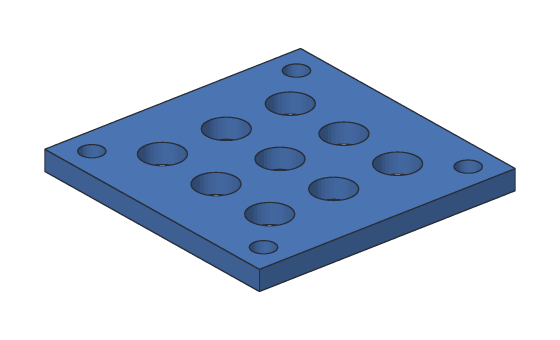

# Tutorial 6: Fan cover

You'll make a cover for a small 40 mm fan, the kind inside 3D printers and
computer cases: a square plate with a screw hole in each corner and a grid of air
holes in the middle. You'll make one screw hole and one air hole, and let
**patterns** make the rest.



**You'll learn:** circular patterns, linear patterns in a grid, patterns of
holes. **Time:** about 15 minutes.

**Before you start:** do [Tutorial 5](05-mounting-plate.md) first. [Patterns](../user-guide/patterns.md)
in the user's guide has more about every step.

## The plan

A 40 mm fan's screw holes are 32 mm apart, so each is 16 mm from the middle in x
and in y. The cover is centered on the z axis, so they're at (16, 16),
(−16, 16), (−16, −16) and (16, −16): one hole, turned a quarter at a time.

1. **Plate:** 40 × 40 × 3 mm, from −20 to 20 in x and y.
2. **Screw:** an M3 hole at (16, 16).
3. **Screws:** a circular pattern of it: 4 round the z axis.
4. **Air:** a 6 mm hole at (−10, −10).
5. **Grille:** a linear pattern of it: 3 by 3, 10 mm apart.

## Step 1: The plate

<!-- cli-example -->
```console
$ sketchbillet_cli run --save fan.sb feature.add_box corner=-20,-20,0 size=40,40,3 name=Plate
fan: 1 step
  Plate        ok  volume 4800.00 mm^3  mass 5.95 g (PLA)
wrote fan.sb
```

## Step 2: One screw hole

Sketch on the plate's top (face 6 of a box), put a point at (16, 16), and drill
an M3 hole there:

<!-- cli-example -->
```console
$ sketchbillet_cli run --open fan.sb --save fan.sb feature.add_sketch body=Plate face=6
fan: 2 steps
  Plate        ok  volume 4800.00 mm^3  mass 5.95 g (PLA)
  Sketch1      ok  empty
wrote fan.sb
$ sketchbillet_cli run --open fan.sb --save fan.sb sketch.add_point sketch=Sketch1 at=16,16
fan: 2 steps
  Plate        ok  volume 4800.00 mm^3  mass 5.95 g (PLA)
  Sketch1      ok  1 point, 0 constraints, free to move 2 ways
wrote fan.sb
$ sketchbillet_cli run --open fan.sb --save fan.sb feature.add_hole sketch=Sketch1 name=Screw
fan: 3 steps
  Plate        ok  volume 4800.00 mm^3
  Sketch1      ok  1 point, 0 constraints, free to move 2 ways
  Screw        ok  volume 4772.76 mm^3  mass 5.92 g (PLA)
wrote fan.sb
```

## Step 3: Four screw holes, round a circle

A circular pattern turns copies round an axis. The z axis goes through the
plate's middle, which is the default, so just say how many:

<!-- cli-example -->
```console
$ sketchbillet_cli run --open fan.sb --save fan.sb feature.add_pattern steps=Screw kind=circular count=4 name=Screws
fan: 4 steps
  Plate        ok  volume 4800.00 mm^3
  Sketch1      ok  1 point, 0 constraints, free to move 2 ways
  Screw        ok  volume 4772.76 mm^3
  Screws       ok  volume 4691.05 mm^3  mass 5.82 g (PLA)
wrote fan.sb
```

Four copies, 90° apart, the first being the hole you made: π × 1.7² × 3 =
27.24 mm³ each, so 108.95 mm³ out of 4800 mm³ in all.

## Step 4: One air hole

A second sketch on the top, with a point at (−10, −10), for the grid's corner.
This hole goes into the body with the screw holes, `Screws`, so say so with
`body=`. Make it 6 mm across:

<!-- cli-example -->
```console
$ sketchbillet_cli run --open fan.sb --save fan.sb feature.add_sketch body=Plate face=6
fan: 5 steps
  Plate        ok  volume 4800.00 mm^3
  Sketch1      ok  1 point, 0 constraints, free to move 2 ways
  Screw        ok  volume 4772.76 mm^3
  Screws       ok  volume 4691.05 mm^3  mass 5.82 g (PLA)
  Sketch2      ok  empty
wrote fan.sb
$ sketchbillet_cli run --open fan.sb --save fan.sb sketch.add_point sketch=Sketch2 at=-10,-10
fan: 5 steps
  Plate        ok  volume 4800.00 mm^3
  Sketch1      ok  1 point, 0 constraints, free to move 2 ways
  Screw        ok  volume 4772.76 mm^3
  Screws       ok  volume 4691.05 mm^3  mass 5.82 g (PLA)
  Sketch2      ok  1 point, 0 constraints, free to move 2 ways
wrote fan.sb
$ sketchbillet_cli run --open fan.sb --save fan.sb feature.add_hole sketch=Sketch2 body=Screws diameter=6 name=Air
fan: 6 steps
  Plate        ok  volume 4800.00 mm^3
  Sketch1      ok  1 point, 0 constraints, free to move 2 ways
  Screw        ok  volume 4772.76 mm^3
  Screws       ok  volume 4691.05 mm^3
  Sketch2      ok  1 point, 0 constraints, free to move 2 ways
  Air          ok  volume 4606.23 mm^3  mass 5.71 g (PLA)
wrote fan.sb
```

## Step 5: A grid of air holes

A linear pattern goes along x (10 mm apart, by default); `count2` makes it a grid,
with rows going along y:

<!-- cli-example -->
```console
$ sketchbillet_cli run --open fan.sb --save fan.sb feature.add_pattern steps=Air count=3 count2=3 name=Grille
fan: 7 steps
  Plate        ok  volume 4800.00 mm^3
  Sketch1      ok  1 point, 0 constraints, free to move 2 ways
  Screw        ok  volume 4772.76 mm^3
  Screws       ok  volume 4691.05 mm^3
  Sketch2      ok  1 point, 0 constraints, free to move 2 ways
  Air          ok  volume 4606.23 mm^3
  Grille       ok  volume 3927.64 mm^3  mass 4.87 g (PLA)
wrote fan.sb
```

Nine 6 mm holes: 9 × π × 3² × 3 = 763.41 mm³. With the screw holes, that's
4800 − 108.95 − 763.41 = 3927.64 mm³.

## Step 6: Export it for printing

<!-- cli-example -->
```console
$ sketchbillet_cli open fan.sb --export fan.stl --step Grille
fan: 7 steps
  Plate        ok  volume 4800.00 mm^3
  Sketch1      ok  1 point, 0 constraints, free to move 2 ways
  Screw        ok  volume 4772.76 mm^3
  Screws       ok  volume 4691.05 mm^3
  Sketch2      ok  1 point, 0 constraints, free to move 2 ways
  Air          ok  volume 4606.23 mm^3
  Grille       ok  volume 3927.64 mm^3  mass 4.87 g (PLA)
wrote fan.stl
```

Print it flat. The holes are clearance holes: the fan's screws go through the
cover and into the fan.

## Try this

- Make the air holes 7 mm: `feature.set_value feature=Air setting=diameter value=7`.
  All nine change.
- A 4 × 4 grid instead: change `Grille`'s count and count2 to 4, and its spacing
  to 7 mm. Remember the first hole is at (−10, −10).
- In the desktop app, pick `Air` and click **Circle**: a ring of air holes round
  the middle instead of a grid.

## What you learned

- A **circular pattern** turns copies round an axis: the z axis, through 0, 0,
  unless you say otherwise.
- A **linear pattern** makes a row; `count2` makes it a grid.
- Make one, and pattern it: change the one, and every copy follows.
