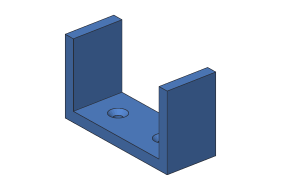

# Tutorial 7: U bracket

You'll make a U-shaped bracket that holds a pipe or a cable bundle against a
wall: a flat base with a screw hole at each end, and a side going up at each end.
It's the same on the left and the right, so you'll model **half** of it and
**mirror** it.



**You'll learn:** joining two boxes, mirroring a body, how a mirror follows its
half. **Time:** about 10 minutes.

**Before you start:** do [Tutorial 5](05-mounting-plate.md) first. [Mirror](../user-guide/mirror.md)
in the user's guide has more about every step.

## The plan

The whole bracket is 50 mm wide, so each half is 25 mm, from x = 0 (the middle)
to x = 25.

1. **Base:** 25 × 20 × 4 mm.
2. **Side:** 4 × 20 × 26 mm, standing on the base's right end.
3. **Half:** the two joined.
4. **Screw:** a countersunk M3 hole in the base.
5. **Bracket:** Screw's body, mirrored across the YZ plane (x = 0).

## Step 1: The half

The side stands on the base, from x = 21 to 25 and from z = 4 up to 30:

<!-- cli-example -->
```console
$ sketchbillet_cli run --save bracket.sb feature.add_box size=25,20,4 name=Base
bracket: 1 step
  Base         ok  volume 2000.00 mm^3  mass 2.48 g (PLA)
wrote bracket.sb
$ sketchbillet_cli run --open bracket.sb --save bracket.sb feature.add_box corner=21,0,4 size=4,20,26 name=Side
bracket: 2 steps
  Base         ok  volume 2000.00 mm^3  mass 2.48 g (PLA)
  Side         ok  volume 2080.00 mm^3  mass 2.58 g (PLA)
wrote bracket.sb
$ sketchbillet_cli run --open bracket.sb --save bracket.sb feature.add_boolean operation=union a=Base b=Side name=Half
bracket: 3 steps
  Base         ok  volume 2000.00 mm^3
  Side         ok  volume 2080.00 mm^3
  Half         ok  volume 4080.00 mm^3  mass 5.06 g (PLA)
wrote bracket.sb
```

## Step 2: A screw hole

A countersunk hole, so a flat-headed screw sits flush with the base, 11 mm from
the middle. The base's top is face 6 of Half:

<!-- cli-example -->
```console
$ sketchbillet_cli open bracket.sb --faces Half
bracket: 3 steps
  Base         ok  volume 2000.00 mm^3
  Side         ok  volume 2080.00 mm^3
  Half         ok  volume 4080.00 mm^3  mass 5.06 g (PLA)
faces of Half: 11
   1  flat        500.00 mm^2  at 12.50,10.00,0.00  bottom of Base
   2  flat        100.00 mm^2  at 12.50,0.00,2.00  front side of Base
   3  flat         80.00 mm^2  at 0.00,10.00,2.00  left side of Base
   4  flat         80.00 mm^2  at 25.00,10.00,2.00  right side of Base
   5  flat        100.00 mm^2  at 12.50,20.00,2.00  back side of Base
   6  flat        420.00 mm^2  at 10.50,10.00,4.00  top of Base
   7  flat        104.00 mm^2  at 23.00,0.00,17.00  front side of Side
   8  flat        520.00 mm^2  at 21.00,10.00,17.00  left side of Side
   9  flat        520.00 mm^2  at 25.00,10.00,17.00  right side of Side
  10  flat        104.00 mm^2  at 23.00,20.00,17.00  back side of Side
  11  flat         80.00 mm^2  at 23.00,10.00,30.00  top of Side
```

<!-- cli-example -->
```console
$ sketchbillet_cli run --open bracket.sb --save bracket.sb feature.add_sketch body=Half face=6
bracket: 4 steps
  Base         ok  volume 2000.00 mm^3
  Side         ok  volume 2080.00 mm^3
  Half         ok  volume 4080.00 mm^3  mass 5.06 g (PLA)
  Sketch1      ok  empty
wrote bracket.sb
$ sketchbillet_cli run --open bracket.sb --save bracket.sb sketch.add_point sketch=Sketch1 at=11,10
bracket: 4 steps
  Base         ok  volume 2000.00 mm^3
  Side         ok  volume 2080.00 mm^3
  Half         ok  volume 4080.00 mm^3  mass 5.06 g (PLA)
  Sketch1      ok  1 point, 0 constraints, free to move 2 ways
wrote bracket.sb
$ sketchbillet_cli run --open bracket.sb --save bracket.sb feature.add_hole sketch=Sketch1 kind=countersink name=Screw
bracket: 5 steps
  Base         ok  volume 2000.00 mm^3
  Side         ok  volume 2080.00 mm^3
  Half         ok  volume 4080.00 mm^3
  Sketch1      ok  1 point, 0 constraints, free to move 2 ways
  Screw        ok  volume 4024.18 mm^3  mass 4.99 g (PLA)
wrote bracket.sb
```

The countersink is a cone 6.72 mm across, 1.66 mm deep, over the 3.4 mm hole:
π × 1.66 ÷ 3 × (3.36² + 3.36 × 1.7 + 1.7²) + π × 1.7² × 2.34 = 55.82 mm³ out of
the half's 4080 mm³.

## Step 3: Mirror it

The middle of the bracket is x = 0, the YZ plane, which is Mirror's default:

<!-- cli-example -->
```console
$ sketchbillet_cli run --open bracket.sb --save bracket.sb feature.add_mirror body=Screw name=Bracket
bracket: 6 steps
  Base         ok  volume 2000.00 mm^3
  Side         ok  volume 2080.00 mm^3
  Half         ok  volume 4080.00 mm^3
  Sketch1      ok  1 point, 0 constraints, free to move 2 ways
  Screw        ok  volume 4024.18 mm^3
  Bracket      ok  volume 8048.35 mm^3  mass 9.98 g (PLA)
wrote bracket.sb
```

Exactly twice the half, with the hole mirrored too, since it was part of the
half's body.

## Step 4: Change the half

Make the sides taller. Change the half, and the mirror follows:

<!-- cli-example -->
```console
$ sketchbillet_cli run --open bracket.sb --save bracket.sb feature.set_value feature=Side setting=size_z value=36
bracket: 6 steps
  Base         ok  volume 2000.00 mm^3
  Side         ok  volume 2880.00 mm^3
  Half         ok  volume 4880.00 mm^3
  Sketch1      ok  1 point, 0 constraints, free to move 2 ways
  Screw        ok  volume 4824.18 mm^3
  Bracket      ok  volume 9648.35 mm^3  mass 11.96 g (PLA)
wrote bracket.sb
```

Each side grew by 4 × 20 × 10 = 800 mm³, so the bracket grew by 1600 mm³.

## Step 5: Export it for printing

<!-- cli-example -->
```console
$ sketchbillet_cli open bracket.sb --export bracket.stl --step Bracket
bracket: 6 steps
  Base         ok  volume 2000.00 mm^3
  Side         ok  volume 2880.00 mm^3
  Half         ok  volume 4880.00 mm^3
  Sketch1      ok  1 point, 0 constraints, free to move 2 ways
  Screw        ok  volume 4824.18 mm^3
  Bracket      ok  volume 9648.35 mm^3  mass 11.96 g (PLA)
wrote bracket.stl
```

Print it standing on its base. The inside of the U is 42 mm wide (50 − 2 × 4),
for a pipe up to about 40 mm across.

## Try this

- Make the bracket wider for a bigger pipe: change Base's size_x to 30 and move
  Side's corner to x = 26. Both halves change.
- In the desktop app, pick `Screw` and click **Mirror**: only the hole is
  mirrored, into the same half. Then change **Plane** to XZ in Properties.

## What you learned

- Parts that are the same on both sides: model half, then **Mirror**.
- Start the half at x = 0, and the YZ plane is its middle.
- A mirror of a body includes everything already in it, like its holes.
- Change the half, and the whole changes.

Next: [Tutorial 8](08-phone-stand.md) sketches on a tilted construction plane.
