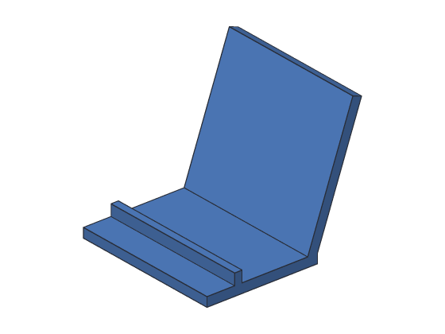

# Tutorial 8: Phone stand

You'll make a stand that holds a phone leaning back, for watching videos or
video calls: a flat base, a back rest tilted at 70°, and a lip at the front that
stops the phone sliding. The back rest isn't on any face or base plane, so you'll
sketch it on a **construction plane**.



**You'll learn:** construction planes, tilting a plane about an edge, sketching on
a plane, joining an extrude to a body. **Time:** about 15 minutes.

**Before you start:** do [Tutorial 7](07-u-bracket.md) first. [Construction planes](../user-guide/planes.md)
in the user's guide has more about every step.

## The plan

1. **Base:** 80 × 60 × 5 mm.
2. **Lean:** a plane that starts as the base's top, folded up 70° about its back
   edge, like a book cover.
3. **Sketch1** on Lean: the back rest's outline.
4. **Back:** the outline extruded 5 mm, joined to the base.
5. **Lip:** a strip at the front, 4 mm wide and 6 mm tall, joined on.

## Step 1: The base

<!-- cli-example -->
```console
$ sketchbillet_cli run --save stand.sb feature.add_box size=80,60,5 name=Base
stand: 1 step
  Base         ok  volume 24000.00 mm^3  mass 29.76 g (PLA)
wrote stand.sb
```

## Step 2: A plane folded up from the back edge

List the base's edges to find the top's back edge:

<!-- cli-example -->
```console
$ sketchbillet_cli open stand.sb --edges Base
stand: 1 step
  Base         ok  volume 24000.00 mm^3  mass 29.76 g (PLA)
edges of Base: 12
   1  line           80.00 mm  at 40.00,0.00,0.00  between bottom of Base and front side of Base
   2  line           60.00 mm  at 0.00,30.00,0.00  between bottom of Base and left side of Base
   3  line           60.00 mm  at 80.00,30.00,0.00  between bottom of Base and right side of Base
   4  line           80.00 mm  at 40.00,60.00,0.00  between back side of Base and bottom of Base
   5  line            5.00 mm  at 0.00,0.00,2.50  between front side of Base and left side of Base
   6  line            5.00 mm  at 80.00,0.00,2.50  between front side of Base and right side of Base
   7  line            5.00 mm  at 0.00,60.00,2.50  between back side of Base and left side of Base
   8  line            5.00 mm  at 80.00,60.00,2.50  between back side of Base and right side of Base
   9  line           80.00 mm  at 40.00,0.00,5.00  between front side of Base and top of Base
  10  line           60.00 mm  at 0.00,30.00,5.00  between left side of Base and top of Base
  11  line           60.00 mm  at 80.00,30.00,5.00  between right side of Base and top of Base
  12  line           80.00 mm  at 40.00,60.00,5.00  between back side of Base and top of Base
```

Edge 12 is between the back side and the top. Start a plane from the top (face 6),
and tilt it 70° about that edge:

<!-- cli-example -->
```console
$ sketchbillet_cli run --open stand.sb --save stand.sb feature.add_plane body=Base face=6 edge=12 angle=70 name=Lean
stand: 2 steps
  Base         ok  volume 24000.00 mm^3  mass 29.76 g (PLA)
  Lean         ok  plane through 0.00,39.48,-51.38 mm, facing 0.00,-0.94,0.34
wrote stand.sb
```

Its line says it faces 0, −0.94, 0.34: mostly toward the front, a little up. That's
the side a phone leans on.

## Step 3: Sketch the back rest

A sketch on Lean is the base's top, folded up along the back edge. The back edge
is at y = 60, as it is on the top; what you draw past y = 60 folds up. The back
rest goes from y = 57 to 130: 70 mm up the slope, and the first 3 mm fold down into
the base, so the two join solidly.

<!-- cli-example -->
```console
$ sketchbillet_cli run --open stand.sb --save stand.sb feature.add_sketch on=Lean
stand: 3 steps
  Base         ok  volume 24000.00 mm^3  mass 29.76 g (PLA)
  Lean         ok  plane through 0.00,39.48,-51.38 mm, facing 0.00,-0.94,0.34
  Sketch1      ok  empty
wrote stand.sb
$ sketchbillet_cli run --open stand.sb --save stand.sb sketch.add_rectangle sketch=Sketch1 from=0,57 to=80,130
stand: 3 steps
  Base         ok  volume 24000.00 mm^3  mass 29.76 g (PLA)
  Lean         ok  plane through 0.00,39.48,-51.38 mm, facing 0.00,-0.94,0.34
  Sketch1      ok  4 lines, 8 constraints, free to move 4 ways
wrote stand.sb
```

## Step 4: Extrude it onto the base

A sketch on a plane makes a new body unless you say otherwise. Join it to the
base:

<!-- cli-example -->
```console
$ sketchbillet_cli run --open stand.sb --save stand.sb feature.add_extrude sketch=Sketch1 distance=5 operation=join body=Base name=Back
stand: 4 steps
  Base         ok  volume 24000.00 mm^3
  Lean         ok  plane through 0.00,39.48,-51.38 mm, facing 0.00,-0.94,0.34
  Sketch1      ok  4 lines, 8 constraints, free to move 4 ways
  Back         ok  volume 52363.97 mm^3  mass 64.93 g (PLA)
wrote stand.sb
```

The back rest is 80 × 73 × 5 = 29200 mm³, and the base 24000 mm³; they overlap by
836.03 mm³ where the strip folds into the base, which leaves 52363.97 mm³.

## Step 5: A lip at the front

A strip from y = 15 to 19, standing on the base, joined on:

<!-- cli-example -->
```console
$ sketchbillet_cli run --open stand.sb --save stand.sb feature.add_box corner=0,15,5 size=80,4,6 name=Lip
stand: 5 steps
  Base         ok  volume 24000.00 mm^3
  Lean         ok  plane through 0.00,39.48,-51.38 mm, facing 0.00,-0.94,0.34
  Sketch1      ok  4 lines, 8 constraints, free to move 4 ways
  Back         ok  volume 52363.97 mm^3  mass 64.93 g (PLA)
  Lip          ok  volume 1920.00 mm^3  mass 2.38 g (PLA)
wrote stand.sb
$ sketchbillet_cli run --open stand.sb --save stand.sb feature.add_boolean operation=union a=Back b=Lip name=Stand
stand: 6 steps
  Base         ok  volume 24000.00 mm^3
  Lean         ok  plane through 0.00,39.48,-51.38 mm, facing 0.00,-0.94,0.34
  Sketch1      ok  4 lines, 8 constraints, free to move 4 ways
  Back         ok  volume 52363.97 mm^3
  Lip          ok  volume 1920.00 mm^3
  Stand        ok  volume 54283.97 mm^3  mass 67.31 g (PLA)
wrote stand.sb
```

## Step 6: Try another angle

Lean it back further: 60° instead of 70°. The plane tilts, the sketch on it
tilts, and the back rest follows:

<!-- cli-example -->
```console
$ sketchbillet_cli run --open stand.sb --save stand.sb feature.set_value feature=Lean setting=angle value=60
stand: 6 steps
  Base         ok  volume 24000.00 mm^3
  Lean         ok  plane through 0.00,30.00,-46.96 mm, facing 0.00,-0.87,0.50
  Sketch1      ok  4 lines, 8 constraints, free to move 4 ways
  Back         ok  volume 52577.35 mm^3
  Lip          ok  volume 1920.00 mm^3
  Stand        ok  volume 54497.35 mm^3  mass 67.58 g (PLA)
wrote stand.sb
```

## Step 7: Export it for printing

<!-- cli-example -->
```console
$ sketchbillet_cli open stand.sb --export stand.stl --step Stand
stand: 6 steps
  Base         ok  volume 24000.00 mm^3
  Lean         ok  plane through 0.00,30.00,-46.96 mm, facing 0.00,-0.87,0.50
  Sketch1      ok  4 lines, 8 constraints, free to move 4 ways
  Back         ok  volume 52577.35 mm^3
  Lip          ok  volume 1920.00 mm^3
  Stand        ok  volume 54497.35 mm^3  mass 67.58 g (PLA)
wrote stand.stl
```

Print it standing on its base. The back rest leans back over nothing, so turn on
supports in your slicer, or print it on its side.

## Try this

- A wider stand for a tablet: make Base 160 mm wide (size_x), and the sketch's
  rectangle to x = 160.
- In the desktop app, pick Lean and change **Angle** in Properties: watch the
  back rest tilt.

## What you learned

- A **construction plane** is a place to sketch where there's no face.
- A plane from a face can **tilt about an edge**, like a book cover; the sketch
  on it is the face, folded along the edge.
- A sketch on a plane makes a new body; use **operation=join** to add it to one.
- Change the plane, and everything on it follows.
