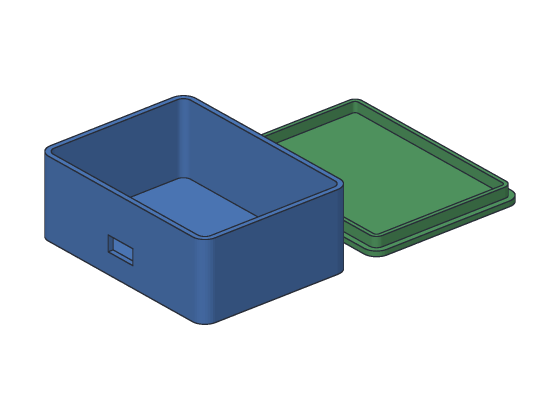
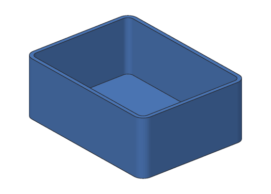
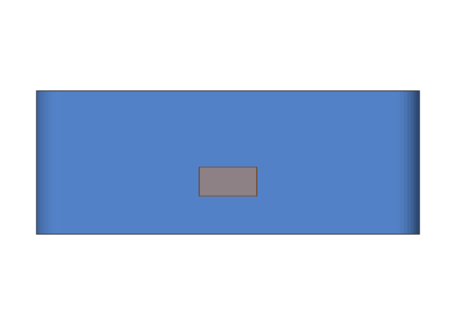

# Tutorial 9: Project box

You'll make a box with a lid for a small electronics project, like a
microcontroller board and a battery: rounded corners, 2 mm walls, a slot in the
front for the cable, and a lid with a lip that holds it in place. The box is
solid at first; a **Shell** hollows it out.



**You'll learn:** shelling a body, leaving one face open or two, rounding
corners before shelling, cutting a slot in a wall. **Time:** about 20 minutes.

**Before you start:** do [Tutorial 8](08-phone-stand.md) first. [Shell](../user-guide/shell.md)
in the user's guide has more about every step.

## The plan

1. **Case:** a solid box, 80 × 60 × 30 mm, with its four upright corners
   rounded to 5 mm.
2. **Hollow:** shelled to 2 mm walls, open at the top.
3. **Slot:** a 12 × 6 mm slot through the front wall, for a USB cable.
4. **Lid:** a plate 80 × 60 × 2 mm with the same corners, and a thin ring on it
   (a **lip**) that fits inside the box. The ring is a shell too, open at the top
   and the bottom.

## Step 1: The solid case

<!-- cli-example -->
```console
$ sketchbillet_cli run --save box.sb feature.add_box size=80,60,30 name=Case
box: 1 step
  Case         ok  volume 144000.00 mm^3  mass 178.56 g (PLA)
wrote box.sb
```

Round the four upright edges. They're edges 5 to 8 (see them with
`sketchbillet_cli open box.sb --edges Case`):

<!-- cli-example -->
```console
$ sketchbillet_cli run --open box.sb --save box.sb feature.add_fillet body=Case edges=5,6,7,8 radius=5 name=Corners
box: 2 steps
  Case         ok  volume 144000.00 mm^3
  Corners      ok  volume 143356.19 mm^3  mass 177.76 g (PLA)
wrote box.sb
```

## Step 2: Hollow it out

List the faces to find the top:

<!-- cli-example -->
```console
$ sketchbillet_cli open box.sb --faces Corners
box: 2 steps
  Case         ok  volume 144000.00 mm^3
  Corners      ok  volume 143356.19 mm^3  mass 177.76 g (PLA)
faces of Corners: 10
   1  flat       4778.54 mm^2  at 40.00,30.00,0.00  bottom of Case
   2  flat       2100.00 mm^2  at 40.00,0.00,15.00  front side of Case
   3  cylinder    235.62 mm^2  at 1.82,1.82,15.00  round of Corners
   4  cylinder    235.62 mm^2  at 78.18,1.82,15.00  round of Corners
   5  flat       1500.00 mm^2  at 0.00,30.00,15.00  left side of Case
   6  flat       1500.00 mm^2  at 80.00,30.00,15.00  right side of Case
   7  cylinder    235.62 mm^2  at 1.82,58.18,15.00  round of Corners
   8  cylinder    235.62 mm^2  at 78.18,58.18,15.00  round of Corners
   9  flat       2100.00 mm^2  at 40.00,60.00,15.00  back side of Case
  10  flat       4778.54 mm^2  at 40.00,30.00,30.00  top of Case
```

Face 10 is the top. Shell the case with it open; the walls are 2 mm unless you
say otherwise:

<!-- cli-example -->
```console
$ sketchbillet_cli run --open box.sb --save box.sb feature.add_shell body=Corners faces=10 name=Hollow
box: 3 steps
  Case         ok  volume 144000.00 mm^3
  Corners      ok  volume 143356.19 mm^3
  Hollow       ok  volume 24404.51 mm^3  mass 30.26 g (PLA)
wrote box.sb
```



Check it by hand: the inside is 76 × 56 × 28 mm, with corners rounded to 3 mm
(5 mm outside, less the 2 mm wall). That's 118951.69 mm³ taken from the solid
143356.19 mm³, which leaves 24404.51 mm³.

## Step 3: A slot for the cable

A box 12 mm wide and 6 mm tall, poking out both sides of the front wall (y = 0 to 2), 8 mm
up from the bottom. Cut it away:

<!-- cli-example -->
```console
$ sketchbillet_cli run --open box.sb --save box.sb feature.add_box corner=34,-1,8 size=12,5,6 name=SlotTool
box: 4 steps
  Case         ok  volume 144000.00 mm^3
  Corners      ok  volume 143356.19 mm^3
  Hollow       ok  volume 24404.51 mm^3  mass 30.26 g (PLA)
  SlotTool     ok  volume 360.00 mm^3  mass 0.45 g (PLA)
wrote box.sb
$ sketchbillet_cli run --open box.sb --save box.sb feature.add_boolean operation=cut a=Hollow b=SlotTool name=Slot
box: 5 steps
  Case         ok  volume 144000.00 mm^3
  Corners      ok  volume 143356.19 mm^3
  Hollow       ok  volume 24404.51 mm^3
  SlotTool     ok  volume 360.00 mm^3
  Slot         ok  volume 24260.51 mm^3  mass 30.08 g (PLA)
wrote box.sb
```

The slot takes 12 × 2 × 6 = 144 mm³ out of the wall.



## Step 4: The lid

Make the lid beside the box, 10 mm behind it, so you can print both at once. A
plate with the same rounded corners:

<!-- cli-example -->
```console
$ sketchbillet_cli run --open box.sb --save box.sb feature.add_box corner=0,70,0 size=80,60,2 name=Lid
box: 6 steps
  Case         ok  volume 144000.00 mm^3
  Corners      ok  volume 143356.19 mm^3
  Hollow       ok  volume 24404.51 mm^3
  SlotTool     ok  volume 360.00 mm^3
  Slot         ok  volume 24260.51 mm^3  mass 30.08 g (PLA)
  Lid          ok  volume 9600.00 mm^3  mass 11.90 g (PLA)
wrote box.sb
$ sketchbillet_cli run --open box.sb --save box.sb feature.add_fillet body=Lid edges=5,6,7,8 radius=5 name=LidCorners
box: 7 steps
  Case         ok  volume 144000.00 mm^3
  Corners      ok  volume 143356.19 mm^3
  Hollow       ok  volume 24404.51 mm^3
  SlotTool     ok  volume 360.00 mm^3
  Slot         ok  volume 24260.51 mm^3  mass 30.08 g (PLA)
  Lid          ok  volume 9600.00 mm^3
  LidCorners   ok  volume 9557.08 mm^3  mass 11.85 g (PLA)
wrote box.sb
```

## Step 5: The lip

The lip is a ring that slides into the box's opening. The opening is 76 × 56 mm;
the lip is 0.2 mm smaller on each side, 75.6 × 55.6 mm, so it slides in without
forcing. Its corners are rounded to 2.8 mm, to match the 3 mm inside corners.
Start with a solid block on the lid:

<!-- cli-example -->
```console
$ sketchbillet_cli run --open box.sb --save box.sb feature.add_box corner=2.2,72.2,2 size=75.6,55.6,4 name=Lip
box: 8 steps
  Case         ok  volume 144000.00 mm^3
  Corners      ok  volume 143356.19 mm^3
  Hollow       ok  volume 24404.51 mm^3
  SlotTool     ok  volume 360.00 mm^3
  Slot         ok  volume 24260.51 mm^3  mass 30.08 g (PLA)
  Lid          ok  volume 9600.00 mm^3
  LidCorners   ok  volume 9557.08 mm^3  mass 11.85 g (PLA)
  Lip          ok  volume 16813.44 mm^3  mass 20.85 g (PLA)
wrote box.sb
$ sketchbillet_cli run --open box.sb --save box.sb feature.add_fillet body=Lip edges=5,6,7,8 radius=2.8 name=LipCorners
box: 9 steps
  Case         ok  volume 144000.00 mm^3
  Corners      ok  volume 143356.19 mm^3
  Hollow       ok  volume 24404.51 mm^3
  SlotTool     ok  volume 360.00 mm^3
  Slot         ok  volume 24260.51 mm^3  mass 30.08 g (PLA)
  Lid          ok  volume 9600.00 mm^3
  LidCorners   ok  volume 9557.08 mm^3  mass 11.85 g (PLA)
  Lip          ok  volume 16813.44 mm^3
  LipCorners   ok  volume 16786.52 mm^3  mass 20.82 g (PLA)
wrote box.sb
```

Now shell it with **two** faces open, the bottom (1) and the top (10), to leave
just a ring, 1.5 mm thick:

<!-- cli-example -->
```console
$ sketchbillet_cli run --open box.sb --save box.sb feature.add_shell body=LipCorners faces=1,10 thickness=1.5 name=Ring
box: 10 steps
  Case         ok  volume 144000.00 mm^3
  Corners      ok  volume 143356.19 mm^3
  Hollow       ok  volume 24404.51 mm^3
  SlotTool     ok  volume 360.00 mm^3
  Slot         ok  volume 24260.51 mm^3  mass 30.08 g (PLA)
  Lid          ok  volume 9600.00 mm^3
  LidCorners   ok  volume 9557.08 mm^3  mass 11.85 g (PLA)
  Lip          ok  volume 16813.44 mm^3
  LipCorners   ok  volume 16786.52 mm^3
  Ring         ok  volume 1517.28 mm^3  mass 1.88 g (PLA)
wrote box.sb
```

Join the ring to the lid:

<!-- cli-example -->
```console
$ sketchbillet_cli run --open box.sb --save box.sb feature.add_boolean operation=union a=LidCorners b=Ring name=LidDone
box: 11 steps
  Case         ok  volume 144000.00 mm^3
  Corners      ok  volume 143356.19 mm^3
  Hollow       ok  volume 24404.51 mm^3
  SlotTool     ok  volume 360.00 mm^3
  Slot         ok  volume 24260.51 mm^3  mass 30.08 g (PLA)
  Lid          ok  volume 9600.00 mm^3
  LidCorners   ok  volume 9557.08 mm^3
  Lip          ok  volume 16813.44 mm^3
  LipCorners   ok  volume 16786.52 mm^3
  Ring         ok  volume 1517.28 mm^3
  LidDone      ok  volume 11074.36 mm^3  mass 13.73 g (PLA)
wrote box.sb
```

## Step 6: Try thicker walls

Make the box's walls 3 mm. The slot still goes through, because it pokes out
both sides of the wall:

<!-- cli-example -->
```console
$ sketchbillet_cli run --open box.sb feature.set_value feature=Hollow setting=thickness value=3
box: 11 steps
  Case         ok  volume 144000.00 mm^3
  Corners      ok  volume 143356.19 mm^3
  Hollow       ok  volume 35556.90 mm^3
  SlotTool     ok  volume 360.00 mm^3
  Slot         ok  volume 35340.90 mm^3  mass 43.82 g (PLA)
  Lid          ok  volume 9600.00 mm^3
  LidCorners   ok  volume 9557.08 mm^3
  Lip          ok  volume 16813.44 mm^3
  LipCorners   ok  volume 16786.52 mm^3
  Ring         ok  volume 1517.28 mm^3
  LidDone      ok  volume 11074.36 mm^3  mass 13.73 g (PLA)
```

The inside is now 74 × 54 × 27 mm with 2 mm corners, and the slot takes
12 × 3 × 6 = 216 mm³ from the thicker wall. Without `--save`, the design keeps
its 2 mm walls.

The lid's lip would no longer fit the smaller opening, so keep 2 mm for this
lid, or make the lip 2 mm smaller too.

## Step 7: Export it for printing

Export the box and the lid as two files:

<!-- cli-example -->
```console
$ sketchbillet_cli open box.sb --export box.stl --step Slot
box: 11 steps
  Case         ok  volume 144000.00 mm^3
  Corners      ok  volume 143356.19 mm^3
  Hollow       ok  volume 24404.51 mm^3
  SlotTool     ok  volume 360.00 mm^3
  Slot         ok  volume 24260.51 mm^3  mass 30.08 g (PLA)
  Lid          ok  volume 9600.00 mm^3
  LidCorners   ok  volume 9557.08 mm^3
  Lip          ok  volume 16813.44 mm^3
  LipCorners   ok  volume 16786.52 mm^3
  Ring         ok  volume 1517.28 mm^3
  LidDone      ok  volume 11074.36 mm^3  mass 13.73 g (PLA)
wrote box.stl
$ sketchbillet_cli open box.sb --export lid.stl --step LidDone
box: 11 steps
  Case         ok  volume 144000.00 mm^3
  Corners      ok  volume 143356.19 mm^3
  Hollow       ok  volume 24404.51 mm^3
  SlotTool     ok  volume 360.00 mm^3
  Slot         ok  volume 24260.51 mm^3  mass 30.08 g (PLA)
  Lid          ok  volume 9600.00 mm^3
  LidCorners   ok  volume 9557.08 mm^3
  Lip          ok  volume 16813.44 mm^3
  LipCorners   ok  volume 16786.52 mm^3
  Ring         ok  volume 1517.28 mm^3
  LidDone      ok  volume 11074.36 mm^3  mass 13.73 g (PLA)
wrote lid.stl
```

Print the box standing on its bottom, and the lid with its lip up, as it is
here. Neither needs supports.

## Try this

- A taller box for a bigger battery: make Case 40 mm tall (`size_z`).
- In the desktop app, pick Hollow and change **Thickness** in Properties: watch
  the walls grow inward while the outside stays the same.
- Add holes in the bottom for screws to hold your board, with
  [Holes](../user-guide/holes.md) on the inside floor.

## What you learned

- **Shell** hollows a body, leaving walls of one thickness, with the faces you
  pick open. The outside stays the same size.
- Round corners **before** shelling, and the inside corners come out round too.
- Shell with two faces open makes a tube or a ring.
- Cut holes and slots after shelling.
