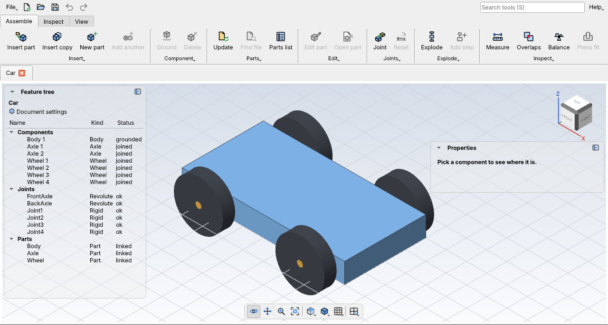

# Tutorial 10: Toy car

You'll make a toy car whose wheels really turn: a body with two holes through
it, two axles that turn in the holes, and four wheels fixed on the axles. Each
is its own part, in its own file, and an **assembly** puts them together.



**You'll learn:** making an assembly, putting parts in it, joining them with
**joints** (one that turns, one that holds), turning a joint, checking that no
parts overlap, and printing every part as many times as it's used. **Time:**
about 25 minutes.

**Before you start:** do [Tutorial 9](09-project-box.md) first.
[Assemblies](../user-guide/assemblies.md) in the user's guide has more about
every step.

## The plan

1. **Body:** a block 80 × 40 × 10 mm, with two holes 3.5 mm across going all the
   way through it, side to side, for the axles.
2. **Axle:** a rod 3 mm across and 54 mm long. It's 0.5 mm thinner than the
   holes, so it turns freely.
3. **Wheel:** a disc 24 mm across and 6 mm thick, with a 3 mm hole in the middle
   that holds tight on the axle.
4. **Car:** an assembly with one body, two axles and four wheels. Each axle turns
   in its hole (a **revolute** joint), and each wheel is fixed to its axle (a
   **rigid** joint), so the wheels turn with the axles.

## Step 1: The body

A block, and two cylinders lying along y to cut the holes. `axis=0,1,0` lays a
cylinder along y; `base=15,0,5` starts it at the front, 15 mm from the left end
and half way up the block:

<!-- cli-example -->
```console
$ sketchbillet_cli run --save Body.sb feature.add_box size=80,40,10 name=Chassis
Body: 1 step
  Chassis      ok  volume 32000.00 mm^3  mass 39.68 g (PLA)
wrote Body.sb
$ sketchbillet_cli run --open Body.sb --save Body.sb feature.add_cylinder radius=1.75 height=40 base=15,0,5 axis=0,1,0 name=FrontHole
Body: 2 steps
  Chassis      ok  volume 32000.00 mm^3  mass 39.68 g (PLA)
  FrontHole    ok  volume 384.85 mm^3  mass 0.48 g (PLA)
wrote Body.sb
$ sketchbillet_cli run --open Body.sb --save Body.sb feature.add_cylinder radius=1.75 height=40 base=65,0,5 axis=0,1,0 name=BackHole
Body: 3 steps
  Chassis      ok  volume 32000.00 mm^3  mass 39.68 g (PLA)
  FrontHole    ok  volume 384.85 mm^3  mass 0.48 g (PLA)
  BackHole     ok  volume 384.85 mm^3  mass 0.48 g (PLA)
wrote Body.sb
$ sketchbillet_cli run --open Body.sb --save Body.sb feature.add_boolean operation=cut a=Chassis b=FrontHole name=Front
Body: 4 steps
  Chassis      ok  volume 32000.00 mm^3
  FrontHole    ok  volume 384.85 mm^3
  BackHole     ok  volume 384.85 mm^3  mass 0.48 g (PLA)
  Front        ok  volume 31615.15 mm^3  mass 39.20 g (PLA)
wrote Body.sb
$ sketchbillet_cli run --open Body.sb --save Body.sb feature.add_boolean operation=cut a=Front b=BackHole name=Body
Body: 5 steps
  Chassis      ok  volume 32000.00 mm^3
  FrontHole    ok  volume 384.85 mm^3
  BackHole     ok  volume 384.85 mm^3
  Front        ok  volume 31615.15 mm^3
  Body         ok  volume 31230.31 mm^3  mass 38.73 g (PLA)
wrote Body.sb
```

## Step 2: The axle and the wheel

Each part goes in its own file. The axle is one cylinder:

<!-- cli-example -->
```console
$ sketchbillet_cli run --save Axle.sb feature.add_cylinder radius=1.5 height=54 name=Axle
Axle: 1 step
  Axle         ok  volume 381.70 mm^3  mass 0.47 g (PLA)
wrote Axle.sb
```

The wheel is a cylinder with a hole cut through its middle:

<!-- cli-example -->
```console
$ sketchbillet_cli run --save Wheel.sb feature.add_cylinder radius=12 height=6 name=Tire
Wheel: 1 step
  Tire         ok  volume 2714.34 mm^3  mass 3.37 g (PLA)
wrote Wheel.sb
$ sketchbillet_cli run --open Wheel.sb --save Wheel.sb feature.add_cylinder radius=1.5 height=6 name=AxleHole
Wheel: 2 steps
  Tire         ok  volume 2714.34 mm^3  mass 3.37 g (PLA)
  AxleHole     ok  volume 42.41 mm^3  mass 0.05 g (PLA)
wrote Wheel.sb
$ sketchbillet_cli run --open Wheel.sb --save Wheel.sb feature.add_boolean operation=cut a=Tire b=AxleHole name=Wheel
Wheel: 3 steps
  Tire         ok  volume 2714.34 mm^3
  AxleHole     ok  volume 42.41 mm^3
  Wheel        ok  volume 2671.92 mm^3  mass 3.31 g (PLA)
wrote Wheel.sb
```

## Step 3: Put the parts together

An assembly starts empty. Put in the body, two axles and four wheels.
`count=4` puts in four wheels, and `at` and `step` lay them out in a row, out of
the way: the joints will put them in their places.

<!-- cli-example -->
```console
$ sketchbillet_cli run --save Car.sb assembly.new
Car: assembly, 0 components, 0 parts
wrote Car.sb
$ sketchbillet_cli run --open Car.sb --save Car.sb component.insert file=Body.sb
Car: assembly, 1 component, 1 part
  Body 1       Body       grounded at 0, 0, 0 mm
Parts:
  Body         5 steps  ok        mass 38.73 g (PLA), 1 in the assembly
    linked to Body.sb
Mass in all: 38.73 g (weighs 0.380 N)
Balance point: 40, 20, 5 mm
wrote Car.sb
$ sketchbillet_cli run --open Car.sb --save Car.sb component.insert file=Axle.sb count=2 at=0,60,0 step=20,0,0
Car: assembly, 3 components, 2 parts
  Body 1       Body       grounded at 0, 0, 0 mm
  Axle 1       Axle       free     at 0, 60, 0 mm
  Axle 2       Axle       free     at 20, 60, 0 mm
Parts:
  Body         5 steps  ok        mass 38.73 g (PLA), 1 in the assembly
    linked to Body.sb
  Axle         1 step   ok        mass 0.47 g (PLA), 2 in the assembly
    linked to Axle.sb
Mass in all: 39.67 g (weighs 0.389 N)
Balance point: 39.28, 20.95, 5.52 mm
wrote Car.sb
$ sketchbillet_cli run --open Car.sb --save Car.sb component.insert file=Wheel.sb count=4 at=0,-40,0 step=30,0,0
Car: assembly, 7 components, 3 parts
  Body 1       Body       grounded at 0, 0, 0 mm
  Axle 1       Axle       free     at 0, 60, 0 mm
  Axle 2       Axle       free     at 20, 60, 0 mm
  Wheel 1      Wheel      free     at 0, -40, 0 mm
  Wheel 2      Wheel      free     at 30, -40, 0 mm
  Wheel 3      Wheel      free     at 60, -40, 0 mm
  Wheel 4      Wheel      free     at 90, -40, 0 mm
Parts:
  Body         5 steps  ok        mass 38.73 g (PLA), 1 in the assembly
    linked to Body.sb
  Axle         1 step   ok        mass 0.47 g (PLA), 2 in the assembly
    linked to Axle.sb
  Wheel        3 steps  ok        mass 3.31 g (PLA), 4 in the assembly
    linked to Wheel.sb
Mass in all: 52.92 g (weighs 0.519 N)
Balance point: 40.72, 5.69, 4.89 mm
wrote Car.sb
```

Each is a **component**: Wheel 1 to Wheel 4 are four components of one part,
Wheel. The body came first, so it's **grounded**: it stays where it is. The
others are **free**.

The parts stay **linked** to their files: change `Wheel.sb` later, and
`component.update` brings the change into the car.

## Step 4: The axles turn in their holes

A joint joins two components by something picked on each: here, a round edge.
List the body's edges to find the holes' rims:

<!-- cli-example -->
```console
$ sketchbillet_cli open Car.sb --edges "Body 1"
Car: assembly, 7 components, 3 parts
  Body 1       Body       grounded at 0, 0, 0 mm
  Axle 1       Axle       free     at 0, 60, 0 mm
  Axle 2       Axle       free     at 20, 60, 0 mm
  Wheel 1      Wheel      free     at 0, -40, 0 mm
  Wheel 2      Wheel      free     at 30, -40, 0 mm
  Wheel 3      Wheel      free     at 60, -40, 0 mm
  Wheel 4      Wheel      free     at 90, -40, 0 mm
Parts:
  Body         5 steps  ok        mass 38.73 g (PLA), 1 in the assembly
    linked to Body.sb
  Axle         1 step   ok        mass 0.47 g (PLA), 2 in the assembly
    linked to Axle.sb
  Wheel        3 steps  ok        mass 3.31 g (PLA), 4 in the assembly
    linked to Wheel.sb
Mass in all: 52.92 g (weighs 0.519 N)
Balance point: 40.72, 5.69, 4.89 mm
edges of Body: 18
   1  line           80.00 mm  at 40.00,0.00,0.00  between bottom of Chassis and front side of Chassis
   2  line           40.00 mm  at 0.00,20.00,0.00  between bottom of Chassis and left side of Chassis
   3  line           40.00 mm  at 80.00,20.00,0.00  between bottom of Chassis and right side of Chassis
   4  line           80.00 mm  at 40.00,40.00,0.00  between back side of Chassis and bottom of Chassis
   5  line           10.00 mm  at 0.00,0.00,5.00  between front side of Chassis and left side of Chassis
   6  circle         11.00 mm  at 15.00,0.00,5.00  between front side of Chassis and side of FrontHole
   7  circle         11.00 mm  at 65.00,0.00,5.00  between front side of Chassis and side of BackHole
   8  line           10.00 mm  at 80.00,0.00,5.00  between front side of Chassis and right side of Chassis
   9  line           10.00 mm  at 0.00,40.00,5.00  between back side of Chassis and left side of Chassis
  10  circle         11.00 mm  at 15.00,40.00,5.00  between back side of Chassis and side of FrontHole
  11  circle         11.00 mm  at 65.00,40.00,5.00  between back side of Chassis and side of BackHole
  12  line           10.00 mm  at 80.00,40.00,5.00  between back side of Chassis and right side of Chassis
  13  line           40.00 mm  at 15.00,20.00,6.75  seam of side of FrontHole
  14  line           40.00 mm  at 65.00,20.00,6.75  seam of side of BackHole
  15  line           80.00 mm  at 40.00,0.00,10.00  between front side of Chassis and top of Chassis
  16  line           40.00 mm  at 0.00,20.00,10.00  between left side of Chassis and top of Chassis
  17  line           40.00 mm  at 80.00,20.00,10.00  between right side of Chassis and top of Chassis
  18  line           80.00 mm  at 40.00,40.00,10.00  between back side of Chassis and top of Chassis
```

Edges 6 and 7 are the rims of the two holes on the front of the body. The axle's
edge 1 is the rim of its bottom end (see it with `open Axle.sb --edges Axle`).

A **revolute** joint puts the axle's end on the hole's rim, and lets it turn
there:

<!-- cli-example -->
```console
$ sketchbillet_cli run --open Car.sb --save Car.sb joint.add kind=revolute a="Body 1:edge:6" b="Axle 1:edge:1" flip=true offset=7 name=FrontAxle
Car: assembly, 7 components, 3 parts
  Body 1       Body       grounded at 0, 0, 0 mm
  Axle 1       Axle       joined   at 15, -7, 5 mm
  Axle 2       Axle       free     at 20, 60, 0 mm
  Wheel 1      Wheel      free     at 0, -40, 0 mm
  Wheel 2      Wheel      free     at 30, -40, 0 mm
  Wheel 3      Wheel      free     at 60, -40, 0 mm
  Wheel 4      Wheel      free     at 90, -40, 0 mm
Joints:
  FrontAxle    revolute  Axle 1 on Body 1, at 0°
Parts:
  Body         5 steps  ok        mass 38.73 g (PLA), 1 in the assembly
    linked to Body.sb
  Axle         1 step   ok        mass 0.47 g (PLA), 2 in the assembly
    linked to Axle.sb
  Wheel        3 steps  ok        mass 3.31 g (PLA), 4 in the assembly
    linked to Wheel.sb
Mass in all: 52.92 g (weighs 0.519 N)
Balance point: 40.85, 5.33, 4.7 mm
wrote Car.sb
$ sketchbillet_cli run --open Car.sb --save Car.sb joint.add kind=revolute a="Body 1:edge:7" b="Axle 2:edge:1" flip=true offset=7 name=BackAxle
Car: assembly, 7 components, 3 parts
  Body 1       Body       grounded at 0, 0, 0 mm
  Axle 1       Axle       joined   at 15, -7, 5 mm
  Axle 2       Axle       joined   at 65, -7, 5 mm
  Wheel 1      Wheel      free     at 0, -40, 0 mm
  Wheel 2      Wheel      free     at 30, -40, 0 mm
  Wheel 3      Wheel      free     at 60, -40, 0 mm
  Wheel 4      Wheel      free     at 90, -40, 0 mm
Joints:
  FrontAxle    revolute  Axle 1 on Body 1, at 0°
  BackAxle     revolute  Axle 2 on Body 1, at 0°
Parts:
  Body         5 steps  ok        mass 38.73 g (PLA), 1 in the assembly
    linked to Body.sb
  Axle         1 step   ok        mass 0.47 g (PLA), 2 in the assembly
    linked to Axle.sb
  Wheel        3 steps  ok        mass 3.31 g (PLA), 4 in the assembly
    linked to Wheel.sb
Mass in all: 52.92 g (weighs 0.519 N)
Balance point: 41.25, 4.98, 4.5 mm
wrote Car.sb
```

- A joint puts the two edges together pointing **at** each other, like a peg
  touching a hole. That would leave the axle sticking out of the car.
  `flip=true` turns it the other way round, so it goes **into** the hole.
- `offset=7` leaves 7 mm of axle out in front: 1 mm of space, and 6 mm for the
  wheel. The axle is 54 mm long, so 7 mm stick out at the back too (54 - 40 - 7).

## Step 5: The wheels hold on the axles

Each wheel's edge 1 is the rim of its hole, on its flat bottom face. A **rigid**
joint fixes it to the end of an axle, so it turns with the axle. The axle's
edge 1 is its front end, and edge 3 its back end:

<!-- cli-example -->
```console
$ sketchbillet_cli run --open Car.sb --save Car.sb joint.add kind=rigid a="Axle 1:edge:1" b="Wheel 1:edge:1" flip=true
Car: assembly, 7 components, 3 parts
  Body 1       Body       grounded at 0, 0, 0 mm
  Axle 1       Axle       joined   at 15, -7, 5 mm
  Axle 2       Axle       joined   at 65, -7, 5 mm
  Wheel 1      Wheel      joined   at 15, -7, 5 mm
  Wheel 2      Wheel      free     at 30, -40, 0 mm
  Wheel 3      Wheel      free     at 60, -40, 0 mm
  Wheel 4      Wheel      free     at 90, -40, 0 mm
Joints:
  FrontAxle    revolute  Axle 1 on Body 1, at 0°
  BackAxle     revolute  Axle 2 on Body 1, at 0°
  Joint1       rigid     Wheel 1 on Axle 1
Parts:
  Body         5 steps  ok        mass 38.73 g (PLA), 1 in the assembly
    linked to Body.sb
  Axle         1 step   ok        mass 0.47 g (PLA), 2 in the assembly
    linked to Axle.sb
  Wheel        3 steps  ok        mass 3.31 g (PLA), 4 in the assembly
    linked to Wheel.sb
Mass in all: 52.92 g (weighs 0.519 N)
Balance point: 42.19, 7.23, 4.62 mm
wrote Car.sb
$ sketchbillet_cli run --open Car.sb --save Car.sb joint.add kind=rigid a="Axle 1:edge:3" b="Wheel 2:edge:1" flip=true
Car: assembly, 7 components, 3 parts
  Body 1       Body       grounded at 0, 0, 0 mm
  Axle 1       Axle       joined   at 15, -7, 5 mm
  Axle 2       Axle       joined   at 65, -7, 5 mm
  Wheel 1      Wheel      joined   at 15, -7, 5 mm
  Wheel 2      Wheel      joined   at 15, 47, 5 mm
  Wheel 3      Wheel      free     at 60, -40, 0 mm
  Wheel 4      Wheel      free     at 90, -40, 0 mm
Joints:
  FrontAxle    revolute  Axle 1 on Body 1, at 0°
  BackAxle     revolute  Axle 2 on Body 1, at 0°
  Joint1       rigid     Wheel 1 on Axle 1
  Joint2       rigid     Wheel 2 on Axle 1
Parts:
  Body         5 steps  ok        mass 38.73 g (PLA), 1 in the assembly
    linked to Body.sb
  Axle         1 step   ok        mass 0.47 g (PLA), 2 in the assembly
    linked to Axle.sb
  Wheel        3 steps  ok        mass 3.31 g (PLA), 4 in the assembly
    linked to Wheel.sb
Mass in all: 52.92 g (weighs 0.519 N)
Balance point: 41.25, 12.49, 4.75 mm
wrote Car.sb
$ sketchbillet_cli run --open Car.sb --save Car.sb joint.add kind=rigid a="Axle 2:edge:1" b="Wheel 3:edge:1" flip=true
Car: assembly, 7 components, 3 parts
  Body 1       Body       grounded at 0, 0, 0 mm
  Axle 1       Axle       joined   at 15, -7, 5 mm
  Axle 2       Axle       joined   at 65, -7, 5 mm
  Wheel 1      Wheel      joined   at 15, -7, 5 mm
  Wheel 2      Wheel      joined   at 15, 47, 5 mm
  Wheel 3      Wheel      joined   at 65, -7, 5 mm
  Wheel 4      Wheel      free     at 90, -40, 0 mm
Joints:
  FrontAxle    revolute  Axle 1 on Body 1, at 0°
  BackAxle     revolute  Axle 2 on Body 1, at 0°
  Joint1       rigid     Wheel 1 on Axle 1
  Joint2       rigid     Wheel 2 on Axle 1
  Joint3       rigid     Wheel 3 on Axle 2
Parts:
  Body         5 steps  ok        mass 38.73 g (PLA), 1 in the assembly
    linked to Body.sb
  Axle         1 step   ok        mass 0.47 g (PLA), 2 in the assembly
    linked to Axle.sb
  Wheel        3 steps  ok        mass 3.31 g (PLA), 4 in the assembly
    linked to Wheel.sb
Mass in all: 52.92 g (weighs 0.519 N)
Balance point: 41.57, 14.74, 4.87 mm
wrote Car.sb
$ sketchbillet_cli run --open Car.sb --save Car.sb joint.add kind=rigid a="Axle 2:edge:3" b="Wheel 4:edge:1" flip=true
Car: assembly, 7 components, 3 parts
  Body 1       Body       grounded at 0, 0, 0 mm
  Axle 1       Axle       joined   at 15, -7, 5 mm
  Axle 2       Axle       joined   at 65, -7, 5 mm
  Wheel 1      Wheel      joined   at 15, -7, 5 mm
  Wheel 2      Wheel      joined   at 15, 47, 5 mm
  Wheel 3      Wheel      joined   at 65, -7, 5 mm
  Wheel 4      Wheel      joined   at 65, 47, 5 mm
Joints:
  FrontAxle    revolute  Axle 1 on Body 1, at 0°
  BackAxle     revolute  Axle 2 on Body 1, at 0°
  Joint1       rigid     Wheel 1 on Axle 1
  Joint2       rigid     Wheel 2 on Axle 1
  Joint3       rigid     Wheel 3 on Axle 2
  Joint4       rigid     Wheel 4 on Axle 2
Parts:
  Body         5 steps  ok        mass 38.73 g (PLA), 1 in the assembly
    linked to Body.sb
  Axle         1 step   ok        mass 0.47 g (PLA), 2 in the assembly
    linked to Axle.sb
  Wheel        3 steps  ok        mass 3.31 g (PLA), 4 in the assembly
    linked to Wheel.sb
Mass in all: 52.92 g (weighs 0.519 N)
Balance point: 40, 20, 5 mm
wrote Car.sb
```

Every component is **joined** now. Each wheel's outside is flush with its
axle's end: Wheel 1's is at y -7 mm, 1 mm out from the body's front.

## Step 6: Check it, and turn the wheels

Two parts can't be in the same place. `check` looks for any that overlap:

<!-- cli-example -->
```console
$ sketchbillet_cli check Car.sb
Car: no components overlap (7 components, 6 pairs close enough to check).
```

Turn the front axle a quarter turn with `joint.set`. Its wheels turn with it:
their x axis pointed along the car, and now points up (`facing x 0, 0, 1`),
while the back wheels' still points along it:

<!-- cli-example -->
```console
$ sketchbillet_cli run --open Car.sb --save Car.sb joint.set joint=FrontAxle value=90
...
$ sketchbillet_cli open Car.sb --components
Car: assembly, 7 components, 3 parts
  Body 1       Body       grounded at 0, 0, 0 mm
    facing x 1, 0, 0, z 0, 0, 1
  Axle 1       Axle       joined   at 15, -7, 5 mm
    facing x 0, 0, 1, z 0, 1, 0
  Axle 2       Axle       joined   at 65, -7, 5 mm
    facing x 1, 0, 0, z 0, 1, 0
  Wheel 1      Wheel      joined   at 15, -7, 5 mm
    facing x 0, 0, 1, z 0, 1, 0
  Wheel 2      Wheel      joined   at 15, 47, 5 mm
    facing x 0, 0, 1, z 0, -1, 0
  Wheel 3      Wheel      joined   at 65, -7, 5 mm
    facing x 1, 0, 0, z 0, 1, 0
  Wheel 4      Wheel      joined   at 65, 47, 5 mm
    facing x 1, 0, 0, z 0, -1, 0
Joints:
  FrontAxle    revolute  Axle 1 on Body 1, at 90°
  BackAxle     revolute  Axle 2 on Body 1, at 0°
  Joint1       rigid     Wheel 1 on Axle 1
  Joint2       rigid     Wheel 2 on Axle 1
  Joint3       rigid     Wheel 3 on Axle 2
  Joint4       rigid     Wheel 4 on Axle 2
Parts:
  Body         5 steps  ok        mass 38.73 g (PLA), 1 in the assembly
    linked to Body.sb
  Axle         1 step   ok        mass 0.47 g (PLA), 2 in the assembly
    linked to Axle.sb
  Wheel        3 steps  ok        mass 3.31 g (PLA), 4 in the assembly
    linked to Wheel.sb
Mass in all: 52.92 g (weighs 0.519 N)
Balance point: 40, 20, 5 mm
```

In the desktop app, open `Car.sb`, pick a wheel, and drag the purple ring round
its axle to turn it.

## Step 7: Print it

The parts list says how many of each part to print:

<!-- cli-example -->
```console
$ sketchbillet_cli parts Car.sb --export car-parts.3mf
Car: 3 parts, 7 components
  # Part  Count Material Mass each Mass in all Kept
  1 Body      1 PLA        38.73 g     38.73 g linked to Body.sb
  2 Axle      2 PLA         0.47 g      0.95 g linked to Axle.sb
  3 Wheel     4 PLA         3.31 g     13.25 g linked to Wheel.sb
Mass in all: 52.92 g
wrote car-parts.3mf
```

`car-parts.3mf` holds every part, as many times as it's used, side by side: one
body, two axles and four wheels. Open it in your slicer.

- **Print the axles lying down** (turn them in the slicer), so they're strong.
- **The wheels' holes are as wide as the axles**, so the wheels push on tight.
  If they're too tight, make `AxleHole`'s radius 1.55 mm in `Wheel.sb`, and run
  `component.update` on the car; too loose, make it 1.45 mm.
- **The axles should turn freely in the body.** If they don't, make the body's
  holes a little wider (radius 1.85 mm).

## What you learned

- An **assembly** puts parts together. Each copy of a part in it is a
  **component**; the first is grounded.
- A **joint** joins two components by an edge, face or point on each. A
  **revolute** joint turns; a **rigid** one holds. `flip` and `offset` set how
  they meet.
- `check` finds parts that overlap, and `parts` lists and exports every part to
  print.

**Next:** [Tutorial 11](11-hinged-box.md) makes a box with a lid on a hinge,
starting from one part with several bodies.
