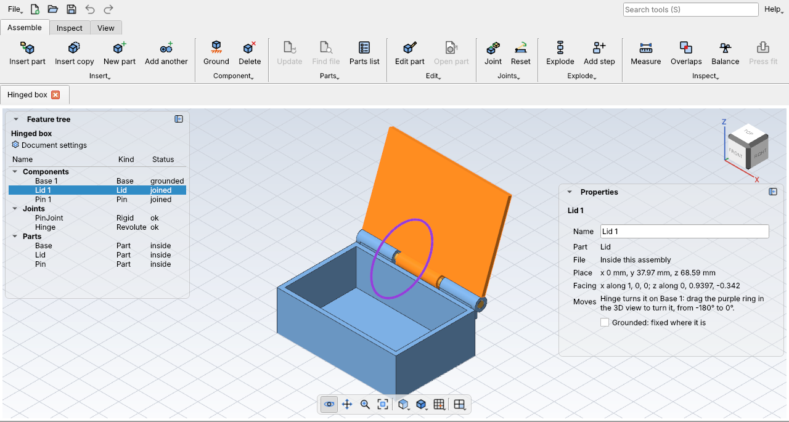
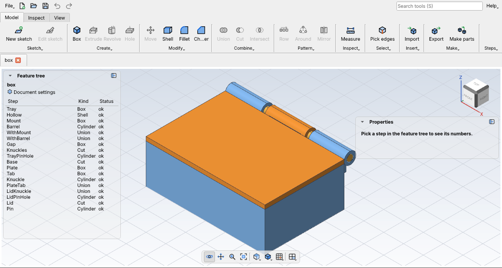

# Tutorial 11: Hinged box

You'll make a small box with a lid on a hinge: the lid turns on a pin that goes
through **knuckles** (the round parts of a hinge) on the box and the lid. You'll
model all three pieces in one design, side by side, where they go; then **Make
Parts from Bodies** turns them into an assembly, and a hinge joint lets the lid
open.



**You'll learn:** modeling parts that fit together in one design, turning its
bodies into an assembly, a hinge joint with **limits**, and using the overlap
check to find out how far a lid can turn. **Time:** about 30 minutes.

**Before you start:** do [Tutorial 10](10-toy-car.md) first.

## The plan

The box is 60 mm wide (x), 40 mm deep (y) and 20 mm tall (z), open at the top.
The hinge's line runs along x behind the box, at y 43 mm and z 21 mm.

1. **Base:** the box, shelled to 2 mm walls, with a strip on its back holding
   two knuckles, 18 mm long, one at each end. A 3.5 mm hole runs through them.
2. **Lid:** a plate 60 × 40 × 2 mm on top of the box, with one 20 mm knuckle in
   the middle that fits between the base's two, 2 mm from each.
3. **Pin:** a rod 3 mm across and 60 mm long, through all three knuckles.

## Step 1: The box

Make the box and hollow it, leaving the top (face 6) open:

<!-- cli-example -->
```console
$ sketchbillet_cli run --save box.sb feature.add_box size=60,40,20 name=Tray
box: 1 step
  Tray         ok  volume 48000.00 mm^3  mass 59.52 g (PLA)
wrote box.sb
$ sketchbillet_cli run --open box.sb --save box.sb feature.add_shell body=Tray faces=6 name=Hollow
box: 2 steps
  Tray         ok  volume 48000.00 mm^3
  Hollow       ok  volume 11712.00 mm^3  mass 14.52 g (PLA)
wrote box.sb
```

## Step 2: The base's knuckles

A strip on the back of the box, and a cylinder along it for the knuckles. The
strip is 2 mm shorter at each end than the cylinder, so the knuckles' ends
are round all the way.

<!-- cli-example -->
```console
$ sketchbillet_cli run --open box.sb --save box.sb feature.add_box size=56,3,7 corner=2,40,14 name=Mount
box: 3 steps
  Tray         ok  volume 48000.00 mm^3
  Hollow       ok  volume 11712.00 mm^3  mass 14.52 g (PLA)
  Mount        ok  volume 1176.00 mm^3  mass 1.46 g (PLA)
wrote box.sb
$ sketchbillet_cli run --open box.sb --save box.sb feature.add_cylinder radius=3 height=60 base=0,43,21 axis=1,0,0 name=Barrel
box: 4 steps
  Tray         ok  volume 48000.00 mm^3
  Hollow       ok  volume 11712.00 mm^3  mass 14.52 g (PLA)
  Mount        ok  volume 1176.00 mm^3  mass 1.46 g (PLA)
  Barrel       ok  volume 1696.46 mm^3  mass 2.10 g (PLA)
wrote box.sb
$ sketchbillet_cli run --open box.sb --save box.sb feature.add_boolean operation=union a=Hollow b=Mount name=WithMount
box: 5 steps
  Tray         ok  volume 48000.00 mm^3
  Hollow       ok  volume 11712.00 mm^3
  Mount        ok  volume 1176.00 mm^3
  Barrel       ok  volume 1696.46 mm^3  mass 2.10 g (PLA)
  WithMount    ok  volume 12888.00 mm^3  mass 15.98 g (PLA)
wrote box.sb
$ sketchbillet_cli run --open box.sb --save box.sb feature.add_boolean operation=union a=WithMount b=Barrel name=WithBarrel
box: 6 steps
  Tray         ok  volume 48000.00 mm^3
  Hollow       ok  volume 11712.00 mm^3
  Mount        ok  volume 1176.00 mm^3
  Barrel       ok  volume 1696.46 mm^3
  WithMount    ok  volume 12888.00 mm^3
  WithBarrel   ok  volume 14188.62 mm^3  mass 17.59 g (PLA)
wrote box.sb
```

Cut a gap 24 mm wide out of the middle, for the lid's knuckle. That leaves two
knuckles, each 18 mm long. Then drill the pin's hole through them: 3.5 mm
across, 0.5 mm wider than the pin, so the pin slides in.

<!-- cli-example -->
```console
$ sketchbillet_cli run --open box.sb --save box.sb feature.add_box size=24,7,12 corner=18,40,13 name=Gap
box: 7 steps
  Tray         ok  volume 48000.00 mm^3
  Hollow       ok  volume 11712.00 mm^3
  Mount        ok  volume 1176.00 mm^3
  Barrel       ok  volume 1696.46 mm^3
  WithMount    ok  volume 12888.00 mm^3
  WithBarrel   ok  volume 14188.62 mm^3  mass 17.59 g (PLA)
  Gap          ok  volume 2016.00 mm^3  mass 2.50 g (PLA)
wrote box.sb
$ sketchbillet_cli run --open box.sb --save box.sb feature.add_boolean operation=cut a=WithBarrel b=Gap name=Knuckles
box: 8 steps
  Tray         ok  volume 48000.00 mm^3
  Hollow       ok  volume 11712.00 mm^3
  Mount        ok  volume 1176.00 mm^3
  Barrel       ok  volume 1696.46 mm^3
  WithMount    ok  volume 12888.00 mm^3
  WithBarrel   ok  volume 14188.62 mm^3
  Gap          ok  volume 2016.00 mm^3
  Knuckles     ok  volume 13175.68 mm^3  mass 16.34 g (PLA)
wrote box.sb
$ sketchbillet_cli run --open box.sb --save box.sb feature.add_cylinder radius=1.75 height=60 base=0,43,21 axis=1,0,0 name=TrayPinHole
box: 9 steps
  Tray         ok  volume 48000.00 mm^3
  Hollow       ok  volume 11712.00 mm^3
  Mount        ok  volume 1176.00 mm^3
  Barrel       ok  volume 1696.46 mm^3
  WithMount    ok  volume 12888.00 mm^3
  WithBarrel   ok  volume 14188.62 mm^3
  Gap          ok  volume 2016.00 mm^3
  Knuckles     ok  volume 13175.68 mm^3  mass 16.34 g (PLA)
  TrayPinHole  ok  volume 577.27 mm^3  mass 0.72 g (PLA)
wrote box.sb
$ sketchbillet_cli run --open box.sb --save box.sb feature.add_boolean operation=cut a=Knuckles b=TrayPinHole name=Base
box: 10 steps
  Tray         ok  volume 48000.00 mm^3
  Hollow       ok  volume 11712.00 mm^3
  Mount        ok  volume 1176.00 mm^3
  Barrel       ok  volume 1696.46 mm^3
  WithMount    ok  volume 12888.00 mm^3
  WithBarrel   ok  volume 14188.62 mm^3
  Gap          ok  volume 2016.00 mm^3
  Knuckles     ok  volume 13175.68 mm^3
  TrayPinHole  ok  volume 577.27 mm^3
  Base         ok  volume 12829.32 mm^3  mass 15.91 g (PLA)
wrote box.sb
```

## Step 3: The lid

The plate sits on top of the box. A small tab joins it to its knuckle, 20 mm
long, in the middle of the gap:

<!-- cli-example -->
```console
$ sketchbillet_cli run --open box.sb --save box.sb feature.add_box size=60,40,2 corner=0,0,20 name=Plate
box: 11 steps
  Tray         ok  volume 48000.00 mm^3
  Hollow       ok  volume 11712.00 mm^3
  Mount        ok  volume 1176.00 mm^3
  Barrel       ok  volume 1696.46 mm^3
  WithMount    ok  volume 12888.00 mm^3
  WithBarrel   ok  volume 14188.62 mm^3
  Gap          ok  volume 2016.00 mm^3
  Knuckles     ok  volume 13175.68 mm^3
  TrayPinHole  ok  volume 577.27 mm^3
  Base         ok  volume 12829.32 mm^3  mass 15.91 g (PLA)
  Plate        ok  volume 4800.00 mm^3  mass 5.95 g (PLA)
wrote box.sb
$ sketchbillet_cli run --open box.sb --save box.sb feature.add_box size=16,3,2 corner=22,40,20 name=Tab
box: 12 steps
  Tray         ok  volume 48000.00 mm^3
  Hollow       ok  volume 11712.00 mm^3
  Mount        ok  volume 1176.00 mm^3
  Barrel       ok  volume 1696.46 mm^3
  WithMount    ok  volume 12888.00 mm^3
  WithBarrel   ok  volume 14188.62 mm^3
  Gap          ok  volume 2016.00 mm^3
  Knuckles     ok  volume 13175.68 mm^3
  TrayPinHole  ok  volume 577.27 mm^3
  Base         ok  volume 12829.32 mm^3  mass 15.91 g (PLA)
  Plate        ok  volume 4800.00 mm^3  mass 5.95 g (PLA)
  Tab          ok  volume 96.00 mm^3  mass 0.12 g (PLA)
wrote box.sb
$ sketchbillet_cli run --open box.sb --save box.sb feature.add_cylinder radius=3 height=20 base=20,43,21 axis=1,0,0 name=Knuckle
box: 13 steps
  Tray         ok  volume 48000.00 mm^3
  Hollow       ok  volume 11712.00 mm^3
  Mount        ok  volume 1176.00 mm^3
  Barrel       ok  volume 1696.46 mm^3
  WithMount    ok  volume 12888.00 mm^3
  WithBarrel   ok  volume 14188.62 mm^3
  Gap          ok  volume 2016.00 mm^3
  Knuckles     ok  volume 13175.68 mm^3
  TrayPinHole  ok  volume 577.27 mm^3
  Base         ok  volume 12829.32 mm^3  mass 15.91 g (PLA)
  Plate        ok  volume 4800.00 mm^3  mass 5.95 g (PLA)
  Tab          ok  volume 96.00 mm^3  mass 0.12 g (PLA)
  Knuckle      ok  volume 565.49 mm^3  mass 0.70 g (PLA)
wrote box.sb
$ sketchbillet_cli run --open box.sb --save box.sb feature.add_boolean operation=union a=Plate b=Tab name=PlateTab
box: 14 steps
  Tray         ok  volume 48000.00 mm^3
  Hollow       ok  volume 11712.00 mm^3
  Mount        ok  volume 1176.00 mm^3
  Barrel       ok  volume 1696.46 mm^3
  WithMount    ok  volume 12888.00 mm^3
  WithBarrel   ok  volume 14188.62 mm^3
  Gap          ok  volume 2016.00 mm^3
  Knuckles     ok  volume 13175.68 mm^3
  TrayPinHole  ok  volume 577.27 mm^3
  Base         ok  volume 12829.32 mm^3  mass 15.91 g (PLA)
  Plate        ok  volume 4800.00 mm^3
  Tab          ok  volume 96.00 mm^3
  Knuckle      ok  volume 565.49 mm^3  mass 0.70 g (PLA)
  PlateTab     ok  volume 4896.00 mm^3  mass 6.07 g (PLA)
wrote box.sb
$ sketchbillet_cli run --open box.sb --save box.sb feature.add_boolean operation=union a=PlateTab b=Knuckle name=LidKnuckle
box: 15 steps
  Tray         ok  volume 48000.00 mm^3
  Hollow       ok  volume 11712.00 mm^3
  Mount        ok  volume 1176.00 mm^3
  Barrel       ok  volume 1696.46 mm^3
  WithMount    ok  volume 12888.00 mm^3
  WithBarrel   ok  volume 14188.62 mm^3
  Gap          ok  volume 2016.00 mm^3
  Knuckles     ok  volume 13175.68 mm^3
  TrayPinHole  ok  volume 577.27 mm^3
  Base         ok  volume 12829.32 mm^3  mass 15.91 g (PLA)
  Plate        ok  volume 4800.00 mm^3
  Tab          ok  volume 96.00 mm^3
  Knuckle      ok  volume 565.49 mm^3
  PlateTab     ok  volume 4896.00 mm^3
  LidKnuckle   ok  volume 5367.30 mm^3  mass 6.66 g (PLA)
wrote box.sb
$ sketchbillet_cli run --open box.sb --save box.sb feature.add_cylinder radius=1.75 height=20 base=20,43,21 axis=1,0,0 name=LidPinHole
box: 16 steps
  Tray         ok  volume 48000.00 mm^3
  Hollow       ok  volume 11712.00 mm^3
  Mount        ok  volume 1176.00 mm^3
  Barrel       ok  volume 1696.46 mm^3
  WithMount    ok  volume 12888.00 mm^3
  WithBarrel   ok  volume 14188.62 mm^3
  Gap          ok  volume 2016.00 mm^3
  Knuckles     ok  volume 13175.68 mm^3
  TrayPinHole  ok  volume 577.27 mm^3
  Base         ok  volume 12829.32 mm^3  mass 15.91 g (PLA)
  Plate        ok  volume 4800.00 mm^3
  Tab          ok  volume 96.00 mm^3
  Knuckle      ok  volume 565.49 mm^3
  PlateTab     ok  volume 4896.00 mm^3
  LidKnuckle   ok  volume 5367.30 mm^3  mass 6.66 g (PLA)
  LidPinHole   ok  volume 192.42 mm^3  mass 0.24 g (PLA)
wrote box.sb
$ sketchbillet_cli run --open box.sb --save box.sb feature.add_boolean operation=cut a=LidKnuckle b=LidPinHole name=Lid
box: 17 steps
  Tray         ok  volume 48000.00 mm^3
  Hollow       ok  volume 11712.00 mm^3
  Mount        ok  volume 1176.00 mm^3
  Barrel       ok  volume 1696.46 mm^3
  WithMount    ok  volume 12888.00 mm^3
  WithBarrel   ok  volume 14188.62 mm^3
  Gap          ok  volume 2016.00 mm^3
  Knuckles     ok  volume 13175.68 mm^3
  TrayPinHole  ok  volume 577.27 mm^3
  Base         ok  volume 12829.32 mm^3  mass 15.91 g (PLA)
  Plate        ok  volume 4800.00 mm^3
  Tab          ok  volume 96.00 mm^3
  Knuckle      ok  volume 565.49 mm^3
  PlateTab     ok  volume 4896.00 mm^3
  LidKnuckle   ok  volume 5367.30 mm^3
  LidPinHole   ok  volume 192.42 mm^3
  Lid          ok  volume 5174.87 mm^3  mass 6.42 g (PLA)
wrote box.sb
```

## Step 4: The pin

<!-- cli-example -->
```console
$ sketchbillet_cli run --open box.sb --save box.sb feature.add_cylinder radius=1.5 height=60 base=0,43,21 axis=1,0,0 name=Pin
box: 18 steps
  Tray         ok  volume 48000.00 mm^3
  Hollow       ok  volume 11712.00 mm^3
  Mount        ok  volume 1176.00 mm^3
  Barrel       ok  volume 1696.46 mm^3
  WithMount    ok  volume 12888.00 mm^3
  WithBarrel   ok  volume 14188.62 mm^3
  Gap          ok  volume 2016.00 mm^3
  Knuckles     ok  volume 13175.68 mm^3
  TrayPinHole  ok  volume 577.27 mm^3
  Base         ok  volume 12829.32 mm^3  mass 15.91 g (PLA)
  Plate        ok  volume 4800.00 mm^3
  Tab          ok  volume 96.00 mm^3
  Knuckle      ok  volume 565.49 mm^3
  PlateTab     ok  volume 4896.00 mm^3
  LidKnuckle   ok  volume 5367.30 mm^3
  LidPinHole   ok  volume 192.42 mm^3
  Lid          ok  volume 5174.87 mm^3  mass 6.42 g (PLA)
  Pin          ok  volume 424.12 mm^3  mass 0.53 g (PLA)
wrote box.sb
```

The design has three finished bodies now, the ones with a mass: Base, Lid and
Pin. They're where they go, but they're one part: nothing can turn.



## Step 5: Make parts from the bodies

**Make Parts from Bodies** makes a new assembly with one part for each body,
each where it was. In the desktop app, click **Make parts** on the Model tab.
With `sketchbillet_cli`, run `assembly.from_bodies` in a new design:

<!-- cli-example -->
```console
$ sketchbillet_cli run --save "Hinged box.sb" assembly.from_bodies file=box.sb
Hinged box: assembly, 3 components, 3 parts
  Base 1       Base       grounded at 0, 0, 0 mm
  Lid 1        Lid        free     at 0, 0, 0 mm
  Pin 1        Pin        free     at 0, 0, 0 mm
Parts:
  Base         10 steps  ok        mass 15.91 g (PLA), 1 in the assembly
  Lid          7 steps  ok        mass 6.42 g (PLA), 1 in the assembly
  Pin          1 step   ok        mass 0.53 g (PLA), 1 in the assembly
Mass in all: 22.85 g (weighs 0.224 N)
Balance point: 30, 22.35, 11.93 mm
wrote Hinged box.sb
```

Each part keeps the steps that make it (the Base part has the 10 steps of the
box), so you can still change it. `box.sb` isn't changed.

## Step 6: The pin and the hinge

The joints use the pin hole's rims. In the base, edge 59 is the rim at the left
end (x 0 mm), and edge 61 is the rim facing the gap (x 18 mm). In the lid, edge
22 is the rim on its left end (x 20 mm). The pin's edge 1 is its left end.
(`open "Hinged box.sb" --edges "Base 1"` lists them all.)

The pin is held in the base: a **rigid** joint, its end flush with the base's
end, so `flip=true`:

<!-- cli-example -->
```console
$ sketchbillet_cli run --open "Hinged box.sb" --save "Hinged box.sb" joint.add kind=rigid a="Base 1:edge:59" b="Pin 1:edge:1" flip=true name=PinJoint
...
```

The lid turns on a **revolute** joint, its knuckle's end facing the base's
knuckle, 2 mm away (`offset=2`):

<!-- cli-example -->
```console
$ sketchbillet_cli run --open "Hinged box.sb" --save "Hinged box.sb" joint.add kind=revolute a="Base 1:edge:61" b="Lid 1:edge:22" offset=2 name=Hinge
Hinged box: assembly, 3 components, 3 parts
  Base 1       Base       grounded at 0, 0, 0 mm
  Lid 1        Lid        joined   at 0, 0, 0 mm
  Pin 1        Pin        joined   at 0, 0, 0 mm
Joints:
  PinJoint     rigid     Pin 1 on Base 1
  Hinge        revolute  Lid 1 on Base 1, at 0°
Parts:
  Base         10 steps  ok        mass 15.91 g (PLA), 1 in the assembly
  Lid          7 steps  ok        mass 6.42 g (PLA), 1 in the assembly
  Pin          1 step   ok        mass 0.53 g (PLA), 1 in the assembly
Mass in all: 22.85 g (weighs 0.224 N)
Balance point: 30, 22.35, 11.93 mm
wrote Hinged box.sb
```

Nothing moved: the parts were where they go already. The joints say how they
can move.

## Step 7: How far does it open?

Open the lid a quarter turn. A negative angle lifts the front:

<!-- cli-example -->
```console
$ sketchbillet_cli run --open "Hinged box.sb" --save "Hinged box.sb" joint.set joint=Hinge value=-90
Hinged box: assembly, 3 components, 3 parts
  Base 1       Base       grounded at 0, 0, 0 mm
  Lid 1        Lid        joined   at 0, 22, 64 mm
  Pin 1        Pin        joined   at 0, 0, 0 mm
Joints:
  PinJoint     rigid     Pin 1 on Base 1
  Hinge        revolute  Lid 1 on Base 1, at -90°
Parts:
  Base         10 steps  ok        mass 15.91 g (PLA), 1 in the assembly
  Lid          7 steps  ok        mass 6.42 g (PLA), 1 in the assembly
  Pin          1 step   ok        mass 0.53 g (PLA), 1 in the assembly
Mass in all: 22.85 g (weighs 0.224 N)
Balance point: 30, 28.34, 17.92 mm
wrote Hinged box.sb
$ sketchbillet_cli check "Hinged box.sb"
Hinged box: no components overlap (3 components, 3 pairs close enough to check).
```

Turn it the other way, and the lid goes into the box. `check` says so:

<!-- cli-example exit=1 -->
```console
$ sketchbillet_cli run --open "Hinged box.sb" --save "Hinged box.sb" joint.set joint=Hinge value=10
...
$ sketchbillet_cli check "Hinged box.sb"
warning [assembly.overlap]: Base 1 and Lid 1 overlap by 532.95 mm^3, around x 30, y 17.05, z 16.31 mm. Parts can't be in the same place, so they won't go together. Move one of them, or change one of their parts so they fit.
```

So the lid turns between 0° (closed) and -180° (lying flat behind the box).
**Limits** stop it there, and `value=-110` leaves it open:

<!-- cli-example -->
```console
$ sketchbillet_cli run --open "Hinged box.sb" --save "Hinged box.sb" joint.set joint=Hinge lowest=-180 highest=0 value=-110
Hinged box: assembly, 3 components, 3 parts
  Base 1       Base       grounded at 0, 0, 0 mm
  Lid 1        Lid        joined   at 0, 37.97, 68.59 mm
  Pin 1        Pin        joined   at 0, 0, 0 mm
Joints:
  PinJoint     rigid     Pin 1 on Base 1
  Hinge        revolute  Lid 1 on Base 1, at -110°, from -180° to 0°
Parts:
  Base         10 steps  ok        mass 15.91 g (PLA), 1 in the assembly
  Lid          7 steps  ok        mass 6.42 g (PLA), 1 in the assembly
  Pin          1 step   ok        mass 0.53 g (PLA), 1 in the assembly
Mass in all: 22.85 g (weighs 0.224 N)
Balance point: 30, 30.39, 17.56 mm
wrote Hinged box.sb
```

In the desktop app, pick the lid and drag the purple ring round the hinge: it
stops at the limits.

## Step 8: Print it

<!-- cli-example -->
```console
$ sketchbillet_cli parts "Hinged box.sb" --export box-parts.3mf
Hinged box: 3 parts, 3 components
  # Part Count Material Mass each Mass in all Kept
  1 Base     1 PLA        15.91 g     15.91 g inside
  2 Lid      1 PLA         6.42 g      6.42 g inside
  3 Pin      1 PLA         0.53 g      0.53 g inside
Mass in all: 22.85 g
wrote box-parts.3mf
```

- **Print the base as it is**, open side up, and **the lid upside down**, flat
  side on the plate. Turn it over in your slicer.
- **Print the pin lying down**, or use a piece of 3 mm rod, or a nail 3 mm
  across, instead.
- If the pin is tight in the holes, make them a bit wider: in the desktop app,
  pick the lid, click **Edit part**, and make `LidPinHole`'s radius 1.85 mm. Do
  the same for the base's `TrayPinHole`. The parts are inside the assembly
  now, so `box.sb` doesn't change them anymore.

## What you learned

- Parts that fit together can be modeled in one design, where they go, then
  turned into an assembly with **Make Parts from Bodies**.
- A **revolute** joint is a hinge; **limits** say how far it turns.
- The overlap check finds where parts would run into each other, which tells
  you where the limits go.
