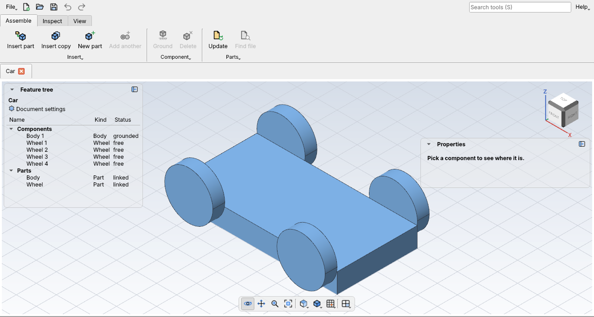
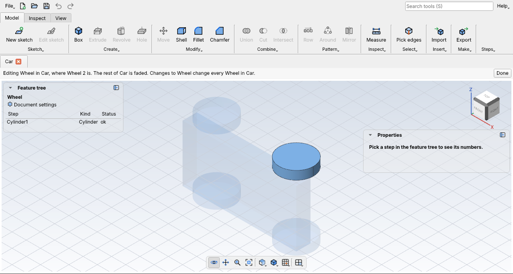

# Assemblies

An **assembly** puts parts together. A toy car is a body and four wheels; a
project box is a box and a lid. In an assembly you say which parts it uses, how
many of each, and where each one sits.

Each copy of a part in an assembly is a **component**. Four wheels are four
components, Wheel 1 to Wheel 4, all made from one Wheel part. Change the Wheel
part and all four change, because they're the same part.

Start one in the desktop app with **File > New assembly**, or with
`sketchbillet_cli` (below). While an assembly is open, the **Assemble** tab takes
the Model tab's place:



In the app, the feature tree lists the assembly's **Components** (each with its
part, and whether it's grounded or free) and its **Parts** (each linked to its
file, or inside the assembly). Click a component, in the tree or in the viewer,
to pick it: Properties shows its part, its file, where it's placed and which way
it faces. Rename it there, or tick **Grounded** to fix it where it is.
Right-click it in the tree to rename it, ground it or delete it.

| Assemble tab | What it does |
| --- | --- |
| **Insert part** | Puts a part from a `.sb` file in, linked to the file |
| **Insert copy** | Puts a copy of a part from a `.sb` file in, as an inside part |
| **New part** | Adds a new, empty part, made inside the assembly |
| **Add another** | Adds another copy of the picked component's part, beside it, facing the same way |
| **Ground** | Fixes the picked component where it is, or lets it go |
| **Delete** | Takes the picked component out |
| **Update** | Uses the new part from each linked file that changed |
| **Find file** | Links the picked component's part to its file where it is now |
| **Edit part** | Changes the picked component's part right here, in the assembly ([below](#changing-a-part)) |
| **Open part** | Opens the picked component's part file beside the assembly, to change it there |
| **Make part inside**, **Save part as file** | In the Parts dropdown: switch the picked component's part between inside and linked |

**Moving a component:** pick a free one, and drag the arrows or the square that
appear on it, in steps of 1 mm, like [dragging a body](moving.md#dragging-a-body).
Its picture moves while you drag; when you let go it's placed there, as one step
of Undo. A grounded component has no arrows: it stays where it is. Press
**Escape** before you let go to put it back.

**Joints** hold parts together and say how they still move: a lid turning on its
hinge, a wheel on its axle. For now they're made with
[`sketchbillet_cli`](#joints); the Assemble tab gets them next.

## Changing a part

A part made **inside** the assembly is changed right in it. Pick one of its
components and click **Edit part**. The part's steps fill the feature tree, the
Model tab comes back, and the rest of the assembly fades, so you see the part
where it goes:



Add boxes, sketches, holes and fillets as in any part. A change to the part
changes every component of it: give one wheel a hub, and all four have one.
Each change is a step of the assembly's Undo. Click **Done** in the bar under
the design tabs to go back to the assembly, with the component picked again.

The part stays at its own origin (0, 0, 0) while you edit it, with the
assembly around it, so its sketches and steps are where they always were.

A **linked** part is changed in its own file. Pick one of its components and
click **Open part**: its file opens in a tab beside the assembly. Change it and
save it (**File > Save**), and the assembly uses the new part straight away,
as one step of its Undo. Saving the assembly keeps it.

Want to change a linked part only in this assembly? Click **Make part inside**
first, then **Edit part**.

## An example: a toy car

First make the parts, each in its own file: a body 80 mm long, 40 mm wide and
10 mm tall, and a wheel 24 mm across and 6 mm thick.

<!-- cli-example -->
```console
$ sketchbillet_cli run --save Body.sb feature.add_box size=80,40,10
...
$ sketchbillet_cli run --save Wheel.sb feature.add_cylinder radius=12 height=6
...
```

Then make an empty assembly, and put the parts in it. `count=2` puts in two
wheels, and `step=60,0,0` puts the second one 60 mm along from the first.

<!-- cli-example -->
```console
$ sketchbillet_cli run --save Car.sb assembly.new
...
$ sketchbillet_cli run --open Car.sb --save Car.sb component.insert file=Body.sb
...
$ sketchbillet_cli run --open Car.sb --save Car.sb component.insert file=Wheel.sb count=2 at=10,-6,0 step=60,0,0
Car: assembly, 3 components, 2 parts
  Body 1       Body       grounded at 0, 0, 0 mm
  Wheel 1      Wheel      free     at 10, -6, 0 mm
  Wheel 2      Wheel      free     at 70, -6, 0 mm
Parts:
  Body         1 step   ok        mass 39.68 g (PLA), 1 in the assembly
    linked to Body.sb
  Wheel        1 step   ok        mass 3.37 g (PLA), 2 in the assembly
    linked to Wheel.sb
Mass in all: 46.41 g
wrote Car.sb
```

Each component is placed by its part's **origin** (the part's 0, 0, 0 point):
Wheel 1's origin is at x 10 mm, y -6 mm, z 0 mm in the car. The list ends with
each part's mass and the whole car's.

Wheels stand on their edge, so turn them: `z=0,-1,0` makes the wheel's own z
axis (the way its cylinder points) face along -y, out to the side of the car.
`open --components` shows which way each component faces.

<!-- cli-example -->
```console
$ sketchbillet_cli run --open Car.sb --save Car.sb component.place component="Wheel 1" origin=10,-6,12 z=0,-1,0
...
$ sketchbillet_cli run --open Car.sb --save Car.sb component.place component="Wheel 2" origin=70,-6,12 z=0,-1,0
...
$ sketchbillet_cli open Car.sb --components
Car: assembly, 3 components, 2 parts
  Body 1       Body       grounded at 0, 0, 0 mm
    facing x 1, 0, 0, z 0, 0, 1
  Wheel 1      Wheel      free     at 10, -6, 12 mm
    facing x 1, 0, 0, z 0, -1, 0
  Wheel 2      Wheel      free     at 70, -6, 12 mm
    facing x 1, 0, 0, z 0, -1, 0
Parts:
  Body         1 step   ok        mass 39.68 g (PLA), 1 in the assembly
    linked to Body.sb
  Wheel        1 step   ok        mass 3.37 g (PLA), 2 in the assembly
    linked to Wheel.sb
Mass in all: 46.41 g
```

## Grounded and free

The first component in an assembly is **grounded**: fixed where it is. The
others are **free**. [Joints](#joints) place the free components against the
grounded ones, so a car usually has its body grounded and its wheels free.
Fix or free a component with
[`component.ground`](../cli/commands.md#componentground).

## Joints

A **joint** joins two components. It moves the second one so a point on it meets
a point on the first, the two pointing at each other, like a peg dropped into a
hole. Then the second one:

| Kind | Still moves | Its value |
| --- | --- | --- |
| **Rigid** | Not at all: they're fixed together | None |
| **Revolute** | Turns about the joint, like a hinge or a wheel on an axle | An angle, in degrees |
| **Slider** | Slides along the joint, like a drawer | A distance, in mm |

The point on each side is picked on its part:

| Pick | The point | Which way it points |
| --- | --- | --- |
| A round edge (a hole's rim, an axle's end) | The circle's center | Straight out of the flat face it's on |
| A flat face | Its center | Straight out of the face |
| A straight edge | Its middle, or an end | Along the edge |
| A point (a corner) | The point | The part's z |
| Nothing | The part's origin | The part's z |

Here a tray gets a cover on a hinge. The tray is 40 mm square and 10 mm tall,
the cover 4 mm thick. [`open --edges`](../cli/open.md#a-components-edges-faces-and-points)
numbers a component's edges: the tray's top back edge is its edge 12, and the
cover's bottom back edge its edge 4.

<!-- cli-example -->
```console
$ sketchbillet_cli run --save Tray.sb feature.add_box size=40,40,10
...
$ sketchbillet_cli run --save Cover.sb feature.add_box size=40,40,4
...
$ sketchbillet_cli run --save Case.sb assembly.new
...
$ sketchbillet_cli run --open Case.sb --save Case.sb component.insert file=Tray.sb
...
$ sketchbillet_cli run --open Case.sb --save Case.sb component.insert file=Cover.sb at=60,0,0
...
$ sketchbillet_cli run --open Case.sb --save Case.sb joint.add kind=revolute a="Tray 1:edge:12" b="Cover 1:edge:4" flip=true lowest=-110 highest=0
Case: assembly, 2 components, 2 parts
  Tray 1       Tray       grounded at 0, 0, 0 mm
  Cover 1      Cover      joined   at 0, 0, 10 mm
Joints:
  Joint1       revolute  Cover 1 on Tray 1, at 0°, from -110° to 0°
Parts:
  Tray         1 step   ok        mass 19.84 g (PLA), 1 in the assembly
    linked to Tray.sb
  Cover        1 step   ok        mass 7.94 g (PLA), 1 in the assembly
    linked to Cover.sb
Mass in all: 27.78 g
wrote Case.sb
```

The cover is **joined** now: the joint puts it on the tray (its origin at 0, 0,
10 mm), wherever it was before. Both edges point along x, so they'd point at
each other, which would turn the cover upside down; `flip=true` turns it the
other way round, so it sits the right way up. `lowest=-110 highest=0` lets it
open up to 110°.

Open it with [`joint.set`](../cli/commands.md#jointset). The hinge turns about x,
and a turn the negative way lifts the cover's front:

<!-- cli-example -->
```console
$ sketchbillet_cli run --open Case.sb --save Case.sb joint.set joint=Joint1 value=-100
Case: assembly, 2 components, 2 parts
  Tray 1       Tray       grounded at 0, 0, 0 mm
  Cover 1      Cover      joined   at 0, 46.95, 49.39 mm
Joints:
  Joint1       revolute  Cover 1 on Tray 1, at -100°, from -110° to 0°
Parts:
  Tray         1 step   ok        mass 19.84 g (PLA), 1 in the assembly
    linked to Tray.sb
  Cover        1 step   ok        mass 7.94 g (PLA), 1 in the assembly
    linked to Cover.sb
Mass in all: 27.78 g
wrote Case.sb
```

A component is placed from the one it's joined to, joint by joint, out from the
grounded ones: a car's body, then its axles, then its wheels. A grounded
component never moves. A joint between two components that are placed already
(a lid with two hinges, say) makes a **loop**: it's fine if its two sides meet,
as a second hinge on the same line does. If they don't, it says so, and moves
nothing: SketchBillet can't move parts in loops yet.

```text
warning [joint.loop]: Joint5 makes a loop (Base 1, Arm 1, Link 1, Base 1), and its two sides are 3.20 mm apart. SketchBillet can't move parts in loops yet, so Joint5 doesn't move anything. Turn Joint5 off, or change a value in the loop so its sides meet.
```

If a change to a part takes away what a joint sits on, the joint says so and
moves nothing, until its sides are picked again with `joint.set`. It never
guesses.

## Linked and inside parts

A part in an assembly is either **linked** to its own `.sb` file, or **inside**
the assembly.

- **Linked parts** follow their file. Put one in with `component.insert`: change
  `Wheel.sb` later, and the car uses the new wheel the next time it opens. This is
  how a team works: one student makes the wheel, another the car.
- **Inside parts** live only in the assembly. Make one with `component.new`, or
  insert a file with `link=false` to keep a copy that doesn't change.

Either way, the assembly keeps a copy of every part, so `Car.sb` opens even on
a computer that doesn't have `Wheel.sb`.

Here the wheel gets a hub. Opening the car says it changed, and uses the new
wheel; saving the car keeps it:

<!-- cli-example -->
```console
$ sketchbillet_cli run --open Wheel.sb --save Wheel.sb feature.add_cylinder radius=4 height=10
...
$ sketchbillet_cli run --open Car.sb --save Car.sb
note [part.updated]: Wheel changed in Wheel.sb, so Car uses the new Wheel.
...
```

**When SketchBillet can't find a part's file**, it looks for it next to the
assembly, then in the folders inside the assembly's folder, even under another
name. If it finds it there, it says so, and links to it there from now on:

```text
note [part.moved]: Car found Wheel.sb in the parts folder, and links to it there now.
```

If the file is gone, the assembly uses the copy it kept, and says what to do:

```text
warning [part.not_found]: Wheel.sb can't be found, so Car uses the copy of Wheel saved on Nov 20, 2026. Put Wheel.sb back, or link Wheel to it where it is now with part.relink part="Wheel" file=<where it is>.
```

So keep an assembly and its parts' files in one folder (and the folders in
it): you can move or copy the whole folder, and everything still links up.

## What you can do

| To | Use |
| --- | --- |
| Make a new design an assembly | [`assembly.new`](../cli/commands.md#assemblynew) |
| Put in a part from a `.sb` file | [`component.insert`](../cli/commands.md#componentinsert) |
| Put in more of a part it has already | [`component.add`](../cli/commands.md#componentadd) |
| Add an empty part, to make later | [`component.new`](../cli/commands.md#componentnew) |
| Move or turn a component | [`component.place`](../cli/commands.md#componentplace) |
| Fix a component or let it go | [`component.ground`](../cli/commands.md#componentground) |
| Rename a component | [`component.rename`](../cli/commands.md#componentrename) |
| Take a component out | [`component.delete`](../cli/commands.md#componentdelete) |
| Join two components | [`joint.add`](../cli/commands.md#jointadd) |
| Turn or slide a joint, or change it | [`joint.set`](../cli/commands.md#jointset) |
| Take a joint out | [`joint.delete`](../cli/commands.md#jointdelete) |
| List a component's edges or faces, for a joint | [`open --edges "Wheel 1"`](../cli/open.md#a-components-edges-faces-and-points) |
| Update linked parts from their files | [`part.update`](../cli/commands.md#partupdate), or just open the assembly |
| Link a part to its file where it is now | [`part.relink`](../cli/commands.md#partrelink) |
| Stop following the file: make a part inside | [`part.make_inside`](../cli/commands.md#partmake_inside) |
| Save an inside part to its own file, and link it | [`part.save_as`](../cli/commands.md#partsave_as) |
| List the components and parts | [`open --components`](../cli/open.md#an-assembly) |

Undo works for all of them in a script, like any other command.

## Tips

- **Open and save to keep updates.** Opening an assembly updates its linked
  parts, but only saving it keeps them: `sketchbillet_cli run --open Car.sb --save Car.sb`.
- **A file only counts if it holds the same design.** A different `Wheel.sb`,
  made from scratch, isn't the wheel the car uses, even with the same name.
  Copies of the file are fine.
- **Inserting the same file again adds more of the same part**, not a second
  Wheel part: you get Wheel 3, Wheel 4, ...
- **Deleting the last component of a part takes the part out too.**
- **An assembly has no steps of its own.** Boxes, sketches and fillets go in its
  parts. Typing a step command for an assembly says so.
- **Assemblies can't go inside assemblies yet.** Insert the parts one at a time.
- **Exporting an assembly** to STL, 3MF or STEP comes in a later version. For
  now, export each part from its own file.
- `.sb` files with assemblies need this version of SketchBillet or newer. An
  older one says to update. The [file format](../file-format.md#assemblies-schema-2)
  page shows what's inside.
