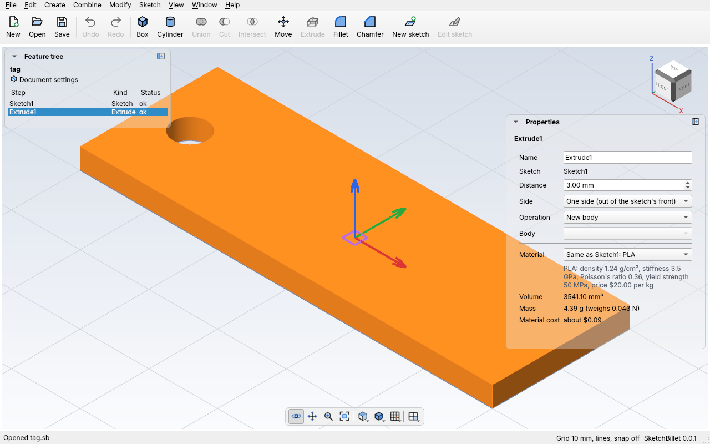
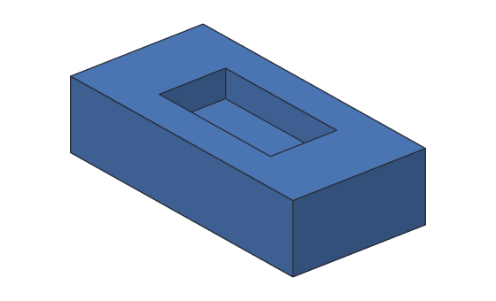

# Extrude

**Extrude** turns a [sketch](sketches.md)'s closed shapes into a solid, by
sweeping them straight out of the sketch's plane, like pushing clay through a
shaped hole. A rectangle becomes a block, a circle a cylinder, and a circle
inside a rectangle a plate with a hole right through it. It's how most parts
start.


The sketch stays in the design as its own step, and the extrude uses it. Change
the sketch (drag a line, change a dimension) and the solid rebuilds to match.

## In the desktop app

1. Draw a sketch with at least one closed shape, and finish it.
2. Pick the sketch in the feature tree.
3. Click **Extrude** on the toolbar, or **Create > Extrude** (Ctrl+Shift+E). It's
   grey unless exactly one sketch is picked.

SketchBillet adds `Extrude1`, 10 mm thick. Pick it to change it in **Properties** (the name tag from
[Tutorial 3](../tutorials/03-name-tag.md), 3 mm thick):



| Setting | What it does |
| --- | --- |
| **Distance** | How far the shape is swept, in mm. |
| **Side** | **One**: out of the front of the sketch (up, for a sketch on XY). **Flipped**: the other way. **Both**: half the distance each way, so the sketch is in the middle of the solid. |
| **Operation** | **New body**: a body of its own. **Join**: added to a body. **Cut**: taken out of a body. See [Join and cut](#join-and-cut). |
| **Body** | For Join or Cut: which body. |

Each change is one undo step.

## Example with sketchbillet_cli

The plate from [Sketches](sketches.md), drawn exactly this time, then extruded
5 mm:

<!-- cli-example -->
```console
$ sketchbillet_cli run --save plate.sb feature.add_sketch
plate: 1 step
  Sketch1      ok  empty
wrote plate.sb
$ sketchbillet_cli run --open plate.sb --save plate.sb sketch.add_line sketch=Sketch1 from=0,0 to=40,0
plate: 1 step
  Sketch1      ok  1 line, 0 constraints, free to move 4 ways
wrote plate.sb
$ sketchbillet_cli run --open plate.sb --save plate.sb sketch.add_line sketch=Sketch1 from=40,0 to=40,20
plate: 1 step
  Sketch1      ok  2 lines, 0 constraints, free to move 8 ways
wrote plate.sb
$ sketchbillet_cli run --open plate.sb --save plate.sb sketch.add_line sketch=Sketch1 from=40,20 to=0,20
plate: 1 step
  Sketch1      ok  3 lines, 0 constraints, free to move 12 ways
wrote plate.sb
$ sketchbillet_cli run --open plate.sb --save plate.sb sketch.add_line sketch=Sketch1 from=0,20 to=0,0
plate: 1 step
  Sketch1      ok  4 lines, 0 constraints, free to move 16 ways
wrote plate.sb
$ sketchbillet_cli run --open plate.sb --save plate.sb sketch.add_circle sketch=Sketch1 center=10,10 radius=4
plate: 1 step
  Sketch1      ok  4 lines, 1 circle, 0 constraints, free to move 19 ways
wrote plate.sb
$ sketchbillet_cli run --open plate.sb --save plate.sb feature.add_extrude sketch=Sketch1 distance=5
plate: 2 steps
  Sketch1      ok  4 lines, 1 circle, 0 constraints, free to move 19 ways
  Extrude1     ok  volume 3748.67 mm^3  mass 4.65 g (PLA)
wrote plate.sb
```

The volume is the shape's area times the distance: (40 × 20 − π × 4²) × 5 =
3748.67 mm^3. See [`feature.add_extrude`](../cli/commands.md#featureadd_extrude)
for every setting (the distance can also come from a
[parameter](parameters.md#using-parameters-in-steps), like `wall * 2`), and [Tutorial 3](../tutorials/03-name-tag.md) for a whole
part made this way.

## Join and cut

An extrude doesn't have to make a body of its own. Its **Operation** can
**join** the solid onto a body (a peg, a tab, a boss) or **cut** it out of one (a
pocket, a slot, a hole), in one step.



When the sketch is [on a face of a body](sketch-on-face.md), the extrude joins
that body by default, and choosing **Cut** sends it into the body (it sets
**Side** to **Flipped**). For a sketch on a base plane, pick the **Body** in
Properties. The body joined or cut is used up: the extrude is the part now.

A cut that doesn't reach the body changes nothing, and says so:

```text
Extrude2 doesn't reach the body, so nothing was cut. Try Flip, to go into it, or a longer distance.
```

<!-- cli-example -->
```console
$ sketchbillet_cli run --save pocket.sb feature.add_box size=40,20,10
pocket: 1 step
  Box1         ok  volume 8000.00 mm^3  mass 9.92 g (PLA)
wrote pocket.sb
$ sketchbillet_cli run --open pocket.sb --save pocket.sb feature.add_sketch body=Box1 face=6
pocket: 2 steps
  Box1         ok  volume 8000.00 mm^3  mass 9.92 g (PLA)
  Sketch1      ok  empty
wrote pocket.sb
$ sketchbillet_cli run --open pocket.sb --save pocket.sb sketch.add_rectangle sketch=Sketch1 from=10,5 to=30,15
pocket: 2 steps
  Box1         ok  volume 8000.00 mm^3  mass 9.92 g (PLA)
  Sketch1      ok  4 lines, 8 constraints, free to move 4 ways
wrote pocket.sb
$ sketchbillet_cli run --open pocket.sb --save pocket.sb feature.add_extrude sketch=Sketch1 distance=4 operation=cut
pocket: 3 steps
  Box1         ok  volume 8000.00 mm^3
  Sketch1      ok  4 lines, 8 constraints, free to move 4 ways
  Extrude1     ok  volume 7200.00 mm^3  mass 8.93 g (PLA)
wrote pocket.sb
```

The pocket takes 20 × 10 × 4 = 800 mm³ out of the 8000 mm³ block.

## What gets extruded

- Every **closed shape** in the sketch: lines and arcs joined end to end all the
  way round, or a circle. A sketch with two separate shapes makes one body with
  two pieces.
- A closed shape inside another one is a **hole**: it goes all the way through.
- Lines that don't close a shape, and helper (construction) lines, are left out.
  If some ends aren't joined, the extrude warns you, or fails if there's no closed
  shape at all.

## Which way it goes

A sketch on **XY** (the ground) extrudes up, in +z. On **XZ** (the front) it
extrudes towards you, in −y, and on **YZ** (the side) in +x. **Flipped** goes the
other way, and **Both** goes half each way.

## Tips

- **Constrain the sketch fully first.** Then nothing in it can move by accident,
  and the part is exactly the size you meant. When the whole sketch is black (or
  says *fully constrained*), it's ready.
- **One sketch, several extrudes.** Two extrudes of the same sketch, with
  different distances, make two bodies. Combine them with
  [union or cut](combining.md).
- **Holes from the sketch.** A circle in the sketch makes a hole with no
  cylinder and no cut, and it moves with the rest of the sketch.
- **When it fails.** SketchBillet says what's wrong and how to fix it:

| Message | What to do |
| --- | --- |
| The sketch has no closed shape to extrude. These ends aren't joined: ... | Join the ends it names: drag one onto the other, or draw a line between them. |
| This step uses Sketch1, which didn't solve. | Fix the sketch first: its constraints fight each other. See [Sketches](sketches.md). |
| Extrude needs a distance greater than 0 mm. | Type a distance in Properties, like 10 mm. |
| 3 lines and arcs meet at ... (a warning) | Delete the extra line, or make it a helper line, so each shape is clear. |

