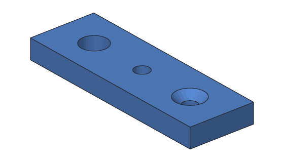
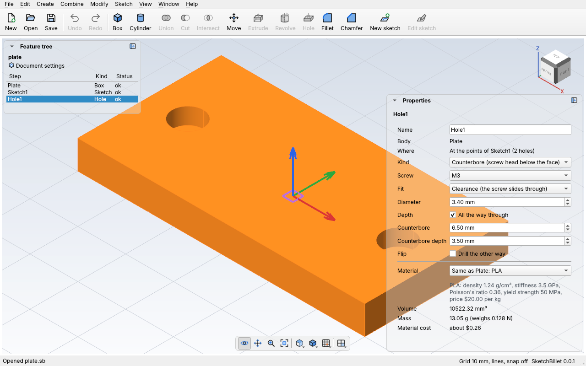

# Holes

**Hole** drills round holes into a body, the right size for a screw. Pick a
screw size, like M3, and SketchBillet makes the hole the screw needs. A hole can
be:

- **Simple:** the same width all the way down.
- **Counterbored:** a wider, flat-bottomed pocket at the top, so a screw's
  round head sits below the face.
- **Countersunk:** a cone at the top, so a flat-headed screw sits flush with the
  face.

It goes all the way through the body, or to a depth, with a flat bottom.



There are two ways to say where holes go:

- **At a sketch's points** (the usual): draw a [sketch on the face](sketch-on-face.md),
  put a point where each hole goes, and use dimensions to place them exactly.
  One Hole step drills at every point. Move a point and its hole follows.
- **In from two edges:** pick two straight edges of a flat face, and say how far
  in from each. That's quick for one hole near a corner, with no sketch needed.

## In the desktop app

**At a sketch's points:**

1. Sketch on the face the holes go in (**Sketch > New sketch on a face**).
2. Click the **Point** tool, and click where each hole goes. Add dimensions to
   place the points exactly, then finish the sketch.
3. Pick the sketch in the feature tree, and click **Hole** on the toolbar (or
   **Create > Hole**). SketchBillet adds `Hole1`: an M3 clearance hole all the
   way through, at every point.

**In from two edges:**

1. Click **Create > Hole from two edges**. The 3D view picks edges now.
2. Click two edges of the face the hole goes in, like the front and left edges of
   a top: two edges that meet at a corner, not parallel ones.
3. Click **Create > Hole from two edges** again. The hole is 10 mm in from each
   edge; change the distances in Properties.

Pick the hole to change it in **Properties**:



| Setting | What it does |
| --- | --- |
| **From edge 1**, **From edge 2** | For a hole from two edges: how far in from each edge, in mm. |
| **Kind** | **Simple**, **Counterbore** or **Countersink**. |
| **Screw** | A metric screw size: sets the diameter, counterbore and countersink to fit it. **Its own size** when you've typed sizes of your own. |
| **Fit** | **Clearance**: the screw slides through. **Tap**: a smaller hole that the screw's thread grips (or that you cut a thread in with a tap). |
| **Diameter** | The hole's diameter, in mm. Typing one makes it a size of its own. |
| **Depth** | **All the way through**, or a depth in mm (untick the box). |
| **Counterbore**, **Counterbore depth** | A counterbore's diameter and depth, in mm. |
| **Countersink**, **Countersink angle** | A countersink's diameter at the face (mm), and how wide its cone is (90° for metric screws). |
| **Flip** | Drill the other way, out of the face instead of into it. |

Each change is one undo step.

## Example with sketchbillet_cli

Two counterbored M3 holes in a 60 × 30 × 6 mm plate: a sketch on its top (face 6
of a box is the top, as `sketchbillet_cli open plate.sb --faces Plate` lists), a
point for each hole, and the Hole step:

<!-- cli-example -->
```console
$ sketchbillet_cli run --save plate.sb feature.add_box size=60,30,6 name=Plate
plate: 1 step
  Plate        ok  volume 10800.00 mm^3  mass 13.39 g (PLA)
wrote plate.sb
$ sketchbillet_cli run --open plate.sb --save plate.sb feature.add_sketch body=Plate face=6
plate: 2 steps
  Plate        ok  volume 10800.00 mm^3  mass 13.39 g (PLA)
  Sketch1      ok  empty
wrote plate.sb
$ sketchbillet_cli run --open plate.sb --save plate.sb sketch.add_point sketch=Sketch1 at=8,15
plate: 2 steps
  Plate        ok  volume 10800.00 mm^3  mass 13.39 g (PLA)
  Sketch1      ok  1 point, 0 constraints, free to move 2 ways
wrote plate.sb
$ sketchbillet_cli run --open plate.sb --save plate.sb sketch.add_point sketch=Sketch1 at=52,15
plate: 2 steps
  Plate        ok  volume 10800.00 mm^3  mass 13.39 g (PLA)
  Sketch1      ok  2 points, 0 constraints, free to move 4 ways
wrote plate.sb
$ sketchbillet_cli run --open plate.sb --save plate.sb feature.add_hole sketch=Sketch1 kind=counterbore
plate: 3 steps
  Plate        ok  volume 10800.00 mm^3
  Sketch1      ok  2 points, 0 constraints, free to move 4 ways
  Hole1        ok  volume 10522.32 mm^3  mass 13.05 g (PLA)
wrote plate.sb
```

Check it: each hole is a 6.5 mm counterbore 3.5 mm deep, π × 3.25² × 3.5 =
116.14 mm³, over the 3.4 mm hole for the last 2.5 mm, π × 1.7² × 2.5 = 22.70 mm³.
Two holes take 277.68 mm³ out of the 10800 mm³ plate.

Each hole's faces are named for its point, so you can tell them apart:

<!-- cli-example -->
```console
$ sketchbillet_cli open plate.sb --faces Hole1
plate: 3 steps
  Plate        ok  volume 10800.00 mm^3
  Sketch1      ok  2 points, 0 constraints, free to move 4 ways
  Hole1        ok  volume 10522.32 mm^3  mass 13.05 g (PLA)
faces of Hole1: 12
   1  flat       1781.84 mm^2  at 30.00,15.00,0.00  bottom of Plate
   2  cylinder     26.70 mm^2  at 8.00,15.00,1.25  wall of Hole1 at Point1
   3  cylinder     26.70 mm^2  at 52.00,15.00,1.25  wall of Hole1 at Point2
   4  flat         24.10 mm^2  at 8.00,15.00,2.50  counterbore floor of Hole1 at Point1
   5  flat         24.10 mm^2  at 52.00,15.00,2.50  counterbore floor of Hole1 at Point2
   6  flat        360.00 mm^2  at 30.00,0.00,3.00  front side of Plate
   7  flat        180.00 mm^2  at 0.00,15.00,3.00  left side of Plate
   8  flat        180.00 mm^2  at 60.00,15.00,3.00  right side of Plate
   9  flat        360.00 mm^2  at 30.00,30.00,3.00  back side of Plate
  10  cylinder     71.47 mm^2  at 8.00,15.00,4.25  counterbore of Hole1 at Point1
  11  cylinder     71.47 mm^2  at 52.00,15.00,4.25  counterbore of Hole1 at Point2
  12  flat       1733.63 mm^2  at 30.00,15.00,6.00  top of Plate
```

See [`feature.add_hole`](../cli/commands.md#featureadd_hole) for every setting,
including holes from two edges, and [Tutorial 5](../tutorials/05-mounting-plate.md)
for a whole part.

## Screw sizes

A screw size sets every diameter of the hole. These are good starting sizes for
3D printed and machined parts. Printers often make holes a little small, so if a
screw is tight, add 0.2 mm to the diameter.

| Screw | Clearance hole | Tap hole | Counterbore (across × deep) | Countersink (across) |
| --- | --- | --- | --- | --- |
| M2 | 2.4 mm | 1.6 mm | 4.8 × 2.5 mm | (give one) |
| M2.5 | 2.9 mm | 2.05 mm | 5.5 × 3.0 mm | (give one) |
| M3 | 3.4 mm | 2.5 mm | 6.5 × 3.5 mm | 6.72 mm |
| M4 | 4.5 mm | 3.3 mm | 8.0 × 4.5 mm | 8.96 mm |
| M5 | 5.5 mm | 4.2 mm | 9.5 × 5.5 mm | 11.2 mm |
| M6 | 6.6 mm | 5.0 mm | 11.0 × 6.5 mm | 13.44 mm |
| M8 | 9.0 mm | 6.8 mm | 14.0 × 8.5 mm | 17.92 mm |

Where these come from:

- **Clearance:** the usual "normal" fit for metric screws.
- **Tap:** the drill size for cutting a metric coarse thread.
- **Counterbore:** for a socket head cap screw (ISO 4762): its head plus 1 mm
  across, and its head's height plus 0.5 mm deep.
- **Countersink:** the widest a 90° flat head socket screw's head can be (ISO
  10642). There's no such screw smaller than M3, so for M2 and M2.5 give
  `countersink_diameter=` yourself.

## Tips

- Leave enough material under a counterbore: an M3 counterbore is 3.5 mm deep,
  so the plate needs to be thicker than that, or the hole goes right through.
- A point that's off the body drills nothing. The step still builds, with a
  warning naming the point. Here a third point is 80 mm along, past the plate's
  end:

<!-- cli-example -->
```console
$ sketchbillet_cli run --open plate.sb --save off.sb sketch.add_point sketch=Sketch1 at=80,15
plate: 3 steps
  Plate        ok  volume 10800.00 mm^3
  Sketch1      ok  3 points, 0 constraints, free to move 6 ways
  Hole1        ok  volume 10522.32 mm^3  mass 13.05 g (PLA)
    warning [hole.missed]: Hole1's hole at Point3 isn't on the body, so it drilled nothing. Move it onto the body, or try Flip.
wrote off.sb
$ sketchbillet_cli open off.sb
plate: 3 steps
  Plate        ok  volume 10800.00 mm^3
  Sketch1      ok  3 points, 0 constraints, free to move 6 ways
  Hole1        ok  volume 10522.32 mm^3  mass 13.05 g (PLA)
    warning [hole.missed]: Hole1's hole at Point3 isn't on the body, so it drilled nothing. Move it onto the body, or try Flip.
```

- Holes from a sketch on a base plane (not on a face) need `body=`, and drill out
  of the sketch's back: use **Flip** if they go the wrong way.
- Holes from two edges follow the edges: make the part wider and the hole stays
  the same distance from them.
