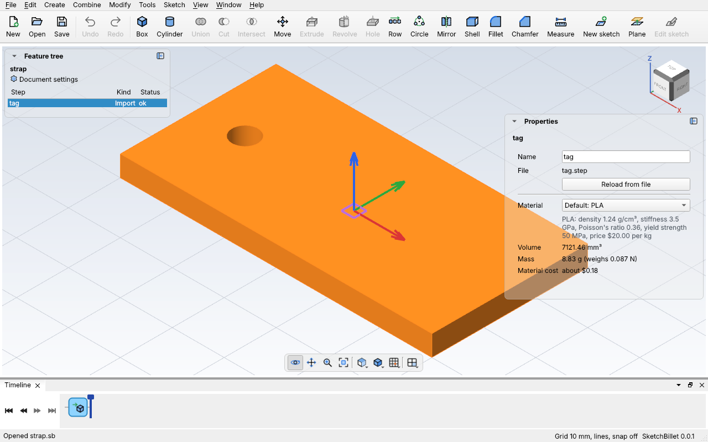

# Importing parts

**Import** a part made in another program (Fusion, Onshape, SolidWorks, FreeCAD,
Tinkercad, a slicer, or a model you downloaded) and build on it in SketchBillet:
drill holes in it, sketch on its faces, join your own parts to it, and 3D print
the result. SketchBillet imports:

- **STEP** files (`.step` or `.stp`): the file almost every CAD program can
  export. The part comes in exact, with its round faces round.
- **STL** and **3MF** files: the files slicers and 3D-printing sites use. They're
  made of triangles, so the part is too: see [STL and 3MF files](#stl-and-3mf-files).

An imported part is one step, **Import**, with the part as a body. You can't
change how the other program made it, but every step after it works like on any
other body.

## In the desktop app

1. Pick **File > Import...** (Ctrl+I).
2. Pick the STEP, STL or 3MF file. The part appears as a new step, named after the file, and
   it's picked, so Properties shows it.
3. Build on it: pick it and another body and **Combine > Cut**, sketch on one of
   its faces with **Sketch > New sketch on a face**, or fillet its edges.



The design keeps **its own copy of the file**, saved inside the `.sb`. So the
design opens anywhere, like on a classmate's computer, even where the STEP file
isn't.

## STL and 3MF files

STL and 3MF files are a skin of flat triangles. SketchBillet makes it into a solid,
and joins triangles that lie flat against each other into one face. So a box from
an STL file has six faces, to sketch on like any other, but a round hole is many
narrow flat strips, and a curved surface is many small flat faces. Holes and cuts
you add in SketchBillet are exact.

- **The skin must be closed.** A mesh with gaps or overlaps has no clear inside,
  and SketchBillet says how many edges are wrong. Repair it first (most slicers
  have a Repair button), then export it again.
- **Up to 100,000 triangles.** More makes a part too slow to work with: export it
  with a coarser resolution, or simplify it in a mesh program.
- **STL files don't say their unit.** SketchBillet takes them as mm, which most are.
  A part that comes in 25.4 times too small was made in inches: pick **inch** in
  Properties under **File unit** (or import with `unit=in`). 3MF files say their unit.

## Reading the file again

Changed the part in the other program? Export it again over the same file,
then click **Reload from file** in Properties. The steps built on it follow
the new part. **Edit > Undo** puts the old one back.

## An example

`sketchbillet_cli demo` can write the demo tag as a STEP file, as another
program would. Import it, then cut a second hole into the other end, for a strap:

<!-- cli-example -->
```console
$ sketchbillet_cli demo tag.step
volume: 7121.46 mm^3
wrote tag.step
$ sketchbillet_cli run --save strap.sb feature.import file=tag.step
strap: 1 step
  tag          ok  volume 7121.46 mm^3  mass 8.83 g (PLA)
wrote strap.sb
$ sketchbillet_cli run --open strap.sb --save strap.sb feature.add_cylinder base=51,15,-1 radius=2.5 height=6
strap: 2 steps
  tag          ok  volume 7121.46 mm^3  mass 8.83 g (PLA)
  Cylinder1    ok  volume 117.81 mm^3  mass 0.15 g (PLA)
wrote strap.sb
$ sketchbillet_cli run --open strap.sb --save strap.sb feature.add_boolean operation=cut a=tag b=Cylinder1 name=Strap
strap: 3 steps
  tag          ok  volume 7121.46 mm^3
  Cylinder1    ok  volume 117.81 mm^3
  Strap        ok  volume 7042.92 mm^3  mass 8.73 g (PLA)
wrote strap.sb
```

The tag came in at its real size: 7121.46 mm^3, the same as the one SketchBillet
made. The strap takes away another 117.81 mm^3, the part of the cylinder inside
the 4 mm thick tag.

See [`feature.import`](../cli/commands.md#featureimport) and
[`feature.reload_import`](../cli/commands.md#featurereload_import) for every setting.

## Tips

- **Export as a solid.** SketchBillet needs a solid part, with an inside. A
  surface model (just skin) can't be imported: export it from the other program
  as a solid body.
- **Units sort themselves out** for STEP and 3MF files: they say what unit they're
  in. A part made in inches comes in at its real size, shown in mm (or your
  design's unit). For STL files, see above.
- **STEP when you can.** If the other program can export STEP, use it: the part
  comes in exact, and its round holes are round.
- **One file, one step.** A STEP file with several separate parts comes in as one
  body made of all of them. To use one piece, cut or intersect it away.
- **The part is placed where the other program put it.** If it's far from the
  middle, add a **Move** step to bring it to where you want it.
- **Big files are slow.** Files up to 64 MB can be imported; a simpler export
  (just the part you need, without tiny details) builds faster.
- To send your part back to another program, [export](files.md#exporting) it as STEP.
