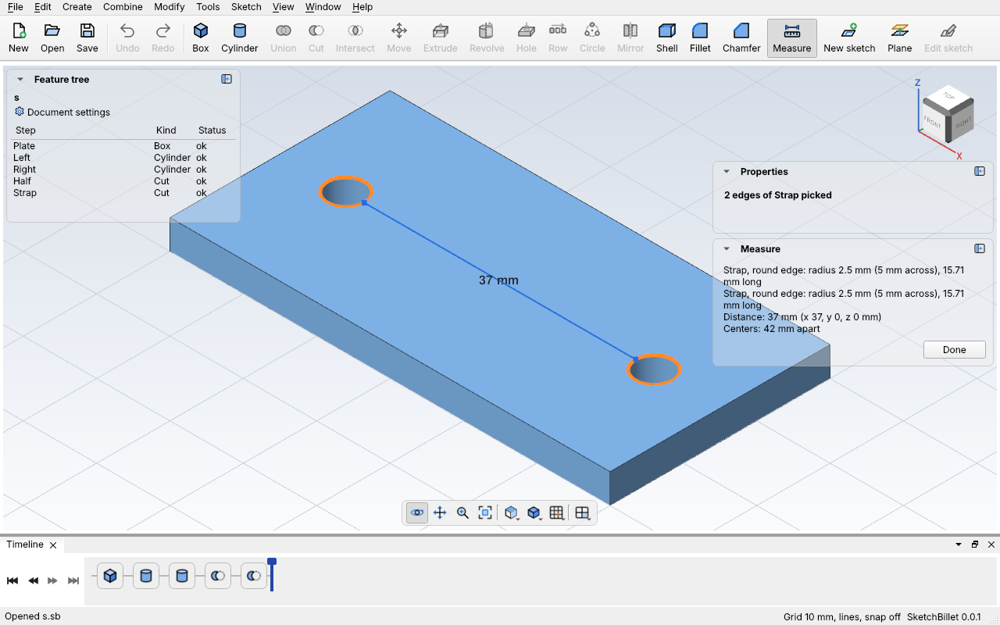
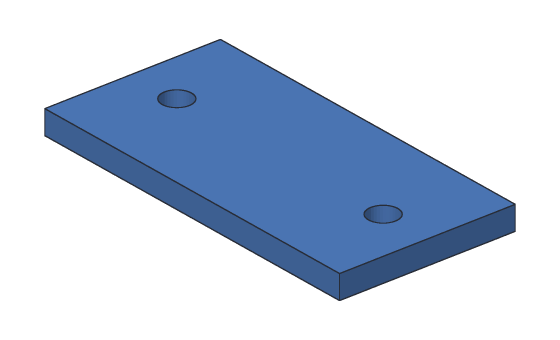

# Measuring

**Measure** a part to check it's the size you meant: how thick a wall is, how big
a hole is, how far apart two holes are, or whether two faces meet square. Pick
one face, edge or point to get its size, or two to get the distance between them.

In the desktop app, pick **Tools > Measure** (Ctrl+Shift+I), or **Measure** on
the toolbar, then click what to measure in the view. With `sketchbillet_cli`, use
[`sketchbillet_cli measure`](../cli/measure.md).

## In the desktop app

1. Pick **Tools > Measure**. The Measure panel opens, and clicks in the view now
   pick a face, edge or point instead of a whole body.
2. Click a face, an edge or a point (a corner). It turns orange, and the Measure
   panel shows its size.
3. Click a second one. The panel shows the distance between them, and a blue
   line in the view joins the nearest points, with the distance written on it.
4. Click a third one to start again with just that one. Click a picked one again
   to un-pick it, or click empty space to un-pick both.
5. Click **Done**, or **Measure** again, to go back to picking bodies.



What's measured stays picked while you change the design, so you can change a
number in Properties and watch the distance change.

## An example with sketchbillet_cli

This tag has a 5 mm hole at each end, 42 mm apart, for a strap:



<!-- cli-example -->
```console
$ sketchbillet_cli run --save strap.sb feature.add_box size=60,30,4 name=Plate
strap: 1 step
  Plate        ok  volume 7200.00 mm^3  mass 8.93 g (PLA)
wrote strap.sb
$ sketchbillet_cli run --open strap.sb --save strap.sb feature.add_cylinder base=9,15,-1 radius=2.5 height=6 name=Left
strap: 2 steps
  Plate        ok  volume 7200.00 mm^3  mass 8.93 g (PLA)
  Left         ok  volume 117.81 mm^3  mass 0.15 g (PLA)
wrote strap.sb
$ sketchbillet_cli run --open strap.sb --save strap.sb feature.add_cylinder base=51,15,-1 radius=2.5 height=6 name=Right
strap: 3 steps
  Plate        ok  volume 7200.00 mm^3  mass 8.93 g (PLA)
  Left         ok  volume 117.81 mm^3  mass 0.15 g (PLA)
  Right        ok  volume 117.81 mm^3  mass 0.15 g (PLA)
wrote strap.sb
$ sketchbillet_cli run --open strap.sb --save strap.sb feature.add_boolean operation=cut a=Plate b=Left name=Half
strap: 4 steps
  Plate        ok  volume 7200.00 mm^3
  Left         ok  volume 117.81 mm^3
  Right        ok  volume 117.81 mm^3  mass 0.15 g (PLA)
  Half         ok  volume 7121.46 mm^3  mass 8.83 g (PLA)
wrote strap.sb
$ sketchbillet_cli run --open strap.sb --save strap.sb feature.add_boolean operation=cut a=Half b=Right name=Strap
strap: 5 steps
  Plate        ok  volume 7200.00 mm^3
  Left         ok  volume 117.81 mm^3
  Right        ok  volume 117.81 mm^3
  Half         ok  volume 7121.46 mm^3
  Strap        ok  volume 7042.92 mm^3  mass 8.73 g (PLA)
wrote strap.sb
```

First find the numbers of the edges to measure. `open --edges` lists them, each
with what it is and where its middle is. The holes' top rims are the `circle`
edges at z 4: numbers 15 and 16.

<!-- cli-example -->
```console
$ sketchbillet_cli open strap.sb --edges Strap
strap: 5 steps
  Plate        ok  volume 7200.00 mm^3
  Left         ok  volume 117.81 mm^3
  Right        ok  volume 117.81 mm^3
  Half         ok  volume 7121.46 mm^3
  Strap        ok  volume 7042.92 mm^3  mass 8.73 g (PLA)
edges of Strap: 18
   1  line           60.00 mm  at 30.00,0.00,0.00  between bottom of Plate and front side of Plate
   2  line           30.00 mm  at 0.00,15.00,0.00  between bottom of Plate and left side of Plate
   3  circle         15.71 mm  at 9.00,15.00,0.00  between bottom of Plate and side of Left
   4  circle         15.71 mm  at 51.00,15.00,0.00  between bottom of Plate and side of Right
   5  line           30.00 mm  at 60.00,15.00,0.00  between bottom of Plate and right side of Plate
   6  line           60.00 mm  at 30.00,30.00,0.00  between back side of Plate and bottom of Plate
   7  line            4.00 mm  at 0.00,0.00,2.00  between front side of Plate and left side of Plate
   8  line            4.00 mm  at 60.00,0.00,2.00  between front side of Plate and right side of Plate
   9  line            4.00 mm  at 11.50,15.00,2.00  seam of side of Left
  10  line            4.00 mm  at 53.50,15.00,2.00  seam of side of Right
  11  line            4.00 mm  at 0.00,30.00,2.00  between back side of Plate and left side of Plate
  12  line            4.00 mm  at 60.00,30.00,2.00  between back side of Plate and right side of Plate
  13  line           60.00 mm  at 30.00,0.00,4.00  between front side of Plate and top of Plate
  14  line           30.00 mm  at 0.00,15.00,4.00  between left side of Plate and top of Plate
  15  circle         15.71 mm  at 9.00,15.00,4.00  between side of Left and top of Plate
  16  circle         15.71 mm  at 51.00,15.00,4.00  between side of Right and top of Plate
  17  line           30.00 mm  at 60.00,15.00,4.00  between right side of Plate and top of Plate
  18  line           60.00 mm  at 30.00,30.00,4.00  between back side of Plate and top of Plate
```

Then measure between them. The rims are 37 mm apart at their nearest, and their
centers are 42 mm apart:

<!-- cli-example -->
```console
$ sketchbillet_cli measure strap.sb Strap edge 15 Strap edge 16
Strap, round edge: radius 2.5 mm (5 mm across), 15.71 mm long
Strap, round edge: radius 2.5 mm (5 mm across), 15.71 mm long
Distance: 37 mm (x 37, y 0, z 0 mm)
Centers: 42 mm apart
```

## What it tells you

| You pick | You get |
| --- | --- |
| One face | Its area. A round face also gives its radius, and how far it is across |
| One edge | Its length. A round edge also gives its radius, and how far it is across |
| One point | Where it is: x, y and z |
| Two of them | The shortest distance between them, and how far that is along x, y and z |
| Two flat faces or straight edges | Also the angle between them: 90° when they meet square, 0° when they're parallel |
| Two parallel ones | Also how far apart they are square across, when that's not the shortest distance |
| Two round edges that go all the way round | Also how far apart their centers are: the spacing of two holes |

Everything is in your design's [unit](README.md#units).

## Tips

- To measure how thick a wall is, pick the faces on each side of it.
- To check two holes' spacing, pick their rims, not their sides: the rims give the
  distance between the centers.
- The shortest distance between two faces that meet is 0 mm. Measure between the
  edges or points at their far ends instead.
- Before 3D printing, [check the part](printing.md): it finds walls that are too
  thin for you.
