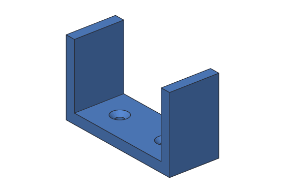
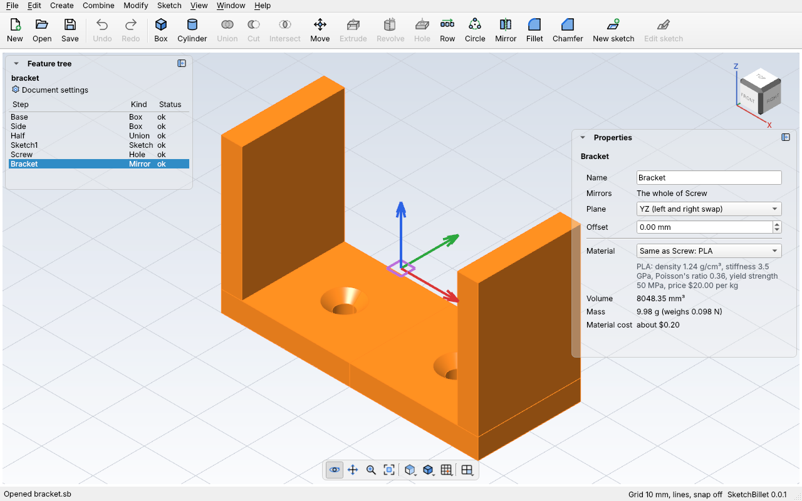

# Mirror

**Mirror** makes a mirror image of something across a plane, as if a mirror
stood there. Many parts are the same on both sides: model half, mirror it, and
the halves always match. Change the half, and the mirror image changes too.



A mirror can reflect:

- **A whole body:** the body and its mirror image join into one body. If they
  touch (half a part, mirrored across its cut side), they make one solid; if they
  don't, they're two pieces of one body.
- **What steps did:** a [Hole](holes.md)'s holes, or an [Extrude](extrude.md) or
  [Revolve](revolve.md) that joins or cuts. A hole on the right gets its match on
  the left, in the same body.

And it reflects across:

- **A plane through the design's middle:** **YZ** faces x, so left and right swap;
  **XZ** faces y, so front and back swap; **XY** faces z, so top and bottom swap.
  **Offset** moves the plane along the way it faces, like to the end of a part.
- **A flat face of the body,** like the cut side of half a part.

## In the desktop app

1. Model half the part, on one side of the plane. The easy way: start it at
   x = 0, so the YZ plane is its cut side.
2. Pick the body (or the steps to mirror, like a hole) in the feature tree.
3. Click **Mirror** on the toolbar, or **Create > Mirror**. It mirrors across YZ.
4. Pick Mirror1 to change it in **Properties**:



| Setting | What it does |
| --- | --- |
| **Mirrors** | What it reflects: "The whole of" a body, or the steps (and the body they're on). |
| **Plane** | **YZ** (left and right swap), **XZ** (front and back) or **XY** (top and bottom). A mirror across a face, made with `sketchbillet_cli`, shows **A face of the body**. |
| **Offset** | How far the plane is from 0, in mm, along the way it faces. |

Each change is one undo step.

## Example with sketchbillet_cli

Half a plate, from x = 0 to 20 mm, mirrored across the YZ plane, makes the whole
plate, 40 mm long:

<!-- cli-example -->
```console
$ sketchbillet_cli run --save half.sb feature.add_box size=20,10,5
half: 1 step
  Box1         ok  volume 1000.00 mm^3  mass 1.24 g (PLA)
wrote half.sb
$ sketchbillet_cli run --open half.sb --save half.sb feature.add_mirror body=Box1
half: 2 steps
  Box1         ok  volume 1000.00 mm^3
  Mirror1      ok  volume 2000.00 mm^3  mass 2.48 g (PLA)
wrote half.sb
```

Twice the half's 1000 mm³. Make the half taller, and the whole plate follows:

<!-- cli-example -->
```console
$ sketchbillet_cli run --open half.sb feature.set_value feature=Box1 setting=size_z value=8
half: 2 steps
  Box1         ok  volume 1600.00 mm^3
  Mirror1      ok  volume 3200.00 mm^3  mass 3.97 g (PLA)
```

See [`feature.add_mirror`](../cli/commands.md#featureadd_mirror) for every
setting, including mirroring across a face, and [Tutorial 7](../tutorials/07-u-bracket.md)
for a bracket made this way.

## Tips

- Each face of the mirror image is named for the face it reflects: "mirror image
  (Mirror1) of wall of Hole1 at Point1".
- A mirror image of a cut that lands off the body cuts nothing, and the step says
  so: check the plane and its offset.
- To make a left-hand and a right-hand part as separate bodies, that's for a
  later version: today a mirror joins the image to the body.
