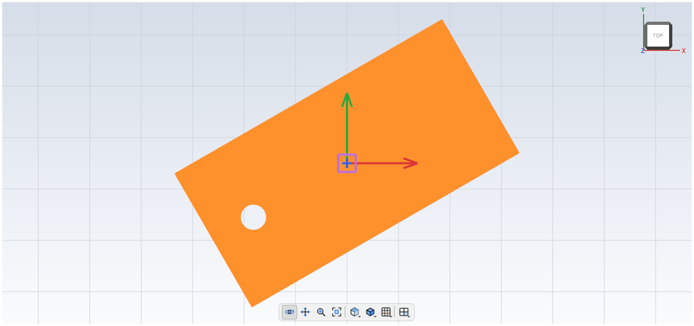
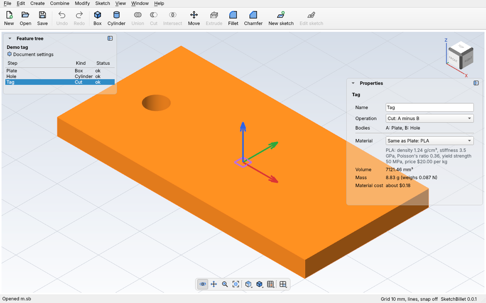
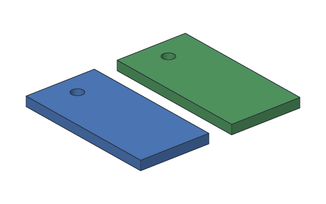

# Moving bodies

A **Move** step slides a body to a new place, turns it, or both. The body keeps
its size and shape. Like a Boolean, a Move uses up the body it moves: the moved
body is the one that's finished, and the original isn't drawn or exported any more.
A [linked copy](#linked-copies) is a Move that keeps the original too.



## Example

Slide the [demo tag](../cli/demo.md) 40 mm along y:

<!-- cli-example -->
```console
$ sketchbillet_cli demo tag.sb
wrote tag.sb
$ sketchbillet_cli run --open tag.sb --save tag.sb feature.add_move body=Tag by=0,40,0
Demo tag: 4 steps
  Plate        ok  volume 7200.00 mm^3
  Hole         ok  volume 117.81 mm^3
  Tag          ok  volume 7121.46 mm^3
  Move1        ok  volume 7121.46 mm^3  mass 8.83 g (PLA)
wrote tag.sb
```

The volume stays 7121.46 mm³: moving never changes a body's size.

## Turning

A Move can also turn the body, before sliding it. Three numbers say how:

| Setting | In Properties | Meaning |
| --- | --- | --- |
| `turn` | Turn | How far to turn, in degrees. Positive turns counterclockwise, looking down the axis (from its tip back toward the center) |
| `axis` | Axis | The direction of the line it turns about. `0,0,1` (the default) is straight up, so the body spins flat on the table |
| `about` | Center (mm) | A point on that line. Pick the middle of the body to turn it in place |

Turn the tag 30° about its middle (it's 60 × 30 mm, so its middle is at 30, 15):

<!-- cli-example -->
```console
$ sketchbillet_cli demo tag.sb
wrote tag.sb
$ sketchbillet_cli run --open tag.sb --save tag.sb feature.add_move body=Tag turn=30 about=30,15,0
Demo tag: 4 steps
  Plate        ok  volume 7200.00 mm^3
  Hole         ok  volume 117.81 mm^3
  Tag          ok  volume 7121.46 mm^3
  Move1        ok  volume 7121.46 mm^3  mass 8.83 g (PLA)
wrote tag.sb
```

## Dragging a body

The quickest way to move a body is to drag it. Click a body in the 3D viewer to
pick it: three arrows and a small square appear in its middle.



| Drag | And the body |
| --- | --- |
| The **red** arrow | slides along x (left and right) |
| The **green** arrow | slides along y (back and forth) |
| The **blue** arrow | slides along z (up and down) |
| The **purple** square | slides flat along the ground, in x and y at once |

The arrow under the mouse turns yellow, so you can see which one you'll grab.
Arrows are drawn over the body, so you can always grab them, even from inside.
The body moves as you drag, in steps of 1 mm (0.1 in in a design shown in
inches or feet), and the whole drag is one step of Edit > Undo. Press **Escape**
before you let go to put it back.

What a drag changes depends on the body:

- A **box** or **cylinder** gets a new corner or base, as if you'd typed it in
  Properties. A number that came from a [formula](parameters.md) is typed over.
- A **Move** step slides further.
- Any other body (an extrude, a union, a cut) gets a new **Move** step at the end
  of the design, which is then picked; dragging again moves that same step.

A body that a later step uses can't be dragged on its own (dragging the Hole out
of the Tag would leave the Tag behind): drag the finished body instead. You can
do the same from `sketchbillet_cli` with [`feature.slide`](../cli/commands.md#featureslide).
The arrows are a plugin too, `sb.movehandles`, built into SketchBillet; a plugin of your
own can put [handles](../plugin-guide/extension-points.md#handles-to-drag-desktop-app-only)
in the viewer the same way.

## Moving by numbers in the desktop app

1. Pick a step in the feature tree.
2. **Modify > Move** (Ctrl+M), or the **Move** button. A `Move1` step is added and
   picked; it doesn't move anything yet.
3. In Properties, type how far in **Move (mm)**, and how far to **Turn**.

Change the numbers whenever you like: the design rebuilds, and Edit > Undo takes
a change back.

## Linked copies

A **linked copy** keeps the original where it is and adds a moved copy of it.
The copy follows the original: change the original, and the copy changes too.
Use it for parts that need two of the same piece, like the two sides of a
shelf or a left and a right foot.



Make a linked copy of the [demo tag](../cli/demo.md), 40 mm along y, then make the
tag's plate 70 mm long instead of 60 mm. The copy grows too:

<!-- cli-example -->
```console
$ sketchbillet_cli demo tag.sb
wrote tag.sb
$ sketchbillet_cli run --open tag.sb --save tag.sb feature.add_move body=Tag by=0,40,0 copy=true
Demo tag: 4 steps
  Plate        ok  volume 7200.00 mm^3
  Hole         ok  volume 117.81 mm^3
  Tag          ok  volume 7121.46 mm^3  mass 8.83 g (PLA)
  Copy1        ok  volume 7121.46 mm^3  mass 8.83 g (PLA)
wrote tag.sb
$ sketchbillet_cli run --open tag.sb --save tag.sb feature.set_value feature=Plate setting=size_x value=70
Demo tag: 4 steps
  Plate        ok  volume 8400.00 mm^3
  Hole         ok  volume 117.81 mm^3
  Tag          ok  volume 8321.46 mm^3  mass 10.32 g (PLA)
  Copy1        ok  volume 8321.46 mm^3  mass 10.32 g (PLA)
wrote tag.sb
```

Both bodies are finished, so both are drawn, exported and printed. In the desktop
app:

1. Pick a step in the feature tree.
2. **Modify > Linked Copy** (Ctrl+Shift+M). A `Copy1` step is added 20 mm along x
   from the original, and picked. The feature tree calls it a **Linked copy**.
3. In Properties, type where it goes in **Move (mm)** and **Turn**, like any Move.

The copy is a Move step with **Keep the original (linked copy)** ticked in
Properties. Untick it, and it's a plain Move that uses the original up.

Things to know:

- The copy is placed from where the original is. Drag a box or cylinder
  original, and the copy goes with it. A body that can only be moved by adding a
  new Move step (an extrude, a union, a cut) can't be dragged while it has a
  linked copy, since the copy would stay behind: move the steps it's made from
  instead.
- The copy has faces of its own: sketch on them, or cut a hole in the copy, and
  the original doesn't change.
- To join the two into one body, [combine](combining.md) them with a union.
- For a row or a ring of copies, use a [pattern](patterns.md).

### Unlinking a copy

Want the copy to be different after all, like a shorter left foot? **Unlink**
it. It stays where it is and looks the same, but it stops following the original.
It gets its own copies of the steps that make the original, to change on their
own: like [Duplicate](../cli/commands.md#featureduplicate), they're named with the
next free number. Holes and sketches already on the copy stay where they are.

Unlink the copy from above. It gets its own `Plate1`, `Hole1` and `Tag1`. Then
make the copy's plate 50 mm long: the original stays 70 mm long.

<!-- cli-example -->
```console
$ sketchbillet_cli run --open tag.sb --save tag.sb feature.unlink feature=Copy1
Demo tag: 7 steps
  Plate        ok  volume 8400.00 mm^3
  Hole         ok  volume 117.81 mm^3
  Tag          ok  volume 8321.46 mm^3  mass 10.32 g (PLA)
  Plate1       ok  volume 8400.00 mm^3
  Hole1        ok  volume 117.81 mm^3
  Tag1         ok  volume 8321.46 mm^3
  Copy1        ok  volume 8321.46 mm^3  mass 10.32 g (PLA)
wrote tag.sb
$ sketchbillet_cli run --open tag.sb feature.set_value feature=Plate1 setting=size_x value=50
Demo tag: 7 steps
  Plate        ok  volume 8400.00 mm^3
  Hole         ok  volume 117.81 mm^3
  Tag          ok  volume 8321.46 mm^3  mass 10.32 g (PLA)
  Plate1       ok  volume 6000.00 mm^3
  Hole1        ok  volume 117.81 mm^3
  Tag1         ok  volume 5921.46 mm^3
  Copy1        ok  volume 5921.46 mm^3  mass 7.34 g (PLA)
```

In the desktop app, pick the linked copy in the feature tree, then **Modify >
Unlink Copy**. **Edit > Undo** links it again.

Unlinking isn't the same as unticking **Keep the original (linked copy)**: that
moves the original itself, so there's only one body left. Unlinking keeps both.

## Tips

- A Move of a step that's turned off is `blocked`, like any step that uses it.
- The moved body is made of what the original is made of, unless you pick a
  material for the Move step.
- To keep the original and move a copy, make a [linked copy](#linked-copies).
  To make a copy that doesn't follow the original, duplicate it first
  (Edit > Duplicate step), then move the duplicate.
- Turning about an axis of `0,0,0` doesn't work: there's no line to turn about.
  Give the axis a direction, like `0,0,1`.
