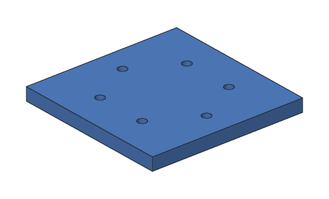
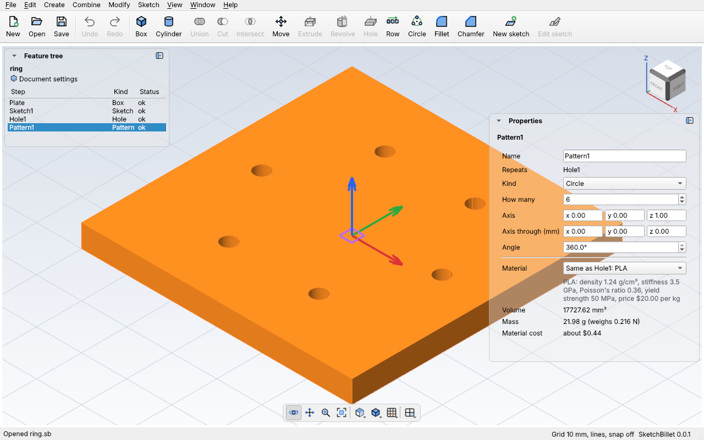

# Patterns

A **pattern** repeats something in a row, a grid or round a circle: one bolt
hole becomes a ring of six, one peg a row of pegs, one slot a grille. You make
the first one; the pattern makes the rest.



A pattern can repeat:

- **What steps did:** a [Hole](holes.md)'s holes, or an [Extrude](extrude.md) or
  [Revolve](revolve.md) that joins or cuts. The copies are made on the same body,
  joining or cutting just like the step did. Change the step (make the hole
  bigger, say) and every copy changes too.
- **A whole body:** copies of it, which make one body together. Copies that touch
  join into one piece; copies that don't touch stay separate pieces of that body.

And it can go:

- **In a row (linear):** **How many**, the **Direction** they go (x, y and z, like
  1, 0, 0 for along x), and the **Spacing** between them. Give **Rows** more than 1
  for a grid: the rows go along a second direction, **Row spacing** apart.
- **Round a circle (circular):** **How many**, round an **Axis** (a direction, like
  0, 0, 1 for up) through a point. With an **Angle** of 360° they're spread evenly
  all the way round; less, and they spread over that angle, the last one at its
  end.

The first copy is always the original, where it is.

## In the desktop app

1. Make the first one: a hole, a peg (an extrude that joins), a slot (an extrude
   that cuts), or a body.
2. Pick it in the feature tree (Ctrl-click to pick several steps, like a hole and
   a slot, to repeat both).
3. Click **Row** (**Create > Linear pattern**) or **Circle** (**Create > Circular
   pattern**) on the toolbar. A row starts as 3 along x, 10 mm apart; a circle as 6
   round the z axis.
4. Pick the pattern and change it in **Properties**:



| Setting | What it does |
| --- | --- |
| **Repeats** | What it copies: the steps (and the body it changes, when that's a later one), or "Copies of" a body. |
| **Kind** | **Row (or grid)** or **Circle**. |
| **How many** | How many in the row or round the circle, the first one included. |
| **Direction**, **Spacing** | For a row: which way, and how far apart (mm). |
| **Rows**, **Rows go**, **Row spacing** | For a grid: how many rows, which way they go, and how far apart. |
| **Axis**, **Axis through**, **Angle** | For a circle: the axis's direction, a point it goes through (mm), and the angle they spread over. |

Each change is one undo step. To go the other way along a row, point the
direction backwards, like −1, 0, 0.

## Example with sketchbillet_cli

A ring of six M3 bolt holes in a 60 × 60 × 5 mm plate. The plate is centered on
the z axis, so the ring goes round it; the first hole is 20 mm out:

<!-- cli-example -->
```console
$ sketchbillet_cli run --save ring.sb feature.add_box corner=-30,-30,0 size=60,60,5 name=Plate
ring: 1 step
  Plate        ok  volume 18000.00 mm^3  mass 22.32 g (PLA)
wrote ring.sb
$ sketchbillet_cli run --open ring.sb --save ring.sb feature.add_sketch body=Plate face=6
ring: 2 steps
  Plate        ok  volume 18000.00 mm^3  mass 22.32 g (PLA)
  Sketch1      ok  empty
wrote ring.sb
$ sketchbillet_cli run --open ring.sb --save ring.sb sketch.add_point sketch=Sketch1 at=20,0
ring: 2 steps
  Plate        ok  volume 18000.00 mm^3  mass 22.32 g (PLA)
  Sketch1      ok  1 point, 0 constraints, free to move 2 ways
wrote ring.sb
$ sketchbillet_cli run --open ring.sb --save ring.sb feature.add_hole sketch=Sketch1
ring: 3 steps
  Plate        ok  volume 18000.00 mm^3
  Sketch1      ok  1 point, 0 constraints, free to move 2 ways
  Hole1        ok  volume 17954.60 mm^3  mass 22.26 g (PLA)
wrote ring.sb
$ sketchbillet_cli run --open ring.sb --save ring.sb feature.add_pattern steps=Hole1 kind=circular
ring: 4 steps
  Plate        ok  volume 18000.00 mm^3
  Sketch1      ok  1 point, 0 constraints, free to move 2 ways
  Hole1        ok  volume 17954.60 mm^3
  Pattern1     ok  volume 17727.62 mm^3  mass 21.98 g (PLA)
wrote ring.sb
```

Check it: each 3.4 mm hole through 5 mm is π × 1.7² × 5 = 45.40 mm³, and there
are six: 18000 − 272.38 = 17727.62 mm³.

Each copy's faces are named for the copy, so a later step can tell them apart:
"copy 3 (Pattern1) of wall of Hole1 at Point1" is the third hole's wall.

Make them M4 holes, and eight of them: change the hole, and the pattern follows.

<!-- cli-example -->
```console
$ sketchbillet_cli run --open ring.sb --save ring.sb feature.set_value feature=Hole1 setting=diameter value=4.5
ring: 4 steps
  Plate        ok  volume 18000.00 mm^3
  Sketch1      ok  1 point, 0 constraints, free to move 2 ways
  Hole1        ok  volume 17920.48 mm^3
  Pattern1     ok  volume 17522.87 mm^3  mass 21.73 g (PLA)
wrote ring.sb
$ sketchbillet_cli run --open ring.sb --save ring.sb feature.set_value feature=Pattern1 setting=count value=8
ring: 4 steps
  Plate        ok  volume 18000.00 mm^3
  Sketch1      ok  1 point, 0 constraints, free to move 2 ways
  Hole1        ok  volume 17920.48 mm^3
  Pattern1     ok  volume 17363.83 mm^3  mass 21.53 g (PLA)
wrote ring.sb
```

See [`feature.add_pattern`](../cli/commands.md#featureadd_pattern) for every
setting, and [Tutorial 6](../tutorials/06-fan-cover.md) for a part with a ring and
a grid.

## Tips

- Put the part's middle on the axis for a circular pattern: a box from −30 to 30
  is centered on the z axis. Or set **Axis through** to the middle.
- A copy that misses the body cuts nothing, and the pattern says which:
  "Pattern1's copy 3 isn't on the body, so it cut nothing. Check the spacing and
  direction."
- A pattern makes up to 200 copies. For more, pattern a pattern.
- To pattern a sketch's shapes, pattern the extrude or revolve made from it, with
  its operation set to join or cut.
