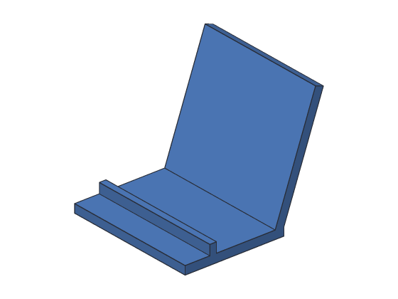
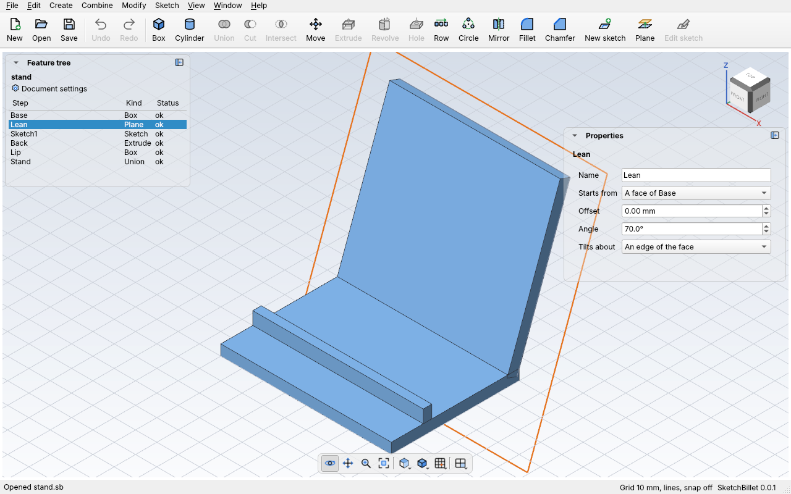

# Construction planes

A **construction plane** is a plane to sketch on where there's no face: 20 mm above
the ground, halfway up a part, or tilted at 70° for the back of a phone stand.
It isn't a body, and it doesn't print; it's a place to draw.



A plane starts from:

- **A base plane:** XY (the ground), XZ (facing the front) or YZ (facing the
  right).
- **A flat face** of a body. The plane moves with the face: make the body taller,
  and a plane on its top goes up too.
- **Another construction plane.**

Then it can **tilt** (Angle) about a hinge line, and **move** (Offset) along the
way it faces. The hinge is the starting plane's x or y direction, or, for a plane
from a face, one of the face's straight edges, like the cover of a book folding
open along its spine.

## In the desktop app

1. Pick what the plane starts from: a flat face (with **Edit > Pick faces** on),
   a construction plane in the feature tree, or nothing for the ground.
2. Click **Plane** on the toolbar (**Sketch > New plane**). It's 10 mm off the
   face or plane you picked, or 20 mm above the ground. It's drawn as an outlined
   square with its name; the picked one is orange.
3. Change it in **Properties**:



| Setting | What it does |
| --- | --- |
| **Starts from** | XY, XZ or YZ, which you can change here; or the face or plane it was made from. |
| **Offset** | How far it's moved along the way it faces, in mm. Below 0 moves it the other way. |
| **Angle** | How far it's tilted about its hinge, in degrees. Below 0 tilts it the other way. |
| **Tilts about** | Its x or y direction, through its 0, 0; or an edge of the face (set with `sketchbillet_cli`). |

4. With the plane picked, click **New sketch**: the sketch goes on the plane, and
   moves with it.

## Example with sketchbillet_cli

A 10 mm square block standing on a plane 20 mm above the ground:

<!-- cli-example -->
```console
$ sketchbillet_cli run --save plane.sb feature.add_plane offset=20
plane: 1 step
  Plane1       ok  plane through 0.00,0.00,20.00 mm, facing 0.00,0.00,1.00
wrote plane.sb
$ sketchbillet_cli run --open plane.sb --save plane.sb feature.add_sketch on=Plane1
plane: 2 steps
  Plane1       ok  plane through 0.00,0.00,20.00 mm, facing 0.00,0.00,1.00
  Sketch1      ok  empty
wrote plane.sb
$ sketchbillet_cli run --open plane.sb --save plane.sb sketch.add_rectangle sketch=Sketch1 from=0,0 to=10,10
plane: 2 steps
  Plane1       ok  plane through 0.00,0.00,20.00 mm, facing 0.00,0.00,1.00
  Sketch1      ok  4 lines, 8 constraints, free to move 4 ways
wrote plane.sb
$ sketchbillet_cli run --open plane.sb --save plane.sb feature.add_extrude sketch=Sketch1 distance=5
plane: 3 steps
  Plane1       ok  plane through 0.00,0.00,20.00 mm, facing 0.00,0.00,1.00
  Sketch1      ok  4 lines, 8 constraints, free to move 4 ways
  Extrude1     ok  volume 500.00 mm^3  mass 0.62 g (PLA)
wrote plane.sb
```

The plane's line says where it goes through and which way it faces. Move it
down to 8 mm, and the block follows:

<!-- cli-example -->
```console
$ sketchbillet_cli run --open plane.sb feature.set_value feature=Plane1 setting=offset value=8
plane: 3 steps
  Plane1       ok  plane through 0.00,0.00,8.00 mm, facing 0.00,0.00,1.00
  Sketch1      ok  4 lines, 8 constraints, free to move 4 ways
  Extrude1     ok  volume 500.00 mm^3  mass 0.62 g (PLA)
```

See [`feature.add_plane`](../cli/commands.md#featureadd_plane) for every setting,
and [Tutorial 8](../tutorials/08-phone-stand.md) for a plane tilted about an edge.

## Where a sketch's 0, 0 is

A sketch on a plane has its 0, 0 where the plane's 0, 0 is:

- **From a base plane:** at the design's 0, 0, 0, moved with the plane.
- **From a face:** at the point of the face's plane closest to the design's 0, 0, 0
  (for a box's top, straight above the design's 0, 0).
- **Tilted about an edge:** the sketch is the face, folded along the edge. A point
  on the face keeps its sketch position: if the back edge is at y = 60 on the face,
  it's at y = 60 on the plane, and what you draw past it folds up with the plane.

## Tips

- Turn a plane the other way with a negative angle.
- A sketch on a plane makes a new body when you extrude it. To add it to a body,
  set the extrude's **Operation** to **Join** and pick the body.
- If a plane's face goes away (an earlier change took it), the plane stops with
  a message, and so do the sketches on it.
