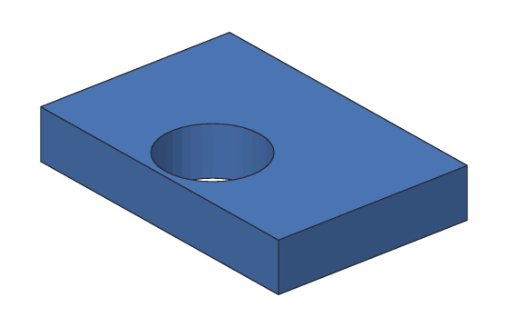

# Getting ready to print

Before you send a part to your 3D printer, **check it**. SketchBillet looks for the
two things that most often spoil a print:

- **Gaps in the surface.** A slicer needs the part's surface to be closed all
  round, like a balloon, so it can tell what's inside. A surface with gaps can
  slice wrong, or not at all.
- **Thin walls.** A printer lays plastic down in lines about as wide as its
  nozzle, usually 0.4 mm. A wall thinner than two lines, 0.8 mm, comes out weak,
  full of holes, or not at all.

In the desktop app, pick **File > Check for Printing...** (Ctrl+Shift+P). With
`sketchbillet_cli`, use [`sketchbillet_cli check`](../cli/check.md). Both check
the same shape that **File > Export** writes: the step you picked, or the
design's one finished body.

## An example

This holder has a 10 mm hole for a pen, but the hole is too close to the front:
the wall in front of it is only about 0.6 mm thick.



<!-- cli-example -->
```console
$ sketchbillet_cli run --save holder.sb feature.add_box size=30,20,5 name=Block
holder: 1 step
  Block        ok  volume 3000.00 mm^3  mass 3.72 g (PLA)
wrote holder.sb
$ sketchbillet_cli run --open holder.sb --save holder.sb feature.add_cylinder radius=5 height=9 base=15,5.6,-2 name=Pen
holder: 2 steps
  Block        ok  volume 3000.00 mm^3  mass 3.72 g (PLA)
  Pen          ok  volume 706.86 mm^3  mass 0.88 g (PLA)
wrote holder.sb
$ sketchbillet_cli run --open holder.sb --save holder.sb feature.add_boolean operation=cut a=Block b=Pen name=Holder
holder: 3 steps
  Block        ok  volume 3000.00 mm^3
  Pen          ok  volume 706.86 mm^3
  Holder       ok  volume 2607.30 mm^3  mass 3.23 g (PLA)
wrote holder.sb
```

The check finds it, and says where it is:

<!-- cli-example exit=1 -->
```console
$ sketchbillet_cli check holder.sb
warning [print.thin]: Holder has walls thinner than 0.8 mm: the thinnest is 0.63 mm thick, near x 14.71, y 0.63, z 1.67 mm. Most printers can't print walls that thin well, so they may come out weak, with holes, or not at all. Make them at least 0.8 mm thick.
```

Move the hole back to the middle, 10 mm from the front, and check again:

<!-- cli-example -->
```console
$ sketchbillet_cli run --open holder.sb --save holder.sb feature.set_value feature=Pen setting=base_y value=10
holder: 3 steps
  Block        ok  volume 3000.00 mm^3
  Pen          ok  volume 706.86 mm^3
  Holder       ok  volume 2607.30 mm^3  mass 3.23 g (PLA)
wrote holder.sb
$ sketchbillet_cli check holder.sb
Holder is ready to print: its surface is closed all round, and its thinnest wall is 5 mm (0.8 mm or more prints well).
```

## Thin walls

The check measures how thick the part is everywhere, straight in from the
surface, and tells you the thinnest wall and where it is. To fix a thin wall:

- Move a hole or a pocket further from the edge, or make it smaller.
- Make the part thicker: change the sketch's dimension or the extrude's distance.
- Use a thicker [shell](shell.md) wall: 1.2 mm or more is a good start.

If your printer prints finer lines, tell the check: `--min-wall 0.5` for a
0.25 mm nozzle. Don't go below your printer's nozzle size.

## Gaps in the surface

Parts made from solid steps (boxes, extrudes, revolves, holes) are always closed.
A gap usually means two bodies only touch along an edge, or at a single point:
then the slicer can't tell if they're one piece or two. Move them so they overlap
by at least 0.1 mm, and join them with a [union](combining.md#union).

## Tips

- Check before every export: it takes a second.
- The check uses the same triangles as STL and 3MF export, 0.05 mm from the true
  surface, so a curved wall can measure a few hundredths of a millimeter thinner
  than its dimension.
- A wall's thinnest spot is often next to a hole, a pocket, or a rounded edge.
- The check doesn't know how your part sits on the bed. Overhangs and supports
  are your slicer's job.
