<!-- Made by tools/reference/check_parts.py from tests/reference/. Don't edit: change the
     parts' files, then run: python3 tools/reference/check_parts.py --gallery docs/user-guide/reference-parts.md --write -->

# Reference parts

Twenty real parts, modeled with SketchBillet: brackets, enclosures, knobs and mounts. Each
one is built from sketches with dimensions, so you can change a dimension and the
whole part follows. They're also SketchBillet's own test: every change to
SketchBillet builds all twenty, checks every volume against a hand calculation,
changes the dimension listed under each, and checks them all again.

To look inside one, open it in the desktop app: **File > Open Sample**, then
its group and its name. It opens as a new design, so try the change listed under
it in Properties, or make it your own and save it wherever you like.

To build one with `sketchbillet_cli`, run its commands one after the other, in a
folder of your own. The first one makes `part.sb`; the others open it, change it
and save it.

## Brackets

### L bracket

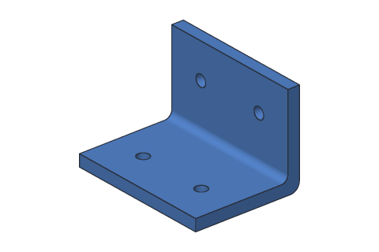

A 60 mm wide angle bracket with two screw holes in each leg, and its bend rounded inside and out so it doesn't crack there. The upright is sketched on the base's back face, so it moves when the base gets deeper.

**Uses:** sketch, dimensions, extrude, sketch on a face, join, fillet, holes. **Try:** make the base 55 mm deep instead of 40 mm (BaseSketch's Depth): the upright, its holes and both roundings move back with it.

```console
$ sketchbillet_cli run --save part.sb feature.add_sketch plane=xy name=BaseSketch
$ sketchbillet_cli run --open part.sb --save part.sb sketch.add_rectangle sketch=BaseSketch from=0,0 to=60,40
$ sketchbillet_cli run --open part.sb --save part.sb sketch.constrain sketch=BaseSketch kind=fix on=Line1.start
$ sketchbillet_cli run --open part.sb --save part.sb sketch.constrain sketch=BaseSketch kind=length on=Line1 value=60 name=Width
$ sketchbillet_cli run --open part.sb --save part.sb sketch.constrain sketch=BaseSketch kind=length on=Line2 value=40 name=Depth
$ sketchbillet_cli run --open part.sb --save part.sb feature.add_extrude sketch=BaseSketch distance=5 name=Base
$ sketchbillet_cli run --open part.sb --save part.sb feature.add_sketch body=Base face=5 name=UpSketch
$ sketchbillet_cli run --open part.sb --save part.sb sketch.add_rectangle sketch=UpSketch from=-60,0 to=0,40
$ sketchbillet_cli run --open part.sb --save part.sb feature.add_extrude sketch=UpSketch distance=5 name=Upright
$ sketchbillet_cli run --open part.sb --save part.sb feature.add_fillet body=Upright edges=15 radius=3 name=Inside
$ sketchbillet_cli run --open part.sb --save part.sb feature.add_fillet body=Inside edges=7 radius=4 name=Outside
$ sketchbillet_cli run --open part.sb --save part.sb feature.add_sketch body=Outside face=7 name=BaseHoles
$ sketchbillet_cli run --open part.sb --save part.sb sketch.add_point sketch=BaseHoles at=15,15
$ sketchbillet_cli run --open part.sb --save part.sb sketch.add_point sketch=BaseHoles at=45,15
$ sketchbillet_cli run --open part.sb --save part.sb feature.add_hole sketch=BaseHoles diameter=5 name=BaseScrews
$ sketchbillet_cli run --open part.sb --save part.sb feature.add_sketch body=BaseScrews face=14 name=UpHoles
$ sketchbillet_cli run --open part.sb --save part.sb sketch.add_point sketch=UpHoles at=15,25
$ sketchbillet_cli run --open part.sb --save part.sb sketch.add_point sketch=UpHoles at=45,25
$ sketchbillet_cli run --open part.sb --save part.sb feature.add_hole sketch=UpHoles diameter=5 name=Bracket
```

Then, to make the change:

```console
$ sketchbillet_cli run --open part.sb --save part.sb sketch.set_value sketch=BaseSketch constraint=Depth value=55
```

### Shelf bracket

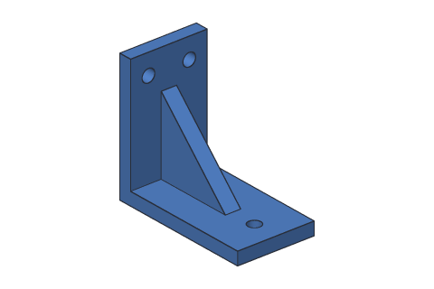

A bracket that holds up a shelf: a wall plate, a shelf arm, and a triangle gusset between them so the arm doesn't bend. The gusset is three lines joined at their ends, sketched standing up in the middle of the bracket and extruded both ways.

**Uses:** sketch, dimensions, lines joined into a shape, extrude both ways, sketch on a face, join, holes. **Try:** make the arm 70 mm long instead of 50 mm (ArmSketch's Length): the wall plate and gusset stay where they are.

```console
$ sketchbillet_cli run --save part.sb feature.add_sketch plane=xy name=ArmSketch
$ sketchbillet_cli run --open part.sb --save part.sb sketch.add_rectangle sketch=ArmSketch from=0,-15 to=50,15
$ sketchbillet_cli run --open part.sb --save part.sb sketch.constrain sketch=ArmSketch kind=fix on=Line1.start
$ sketchbillet_cli run --open part.sb --save part.sb sketch.constrain sketch=ArmSketch kind=length on=Line1 value=50 name=Length
$ sketchbillet_cli run --open part.sb --save part.sb sketch.constrain sketch=ArmSketch kind=length on=Line2 value=30 name=Width
$ sketchbillet_cli run --open part.sb --save part.sb feature.add_extrude sketch=ArmSketch distance=5 name=Arm
$ sketchbillet_cli run --open part.sb --save part.sb feature.add_sketch body=Arm face=3 name=WallSketch
$ sketchbillet_cli run --open part.sb --save part.sb sketch.add_rectangle sketch=WallSketch from=-15,0 to=15,50
$ sketchbillet_cli run --open part.sb --save part.sb feature.add_extrude sketch=WallSketch distance=5 name=Wall
$ sketchbillet_cli run --open part.sb --save part.sb feature.add_sketch plane=xz name=GussetSketch
$ sketchbillet_cli run --open part.sb --save part.sb sketch.add_line sketch=GussetSketch from=0,5 to=30,5
$ sketchbillet_cli run --open part.sb --save part.sb sketch.add_line sketch=GussetSketch from=30,5 to=0,35
$ sketchbillet_cli run --open part.sb --save part.sb sketch.add_line sketch=GussetSketch from=0,35 to=0,5
$ sketchbillet_cli run --open part.sb --save part.sb sketch.constrain sketch=GussetSketch kind=coincident on=Line1.end,Line2.start
$ sketchbillet_cli run --open part.sb --save part.sb sketch.constrain sketch=GussetSketch kind=coincident on=Line2.end,Line3.start
$ sketchbillet_cli run --open part.sb --save part.sb sketch.constrain sketch=GussetSketch kind=coincident on=Line3.end,Line1.start
$ sketchbillet_cli run --open part.sb --save part.sb feature.add_extrude sketch=GussetSketch distance=6 side=both operation=join body=Wall name=Gusset
$ sketchbillet_cli run --open part.sb --save part.sb feature.add_sketch body=Gusset face=11 name=WallHoles
$ sketchbillet_cli run --open part.sb --save part.sb sketch.add_point sketch=WallHoles at=-8,42
$ sketchbillet_cli run --open part.sb --save part.sb sketch.add_point sketch=WallHoles at=8,42
$ sketchbillet_cli run --open part.sb --save part.sb feature.add_hole sketch=WallHoles diameter=5 name=WallScrews
$ sketchbillet_cli run --open part.sb --save part.sb feature.add_sketch body=WallScrews face=6 name=ArmHole
$ sketchbillet_cli run --open part.sb --save part.sb sketch.add_point sketch=ArmHole at=40,0
$ sketchbillet_cli run --open part.sb --save part.sb feature.add_hole sketch=ArmHole diameter=5 name=Bracket
```

Then, to make the change:

```console
$ sketchbillet_cli run --open part.sb --save part.sb sketch.set_value sketch=ArmSketch constraint=Length value=70
```

### Pipe saddle

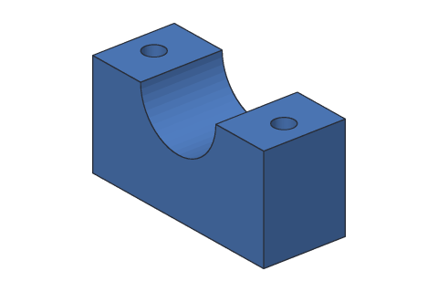

A block that holds a 22 mm pipe or rod on a wall or bench: a half-round channel cut across its top, and a screw hole through each side. The channel is a circle sketched on the front face, centered on the top edge, and cut back through the block.

**Uses:** sketch, dimensions, extrude, sketch on a face, cut, holes. **Try:** fit a 25 mm pipe: make the channel's radius 12.5 mm instead of 11 mm (ChannelSketch's Pipe). The screw holes stay in the flanges.

```console
$ sketchbillet_cli run --save part.sb feature.add_sketch plane=xy name=BlockSketch
$ sketchbillet_cli run --open part.sb --save part.sb sketch.add_rectangle sketch=BlockSketch from=0,0 to=50,20
$ sketchbillet_cli run --open part.sb --save part.sb sketch.constrain sketch=BlockSketch kind=fix on=Line1.start
$ sketchbillet_cli run --open part.sb --save part.sb sketch.constrain sketch=BlockSketch kind=length on=Line1 value=50 name=Width
$ sketchbillet_cli run --open part.sb --save part.sb sketch.constrain sketch=BlockSketch kind=length on=Line2 value=20 name=Depth
$ sketchbillet_cli run --open part.sb --save part.sb feature.add_extrude sketch=BlockSketch distance=25 name=Block
$ sketchbillet_cli run --open part.sb --save part.sb feature.add_sketch body=Block face=2 name=ChannelSketch
$ sketchbillet_cli run --open part.sb --save part.sb sketch.add_circle sketch=ChannelSketch center=25,25 radius=11
$ sketchbillet_cli run --open part.sb --save part.sb sketch.constrain sketch=ChannelSketch kind=radius on=Circle1 value=11 name=Pipe
$ sketchbillet_cli run --open part.sb --save part.sb feature.add_extrude sketch=ChannelSketch distance=20 operation=cut name=Channel
$ sketchbillet_cli run --open part.sb --save part.sb feature.add_sketch body=Channel face=7 name=HoleSketch
$ sketchbillet_cli run --open part.sb --save part.sb sketch.add_point sketch=HoleSketch at=6,10
$ sketchbillet_cli run --open part.sb --save part.sb sketch.add_point sketch=HoleSketch at=44,10
$ sketchbillet_cli run --open part.sb --save part.sb feature.add_hole sketch=HoleSketch diameter=5 name=Saddle
```

Then, to make the change:

```console
$ sketchbillet_cli run --open part.sb --save part.sb sketch.set_value sketch=ChannelSketch constraint=Pipe value=12.5
```

### Hinge leaf

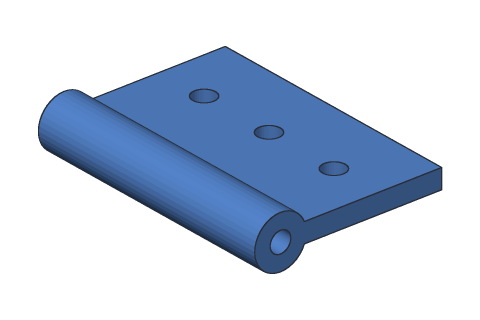

One half of a hinge: a plate with a round knuckle along its front edge, a hole down the knuckle for a 3 mm pin, and three screw holes made by repeating one hole with a pattern. Print two, turn one over, and push a pin through both knuckles.

**Uses:** sketch, dimensions, extrude, sketch on a face, join, cut, holes, pattern. **Try:** make the leaf 35 mm deep instead of 25 mm (PlateSketch's Depth): the knuckle stays on the front edge, and the holes stay where they are.

```console
$ sketchbillet_cli run --save part.sb feature.add_sketch plane=xy name=PlateSketch
$ sketchbillet_cli run --open part.sb --save part.sb sketch.add_rectangle sketch=PlateSketch from=0,0 to=40,25
$ sketchbillet_cli run --open part.sb --save part.sb sketch.constrain sketch=PlateSketch kind=fix on=Line1.start
$ sketchbillet_cli run --open part.sb --save part.sb sketch.constrain sketch=PlateSketch kind=length on=Line1 value=40 name=Length
$ sketchbillet_cli run --open part.sb --save part.sb sketch.constrain sketch=PlateSketch kind=length on=Line2 value=25 name=Depth
$ sketchbillet_cli run --open part.sb --save part.sb feature.add_extrude sketch=PlateSketch distance=3 name=Plate
$ sketchbillet_cli run --open part.sb --save part.sb feature.add_sketch body=Plate face=3 name=KnuckleSketch
$ sketchbillet_cli run --open part.sb --save part.sb sketch.add_circle sketch=KnuckleSketch center=0,1.5 radius=4
$ sketchbillet_cli run --open part.sb --save part.sb feature.add_extrude sketch=KnuckleSketch distance=40 side=flip name=Knuckle
$ sketchbillet_cli run --open part.sb --save part.sb feature.add_sketch body=Knuckle face=3 name=PinSketch
$ sketchbillet_cli run --open part.sb --save part.sb sketch.add_circle sketch=PinSketch center=0,1.5 radius=1.6
$ sketchbillet_cli run --open part.sb --save part.sb feature.add_extrude sketch=PinSketch distance=40 operation=cut name=PinHole
$ sketchbillet_cli run --open part.sb --save part.sb feature.add_sketch body=PinHole face=11 name=ScrewSketch
$ sketchbillet_cli run --open part.sb --save part.sb sketch.add_point sketch=ScrewSketch at=8,15
$ sketchbillet_cli run --open part.sb --save part.sb feature.add_hole sketch=ScrewSketch diameter=3.5 name=Screw
$ sketchbillet_cli run --open part.sb --save part.sb feature.add_pattern steps=Screw count=3 spacing=12 name=Leaf
```

Then, to make the change:

```console
$ sketchbillet_cli run --open part.sb --save part.sb sketch.set_value sketch=PlateSketch constraint=Depth value=35
```

### Flat corner brace

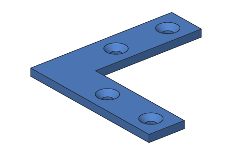

A flat L-shaped plate that holds the corner of a frame square, with four countersunk holes so the screw heads sit flush. The second strip is sketched on the first one's back face and extruded out from it.

**Uses:** sketch, dimensions, extrude, sketch on a face, join, countersunk holes. **Try:** make the long strip 80 mm instead of 60 mm (StripSketch's Length): the other strip and the holes stay put.

```console
$ sketchbillet_cli run --save part.sb feature.add_sketch plane=xy name=StripSketch
$ sketchbillet_cli run --open part.sb --save part.sb sketch.add_rectangle sketch=StripSketch from=0,0 to=60,15
$ sketchbillet_cli run --open part.sb --save part.sb sketch.constrain sketch=StripSketch kind=fix on=Line1.start
$ sketchbillet_cli run --open part.sb --save part.sb sketch.constrain sketch=StripSketch kind=length on=Line1 value=60 name=Length
$ sketchbillet_cli run --open part.sb --save part.sb sketch.constrain sketch=StripSketch kind=length on=Line2 value=15 name=Width
$ sketchbillet_cli run --open part.sb --save part.sb feature.add_extrude sketch=StripSketch distance=3 name=Strip
$ sketchbillet_cli run --open part.sb --save part.sb feature.add_sketch body=Strip face=5 name=ArmSketch
$ sketchbillet_cli run --open part.sb --save part.sb sketch.add_rectangle sketch=ArmSketch from=-15,0 to=0,3
$ sketchbillet_cli run --open part.sb --save part.sb feature.add_extrude sketch=ArmSketch distance=45 name=Arm
$ sketchbillet_cli run --open part.sb --save part.sb feature.add_sketch body=Arm face=10 name=HoleSketch
$ sketchbillet_cli run --open part.sb --save part.sb sketch.add_point sketch=HoleSketch at=30,7.5
$ sketchbillet_cli run --open part.sb --save part.sb sketch.add_point sketch=HoleSketch at=52,7.5
$ sketchbillet_cli run --open part.sb --save part.sb sketch.add_point sketch=HoleSketch at=7.5,30
$ sketchbillet_cli run --open part.sb --save part.sb sketch.add_point sketch=HoleSketch at=7.5,52
$ sketchbillet_cli run --open part.sb --save part.sb feature.add_hole sketch=HoleSketch kind=countersink diameter=4 countersink_diameter=8 name=Brace
```

Then, to make the change:

```console
$ sketchbillet_cli run --open part.sb --save part.sb sketch.set_value sketch=StripSketch constraint=Length value=80
```

## Enclosures

### Box with screw bosses

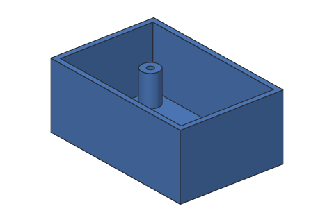

An electronics box with 2 mm walls and four bosses on its floor: posts with holes that self-tapping screws hold a circuit board on. One boss and one hole are drawn; a 2 by 2 pattern makes the other three of each.

**Uses:** sketch, dimensions, extrude, shell, sketch on a face, join, holes, grid pattern. **Try:** make the box 70 mm wide instead of 60 mm (CaseSketch's Width): the walls follow, and the bosses stay where they are on the floor.

```console
$ sketchbillet_cli run --save part.sb feature.add_sketch plane=xy name=CaseSketch
$ sketchbillet_cli run --open part.sb --save part.sb sketch.add_rectangle sketch=CaseSketch from=0,0 to=60,40
$ sketchbillet_cli run --open part.sb --save part.sb sketch.constrain sketch=CaseSketch kind=fix on=Line1.start
$ sketchbillet_cli run --open part.sb --save part.sb sketch.constrain sketch=CaseSketch kind=length on=Line1 value=60 name=Width
$ sketchbillet_cli run --open part.sb --save part.sb sketch.constrain sketch=CaseSketch kind=length on=Line2 value=40 name=Depth
$ sketchbillet_cli run --open part.sb --save part.sb feature.add_extrude sketch=CaseSketch distance=25 name=Case
$ sketchbillet_cli run --open part.sb --save part.sb feature.add_shell body=Case faces=6 thickness=2 name=Hollow
$ sketchbillet_cli run --open part.sb --save part.sb feature.add_sketch body=Hollow face=2 name=BossSketch
$ sketchbillet_cli run --open part.sb --save part.sb sketch.add_circle sketch=BossSketch center=8,8 radius=3.5
$ sketchbillet_cli run --open part.sb --save part.sb feature.add_extrude sketch=BossSketch distance=12 name=Boss
$ sketchbillet_cli run --open part.sb --save part.sb feature.add_pattern steps=Boss count=2 spacing=44 count2=2 spacing2=24 name=Bosses
$ sketchbillet_cli run --open part.sb --save part.sb feature.add_sketch body=Bosses face=15 name=PilotSketch
$ sketchbillet_cli run --open part.sb --save part.sb sketch.add_point sketch=PilotSketch at=8,8
$ sketchbillet_cli run --open part.sb --save part.sb feature.add_hole sketch=PilotSketch diameter=2.5 depth=10 name=Pilot
$ sketchbillet_cli run --open part.sb --save part.sb feature.add_pattern steps=Pilot count=2 spacing=44 count2=2 spacing2=24 name=Box
```

Then, to make the change:

```console
$ sketchbillet_cli run --open part.sb --save part.sb sketch.set_value sketch=CaseSketch constraint=Width value=70
```

### AA battery holder

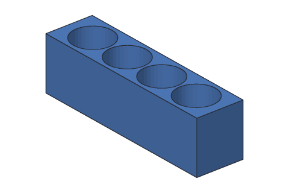

A block that holds four AA batteries standing up, in 15 mm round pockets, 15 mm deep. One pocket is drawn and cut; a pattern repeats it along the block every 16 mm.

**Uses:** sketch, dimensions, extrude, sketch on a face, cut, pattern. **Try:** make the pockets a little looser, 7.7 mm radius instead of 7.5 mm (PocketSketch's Fit): all four change, because the pattern repeats the pocket.

```console
$ sketchbillet_cli run --save part.sb feature.add_sketch plane=xy name=BlockSketch
$ sketchbillet_cli run --open part.sb --save part.sb sketch.add_rectangle sketch=BlockSketch from=0,0 to=70,18
$ sketchbillet_cli run --open part.sb --save part.sb sketch.constrain sketch=BlockSketch kind=fix on=Line1.start
$ sketchbillet_cli run --open part.sb --save part.sb sketch.constrain sketch=BlockSketch kind=length on=Line1 value=70 name=Length
$ sketchbillet_cli run --open part.sb --save part.sb sketch.constrain sketch=BlockSketch kind=length on=Line2 value=18 name=Depth
$ sketchbillet_cli run --open part.sb --save part.sb feature.add_extrude sketch=BlockSketch distance=20 name=Block
$ sketchbillet_cli run --open part.sb --save part.sb feature.add_sketch body=Block face=6 name=PocketSketch
$ sketchbillet_cli run --open part.sb --save part.sb sketch.add_circle sketch=PocketSketch center=11,9 radius=7.5
$ sketchbillet_cli run --open part.sb --save part.sb sketch.constrain sketch=PocketSketch kind=radius on=Circle1 value=7.5 name=Fit
$ sketchbillet_cli run --open part.sb --save part.sb feature.add_extrude sketch=PocketSketch distance=15 operation=cut name=Pocket
$ sketchbillet_cli run --open part.sb --save part.sb feature.add_pattern steps=Pocket count=4 spacing=16 name=Holder
```

Then, to make the change:

```console
$ sketchbillet_cli run --open part.sb --save part.sb sketch.set_value sketch=PocketSketch constraint=Fit value=7.7
```

### Pencil cup

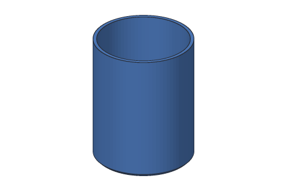

A round cup for pens and pencils: a cylinder shelled to 2.5 mm walls with its top open, and its bottom edge bevelled so it doesn't snag. The bevel goes on after the shell, on the outside only.

**Uses:** sketch, dimensions, extrude, shell, chamfer. **Try:** make it 80 mm across instead of 70 mm (CupSketch's Radius): the walls stay 2.5 mm, and the bevel follows the bottom edge.

```console
$ sketchbillet_cli run --save part.sb feature.add_sketch plane=xy name=CupSketch
$ sketchbillet_cli run --open part.sb --save part.sb sketch.add_circle sketch=CupSketch center=0,0 radius=35
$ sketchbillet_cli run --open part.sb --save part.sb sketch.constrain sketch=CupSketch kind=fix on=Circle1.center
$ sketchbillet_cli run --open part.sb --save part.sb sketch.constrain sketch=CupSketch kind=radius on=Circle1 value=35 name=Radius
$ sketchbillet_cli run --open part.sb --save part.sb feature.add_extrude sketch=CupSketch distance=90 name=Solid
$ sketchbillet_cli run --open part.sb --save part.sb feature.add_shell body=Solid faces=3 thickness=2.5 name=Cup
$ sketchbillet_cli run --open part.sb --save part.sb feature.add_chamfer body=Cup edges=1 distance=2 name=PencilCup
```

Then, to make the change:

```console
$ sketchbillet_cli run --open part.sb --save part.sb sketch.set_value sketch=CupSketch constraint=Radius value=40
```

### Divider tray

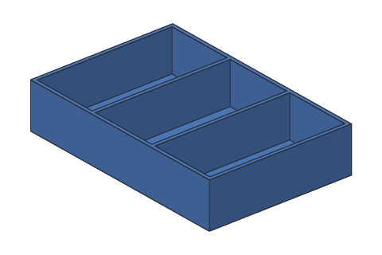

A desk tray split into three parts for screws, parts or stationery. It's a shelled box, then one divider drawn on the inside floor from wall to wall, as tall as the walls, and repeated with a pattern.

**Uses:** sketch, dimensions, extrude, shell, sketch on a face, join, pattern. **Try:** make the tray 150 mm wide instead of 120 mm (TraySketch's Width): the right-hand part gets bigger, and the dividers stay put.

```console
$ sketchbillet_cli run --save part.sb feature.add_sketch plane=xy name=TraySketch
$ sketchbillet_cli run --open part.sb --save part.sb sketch.add_rectangle sketch=TraySketch from=0,0 to=120,80
$ sketchbillet_cli run --open part.sb --save part.sb sketch.constrain sketch=TraySketch kind=fix on=Line1.start
$ sketchbillet_cli run --open part.sb --save part.sb sketch.constrain sketch=TraySketch kind=length on=Line1 value=120 name=Width
$ sketchbillet_cli run --open part.sb --save part.sb sketch.constrain sketch=TraySketch kind=length on=Line2 value=80 name=Depth
$ sketchbillet_cli run --open part.sb --save part.sb feature.add_extrude sketch=TraySketch distance=25 name=Block
$ sketchbillet_cli run --open part.sb --save part.sb feature.add_shell body=Block faces=6 thickness=2 name=Tray
$ sketchbillet_cli run --open part.sb --save part.sb feature.add_sketch body=Tray face=2 name=DividerSketch
$ sketchbillet_cli run --open part.sb --save part.sb sketch.add_rectangle sketch=DividerSketch from=39,2 to=41,78
$ sketchbillet_cli run --open part.sb --save part.sb feature.add_extrude sketch=DividerSketch distance=23 name=Divider
$ sketchbillet_cli run --open part.sb --save part.sb feature.add_pattern steps=Divider count=2 spacing=40 name=Dividers
```

Then, to make the change:

```console
$ sketchbillet_cli run --open part.sb --save part.sb sketch.set_value sketch=TraySketch constraint=Width value=150
```

### Card box

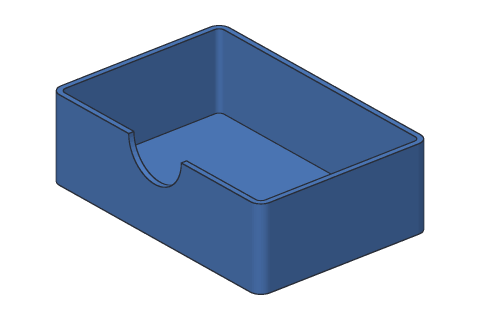

A box for a deck of playing cards, with rounded corners and a thumb notch in the front wall so you can pinch the cards out. The corners are rounded before the shell, so the inside corners come out round too; the notch is a circle on the front face, cut through the wall only.

**Uses:** sketch, dimensions, extrude, fillet, shell, sketch on a face, cut. **Try:** make the box 105 mm wide instead of 95 mm (BoxSketch's Width), for sleeved cards: the corners, walls and notch follow.

```console
$ sketchbillet_cli run --save part.sb feature.add_sketch plane=xy name=BoxSketch
$ sketchbillet_cli run --open part.sb --save part.sb sketch.add_rectangle sketch=BoxSketch from=0,0 to=95,65
$ sketchbillet_cli run --open part.sb --save part.sb sketch.constrain sketch=BoxSketch kind=fix on=Line1.start
$ sketchbillet_cli run --open part.sb --save part.sb sketch.constrain sketch=BoxSketch kind=length on=Line1 value=95 name=Width
$ sketchbillet_cli run --open part.sb --save part.sb sketch.constrain sketch=BoxSketch kind=length on=Line2 value=65 name=Depth
$ sketchbillet_cli run --open part.sb --save part.sb feature.add_extrude sketch=BoxSketch distance=30 name=Block
$ sketchbillet_cli run --open part.sb --save part.sb feature.add_fillet body=Block edges=5,6,7,8 radius=4 name=Corners
$ sketchbillet_cli run --open part.sb --save part.sb feature.add_shell body=Corners faces=10 thickness=2 name=Hollow
$ sketchbillet_cli run --open part.sb --save part.sb feature.add_sketch body=Hollow face=3 name=NotchSketch
$ sketchbillet_cli run --open part.sb --save part.sb sketch.add_circle sketch=NotchSketch center=47.5,30 radius=12
$ sketchbillet_cli run --open part.sb --save part.sb feature.add_extrude sketch=NotchSketch distance=2 operation=cut name=CardBox
```

Then, to make the change:

```console
$ sketchbillet_cli run --open part.sb --save part.sb sketch.set_value sketch=BoxSketch constraint=Width value=105
```

## Knobs

### D-shaft knob

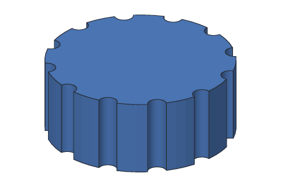

A 30 mm knob for a potentiometer or a motor's 6 mm D-shaft (a round shaft with one flat side). Twelve flutes round its rim give your fingers grip: one is cut, and a circular pattern repeats it. The D-shaped bore is a round hole with a flat added back into it, so the knob can't slip round on the shaft.

**Uses:** sketch, dimensions, extrude, sketch on a face, cut, circular pattern, join. **Try:** fit an 8 mm shaft: make the bore's radius 4 mm instead of 3 mm (BoreSketch's Bore). The flat stays 1.5 mm from the middle.

```console
$ sketchbillet_cli run --save part.sb feature.add_sketch plane=xy name=KnobSketch
$ sketchbillet_cli run --open part.sb --save part.sb sketch.add_circle sketch=KnobSketch center=0,0 radius=15
$ sketchbillet_cli run --open part.sb --save part.sb sketch.constrain sketch=KnobSketch kind=fix on=Circle1.center
$ sketchbillet_cli run --open part.sb --save part.sb sketch.constrain sketch=KnobSketch kind=radius on=Circle1 value=15 name=Radius
$ sketchbillet_cli run --open part.sb --save part.sb feature.add_extrude sketch=KnobSketch distance=12 name=Knob
$ sketchbillet_cli run --open part.sb --save part.sb feature.add_sketch body=Knob face=3 name=FluteSketch
$ sketchbillet_cli run --open part.sb --save part.sb sketch.add_circle sketch=FluteSketch center=15,0 radius=1.5
$ sketchbillet_cli run --open part.sb --save part.sb feature.add_extrude sketch=FluteSketch distance=12 operation=cut name=Flute
$ sketchbillet_cli run --open part.sb --save part.sb feature.add_pattern steps=Flute kind=circular count=12 name=Grip
$ sketchbillet_cli run --open part.sb --save part.sb feature.add_sketch body=Grip face=1 name=BoreSketch
$ sketchbillet_cli run --open part.sb --save part.sb sketch.add_circle sketch=BoreSketch center=0,0 radius=3
$ sketchbillet_cli run --open part.sb --save part.sb sketch.constrain sketch=BoreSketch kind=fix on=Circle1.center
$ sketchbillet_cli run --open part.sb --save part.sb sketch.constrain sketch=BoreSketch kind=radius on=Circle1 value=3 name=Bore
$ sketchbillet_cli run --open part.sb --save part.sb feature.add_extrude sketch=BoreSketch distance=10 operation=cut name=Bored
$ sketchbillet_cli run --open part.sb --save part.sb feature.add_sketch body=Bored face=1 name=FlatSketch
$ sketchbillet_cli run --open part.sb --save part.sb sketch.add_rectangle sketch=FlatSketch from=-4,1.5 to=4,5
$ sketchbillet_cli run --open part.sb --save part.sb feature.add_extrude sketch=FlatSketch distance=10 side=flip name=DKnob
```

Then, to make the change:

```console
$ sketchbillet_cli run --open part.sb --save part.sb sketch.set_value sketch=BoreSketch constraint=Bore value=4
```

### Star knob

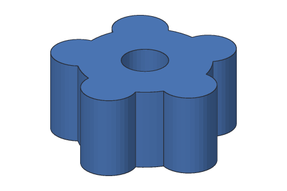

A clamping knob for an M8 bolt, like on a jig or a camera stand: a hub with five round lobes to turn it by. One lobe is joined on, and a circular pattern repeats it; the bolt hole goes through the middle.

**Uses:** sketch, dimensions, extrude, sketch on a face, join, circular pattern, holes. **Try:** make the lobes fatter, 6 mm radius instead of 5 mm (LobeSketch's Lobe): all five change, because the pattern repeats the one.

```console
$ sketchbillet_cli run --save part.sb feature.add_sketch plane=xy name=HubSketch
$ sketchbillet_cli run --open part.sb --save part.sb sketch.add_circle sketch=HubSketch center=0,0 radius=12
$ sketchbillet_cli run --open part.sb --save part.sb sketch.constrain sketch=HubSketch kind=fix on=Circle1.center
$ sketchbillet_cli run --open part.sb --save part.sb sketch.constrain sketch=HubSketch kind=radius on=Circle1 value=12 name=Hub
$ sketchbillet_cli run --open part.sb --save part.sb feature.add_extrude sketch=HubSketch distance=15 name=Core
$ sketchbillet_cli run --open part.sb --save part.sb feature.add_sketch body=Core face=1 name=LobeSketch
$ sketchbillet_cli run --open part.sb --save part.sb sketch.add_circle sketch=LobeSketch center=12,0 radius=5
$ sketchbillet_cli run --open part.sb --save part.sb sketch.constrain sketch=LobeSketch kind=radius on=Circle1 value=5 name=Lobe
$ sketchbillet_cli run --open part.sb --save part.sb feature.add_extrude sketch=LobeSketch distance=15 side=flip name=OneLobe
$ sketchbillet_cli run --open part.sb --save part.sb feature.add_pattern steps=OneLobe kind=circular count=5 name=Lobes
$ sketchbillet_cli run --open part.sb --save part.sb feature.add_sketch body=Lobes face=5 name=BoltSketch
$ sketchbillet_cli run --open part.sb --save part.sb sketch.add_point sketch=BoltSketch at=0,0
$ sketchbillet_cli run --open part.sb --save part.sb feature.add_hole sketch=BoltSketch diameter=8.4 name=StarKnob
```

Then, to make the change:

```console
$ sketchbillet_cli run --open part.sb --save part.sb sketch.set_value sketch=LobeSketch constraint=Lobe value=6
```

### Wing knob

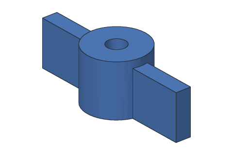

A wing knob for an M5 screw, turned by thumb and finger like a wing nut: a round hub, and one long wing drawn right across it and joined on. The wing is a little lower than the hub, so the hub stands up in the middle.

**Uses:** sketch, dimensions, extrude, join, holes. **Try:** make the wing 54 mm across instead of 44 mm (WingSketch's Span), for more turning force.

```console
$ sketchbillet_cli run --save part.sb feature.add_sketch plane=xy name=HubSketch
$ sketchbillet_cli run --open part.sb --save part.sb sketch.add_circle sketch=HubSketch center=0,0 radius=8
$ sketchbillet_cli run --open part.sb --save part.sb sketch.constrain sketch=HubSketch kind=fix on=Circle1.center
$ sketchbillet_cli run --open part.sb --save part.sb sketch.constrain sketch=HubSketch kind=radius on=Circle1 value=8 name=Hub
$ sketchbillet_cli run --open part.sb --save part.sb feature.add_extrude sketch=HubSketch distance=14 name=Core
$ sketchbillet_cli run --open part.sb --save part.sb feature.add_sketch plane=xy name=WingSketch
$ sketchbillet_cli run --open part.sb --save part.sb sketch.add_rectangle sketch=WingSketch from=-22,-2 to=22,2
$ sketchbillet_cli run --open part.sb --save part.sb sketch.constrain sketch=WingSketch kind=length on=Line1 value=44 name=Span
$ sketchbillet_cli run --open part.sb --save part.sb sketch.constrain sketch=WingSketch kind=length on=Line2 value=4 name=Thickness
$ sketchbillet_cli run --open part.sb --save part.sb feature.add_extrude sketch=WingSketch distance=12 operation=join body=Core name=Wings
$ sketchbillet_cli run --open part.sb --save part.sb feature.add_sketch body=Wings face=3 name=ScrewSketch
$ sketchbillet_cli run --open part.sb --save part.sb sketch.add_point sketch=ScrewSketch at=0,0
$ sketchbillet_cli run --open part.sb --save part.sb feature.add_hole sketch=ScrewSketch diameter=5 name=WingKnob
```

Then, to make the change:

```console
$ sketchbillet_cli run --open part.sb --save part.sb sketch.set_value sketch=WingSketch constraint=Span value=54
```

### Thumb wheel

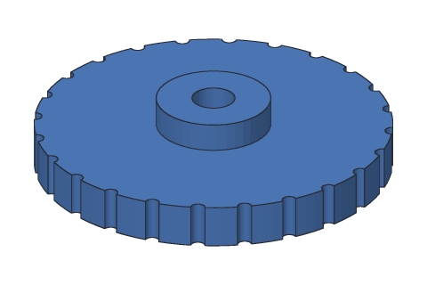

A 50 mm thumb wheel, like the focus wheel on a pair of binoculars: a ring and a raised hub, each a rectangle revolved round the middle, and a knurled rim from one small cut repeated 24 times round.

**Uses:** sketch, dimensions, revolve, join, sketch on a face, cut, circular pattern. **Try:** raise the hub to 7 mm instead of 4 mm (HubSketch's HubHeight): the revolve follows the rectangle.

```console
$ sketchbillet_cli run --save part.sb feature.add_sketch plane=xz name=WheelSketch
$ sketchbillet_cli run --open part.sb --save part.sb sketch.add_rectangle sketch=WheelSketch from=3,0 to=25,6
$ sketchbillet_cli run --open part.sb --save part.sb sketch.constrain sketch=WheelSketch kind=fix on=Line1.start
$ sketchbillet_cli run --open part.sb --save part.sb sketch.constrain sketch=WheelSketch kind=length on=Line1 value=22 name=Ring
$ sketchbillet_cli run --open part.sb --save part.sb sketch.constrain sketch=WheelSketch kind=length on=Line2 value=6 name=Thickness
$ sketchbillet_cli run --open part.sb --save part.sb feature.add_revolve sketch=WheelSketch axis=y name=Wheel
$ sketchbillet_cli run --open part.sb --save part.sb feature.add_sketch plane=xz name=HubSketch
$ sketchbillet_cli run --open part.sb --save part.sb sketch.add_rectangle sketch=HubSketch from=3,6 to=8,10
$ sketchbillet_cli run --open part.sb --save part.sb sketch.constrain sketch=HubSketch kind=fix on=Line1.start
$ sketchbillet_cli run --open part.sb --save part.sb sketch.constrain sketch=HubSketch kind=length on=Line1 value=5 name=HubWidth
$ sketchbillet_cli run --open part.sb --save part.sb sketch.constrain sketch=HubSketch kind=length on=Line2 value=4 name=HubHeight
$ sketchbillet_cli run --open part.sb --save part.sb feature.add_revolve sketch=HubSketch axis=y operation=join body=Wheel name=Hub
$ sketchbillet_cli run --open part.sb --save part.sb feature.add_sketch body=Hub face=1 name=KnurlSketch
$ sketchbillet_cli run --open part.sb --save part.sb sketch.add_circle sketch=KnurlSketch center=25,0 radius=1
$ sketchbillet_cli run --open part.sb --save part.sb feature.add_extrude sketch=KnurlSketch distance=6 operation=cut name=Notch
$ sketchbillet_cli run --open part.sb --save part.sb feature.add_pattern steps=Notch kind=circular count=24 name=ThumbWheel
```

Then, to make the change:

```console
$ sketchbillet_cli run --open part.sb --save part.sb sketch.set_value sketch=HubSketch constraint=HubHeight value=7
```

### Cabinet knob

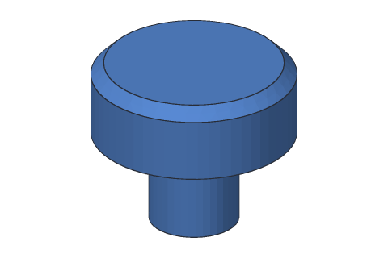

A round knob for a drawer or a cupboard door: a stem and a wider cap, each a rectangle revolved round the middle, a bevel round the cap's top edge so it's kind to fingers, and a hole up the stem for a 4 mm screw from inside the drawer.

**Uses:** sketch, dimensions, revolve, join, chamfer, sketch on a face, hole. **Try:** make the cap 40 mm across instead of 32 mm (CapSketch's CapRadius).

```console
$ sketchbillet_cli run --save part.sb feature.add_sketch plane=xz name=StemSketch
$ sketchbillet_cli run --open part.sb --save part.sb sketch.add_rectangle sketch=StemSketch from=0,0 to=7,15
$ sketchbillet_cli run --open part.sb --save part.sb sketch.constrain sketch=StemSketch kind=fix on=Line1.start
$ sketchbillet_cli run --open part.sb --save part.sb sketch.constrain sketch=StemSketch kind=length on=Line1 value=7 name=StemRadius
$ sketchbillet_cli run --open part.sb --save part.sb sketch.constrain sketch=StemSketch kind=length on=Line2 value=15 name=StemHeight
$ sketchbillet_cli run --open part.sb --save part.sb feature.add_revolve sketch=StemSketch axis=y name=Stem
$ sketchbillet_cli run --open part.sb --save part.sb feature.add_sketch plane=xz name=CapSketch
$ sketchbillet_cli run --open part.sb --save part.sb sketch.add_rectangle sketch=CapSketch from=0,15 to=16,27
$ sketchbillet_cli run --open part.sb --save part.sb sketch.constrain sketch=CapSketch kind=fix on=Line1.start
$ sketchbillet_cli run --open part.sb --save part.sb sketch.constrain sketch=CapSketch kind=length on=Line1 value=16 name=CapRadius
$ sketchbillet_cli run --open part.sb --save part.sb sketch.constrain sketch=CapSketch kind=length on=Line2 value=12 name=CapHeight
$ sketchbillet_cli run --open part.sb --save part.sb feature.add_revolve sketch=CapSketch axis=y operation=join body=Stem name=Cap
$ sketchbillet_cli run --open part.sb --save part.sb feature.add_chamfer body=Cap edges=6 distance=2 name=Bevel
$ sketchbillet_cli run --open part.sb --save part.sb feature.add_sketch body=Bevel face=1 name=ScrewSketch
$ sketchbillet_cli run --open part.sb --save part.sb sketch.add_point sketch=ScrewSketch at=0,0
$ sketchbillet_cli run --open part.sb --save part.sb feature.add_hole sketch=ScrewSketch diameter=3.5 depth=12 name=CabinetKnob
```

Then, to make the change:

```console
$ sketchbillet_cli run --open part.sb --save part.sb sketch.set_value sketch=CapSketch constraint=CapRadius value=20
```

## Mounts

### Motor plate

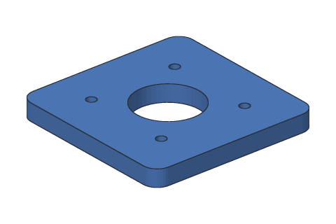

A plate that holds a NEMA 17 stepper motor, the motor in most 3D printers: a 60 mm square with rounded corners, a 23 mm hole for the round boss on the motor's face, and four 3.4 mm holes 31 mm apart for its M3 screws.

**Uses:** sketch, dimensions, extrude, rounding, sketch on a face, cut, hole. **Try:** make the middle hole 24 mm across instead of 23 mm (BoreSketch's Bore), for a motor with a bigger boss.

```console
$ sketchbillet_cli run --save part.sb feature.add_sketch plane=xy name=PlateSketch
$ sketchbillet_cli run --open part.sb --save part.sb sketch.add_rectangle sketch=PlateSketch from=0,0 to=60,60
$ sketchbillet_cli run --open part.sb --save part.sb sketch.constrain sketch=PlateSketch kind=fix on=Line1.start
$ sketchbillet_cli run --open part.sb --save part.sb sketch.constrain sketch=PlateSketch kind=length on=Line1 value=60 name=Width
$ sketchbillet_cli run --open part.sb --save part.sb sketch.constrain sketch=PlateSketch kind=length on=Line2 value=60 name=Height
$ sketchbillet_cli run --open part.sb --save part.sb feature.add_extrude sketch=PlateSketch distance=6 name=Plate
$ sketchbillet_cli run --open part.sb --save part.sb feature.add_fillet body=Plate edges=5,6,7,8 radius=5 name=Corners
$ sketchbillet_cli run --open part.sb --save part.sb feature.add_sketch body=Corners face=10 name=BoreSketch
$ sketchbillet_cli run --open part.sb --save part.sb sketch.add_circle sketch=BoreSketch center=30,30 radius=11.5
$ sketchbillet_cli run --open part.sb --save part.sb sketch.constrain sketch=BoreSketch kind=radius on=Circle1 value=11.5 name=Bore
$ sketchbillet_cli run --open part.sb --save part.sb feature.add_extrude sketch=BoreSketch distance=6 operation=cut name=Bored
$ sketchbillet_cli run --open part.sb --save part.sb feature.add_sketch body=Bored face=11 name=ScrewSketch
$ sketchbillet_cli run --open part.sb --save part.sb sketch.add_point sketch=ScrewSketch at=14.5,14.5
$ sketchbillet_cli run --open part.sb --save part.sb sketch.add_point sketch=ScrewSketch at=45.5,14.5
$ sketchbillet_cli run --open part.sb --save part.sb sketch.add_point sketch=ScrewSketch at=14.5,45.5
$ sketchbillet_cli run --open part.sb --save part.sb sketch.add_point sketch=ScrewSketch at=45.5,45.5
$ sketchbillet_cli run --open part.sb --save part.sb feature.add_hole sketch=ScrewSketch diameter=3.4 name=MotorPlate
```

Then, to make the change:

```console
$ sketchbillet_cli run --open part.sb --save part.sb sketch.set_value sketch=BoreSketch constraint=Bore value=12
```

### Wall hook

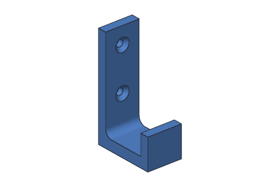

A hook for a coat or a bag: a back plate that screws to the wall, an arm that sticks out, and a lip at the end so nothing slides off. A rounding where the arm meets the plate makes it much stronger than a sharp corner.

**Uses:** sketch, dimensions, extrude, sketch on a face, join, rounding, countersunk hole. **Try:** make the back plate 80 mm tall instead of 60 mm (BackSketch's Height).

```console
$ sketchbillet_cli run --save part.sb feature.add_sketch plane=xz name=BackSketch
$ sketchbillet_cli run --open part.sb --save part.sb sketch.add_rectangle sketch=BackSketch from=0,0 to=5,60
$ sketchbillet_cli run --open part.sb --save part.sb sketch.constrain sketch=BackSketch kind=fix on=Line1.start
$ sketchbillet_cli run --open part.sb --save part.sb sketch.constrain sketch=BackSketch kind=length on=Line1 value=5 name=Thickness
$ sketchbillet_cli run --open part.sb --save part.sb sketch.constrain sketch=BackSketch kind=length on=Line2 value=60 name=Height
$ sketchbillet_cli run --open part.sb --save part.sb feature.add_extrude sketch=BackSketch distance=20 name=Back
$ sketchbillet_cli run --open part.sb --save part.sb feature.add_sketch body=Back face=4 name=ArmSketch
$ sketchbillet_cli run --open part.sb --save part.sb sketch.add_rectangle sketch=ArmSketch from=-20,0 to=0,6
$ sketchbillet_cli run --open part.sb --save part.sb feature.add_extrude sketch=ArmSketch distance=30 operation=join name=Arm
$ sketchbillet_cli run --open part.sb --save part.sb feature.add_sketch body=Arm face=6 name=LipSketch
$ sketchbillet_cli run --open part.sb --save part.sb sketch.add_rectangle sketch=LipSketch from=30,-20 to=35,0
$ sketchbillet_cli run --open part.sb --save part.sb feature.add_extrude sketch=LipSketch distance=12 operation=join name=Lip
$ sketchbillet_cli run --open part.sb --save part.sb feature.add_fillet body=Lip edges=14 radius=4 name=Inside
$ sketchbillet_cli run --open part.sb --save part.sb feature.add_sketch body=Inside face=16 name=ScrewSketch
$ sketchbillet_cli run --open part.sb --save part.sb sketch.add_point sketch=ScrewSketch at=-10,25
$ sketchbillet_cli run --open part.sb --save part.sb sketch.add_point sketch=ScrewSketch at=-10,50
$ sketchbillet_cli run --open part.sb --save part.sb feature.add_hole sketch=ScrewSketch kind=countersink diameter=4 countersink_diameter=8 name=WallHook
```

Then, to make the change:

```console
$ sketchbillet_cli run --open part.sb --save part.sb sketch.set_value sketch=BackSketch constraint=Height value=80
```

### Rail clamp block

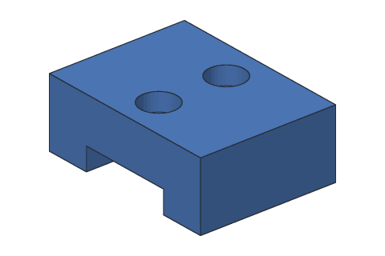

A block that sits over a 20 mm rail, like the aluminum rails many 3D printers and CNC machines are built from: a channel cut across the bottom fits the rail, and two counterbored holes take M4 screws, their heads sunk below the top so a part can sit flat on it.

**Uses:** sketch, dimensions, extrude, sketch on a face, cut, counterbored hole. **Try:** make the channel 20.8 mm wide instead of 20.4 mm (ChannelSketch's Rail), for a looser fit on the rail.

```console
$ sketchbillet_cli run --save part.sb feature.add_sketch plane=xy name=BlockSketch
$ sketchbillet_cli run --open part.sb --save part.sb sketch.add_rectangle sketch=BlockSketch from=0,0 to=40,30
$ sketchbillet_cli run --open part.sb --save part.sb sketch.constrain sketch=BlockSketch kind=fix on=Line1.start
$ sketchbillet_cli run --open part.sb --save part.sb sketch.constrain sketch=BlockSketch kind=length on=Line1 value=40 name=Length
$ sketchbillet_cli run --open part.sb --save part.sb sketch.constrain sketch=BlockSketch kind=length on=Line2 value=30 name=Width
$ sketchbillet_cli run --open part.sb --save part.sb feature.add_extrude sketch=BlockSketch distance=15 name=Block
$ sketchbillet_cli run --open part.sb --save part.sb feature.add_sketch body=Block face=2 name=ChannelSketch
$ sketchbillet_cli run --open part.sb --save part.sb sketch.add_rectangle sketch=ChannelSketch from=9.8,0 to=30.2,5
$ sketchbillet_cli run --open part.sb --save part.sb sketch.constrain sketch=ChannelSketch kind=fix on=Line1.start
$ sketchbillet_cli run --open part.sb --save part.sb sketch.constrain sketch=ChannelSketch kind=length on=Line1 value=20.4 name=Rail
$ sketchbillet_cli run --open part.sb --save part.sb sketch.constrain sketch=ChannelSketch kind=length on=Line2 value=5 name=Depth
$ sketchbillet_cli run --open part.sb --save part.sb feature.add_extrude sketch=ChannelSketch distance=30 operation=cut name=Channel
$ sketchbillet_cli run --open part.sb --save part.sb feature.add_sketch body=Channel face=10 name=ScrewSketch
$ sketchbillet_cli run --open part.sb --save part.sb sketch.add_point sketch=ScrewSketch at=20,7.5
$ sketchbillet_cli run --open part.sb --save part.sb sketch.add_point sketch=ScrewSketch at=20,22.5
$ sketchbillet_cli run --open part.sb --save part.sb feature.add_hole sketch=ScrewSketch kind=counterbore diameter=4.5 counterbore_diameter=8 counterbore_depth=4 name=RailClamp
```

Then, to make the change:

```console
$ sketchbillet_cli run --open part.sb --save part.sb sketch.set_value sketch=ChannelSketch constraint=Rail value=20.8
```

### Rod clamp

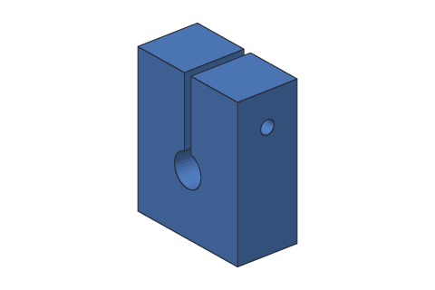

A clamp that holds an 8 mm rod, like the smooth rods a 3D printer slides along: a hole for the rod, a thin slit from the hole to the top, and a screw hole across the slit. Tighten the screw, the slit closes, and the clamp grips the rod.

**Uses:** sketch, dimensions, extrude, sketch on a face, cut, hole. **Try:** make the rod hole 10 mm across instead of 8 mm (RodSketch's Rod), for a 10 mm rod.

```console
$ sketchbillet_cli run --save part.sb feature.add_sketch plane=xz name=BlockSketch
$ sketchbillet_cli run --open part.sb --save part.sb sketch.add_rectangle sketch=BlockSketch from=0,0 to=30,36
$ sketchbillet_cli run --open part.sb --save part.sb sketch.constrain sketch=BlockSketch kind=fix on=Line1.start
$ sketchbillet_cli run --open part.sb --save part.sb sketch.constrain sketch=BlockSketch kind=length on=Line1 value=30 name=Width
$ sketchbillet_cli run --open part.sb --save part.sb sketch.constrain sketch=BlockSketch kind=length on=Line2 value=36 name=Height
$ sketchbillet_cli run --open part.sb --save part.sb feature.add_extrude sketch=BlockSketch distance=15 name=Block
$ sketchbillet_cli run --open part.sb --save part.sb feature.add_sketch body=Block face=2 name=RodSketch
$ sketchbillet_cli run --open part.sb --save part.sb sketch.add_circle sketch=RodSketch center=15,15 radius=4
$ sketchbillet_cli run --open part.sb --save part.sb sketch.constrain sketch=RodSketch kind=radius on=Circle1 value=4 name=Rod
$ sketchbillet_cli run --open part.sb --save part.sb feature.add_extrude sketch=RodSketch distance=15 operation=cut name=Bore
$ sketchbillet_cli run --open part.sb --save part.sb feature.add_sketch body=Bore face=5 name=SlitSketch
$ sketchbillet_cli run --open part.sb --save part.sb sketch.add_rectangle sketch=SlitSketch from=14,15 to=16,36
$ sketchbillet_cli run --open part.sb --save part.sb feature.add_extrude sketch=SlitSketch distance=15 operation=cut name=Slit
$ sketchbillet_cli run --open part.sb --save part.sb feature.add_sketch body=Slit face=7 name=ScrewSketch
$ sketchbillet_cli run --open part.sb --save part.sb sketch.add_point sketch=ScrewSketch at=-7.5,28
$ sketchbillet_cli run --open part.sb --save part.sb feature.add_hole sketch=ScrewSketch diameter=3.4 name=RodClamp
```

Then, to make the change:

```console
$ sketchbillet_cli run --open part.sb --save part.sb sketch.set_value sketch=RodSketch constraint=Rod value=5
```

### Flanged spacer

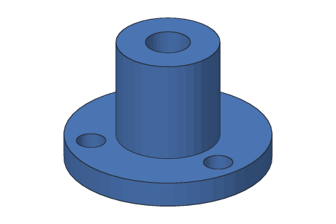

A spacer that holds a board or a panel off a surface, with a flange at the bottom that screws down: one stepped outline, drawn with lines and revolved round the middle, a 5.2 mm hole up the middle for an M5 bolt, and three screw holes round the flange from one hole repeated.

**Uses:** sketch, lines, constraints, dimensions, revolve, sketch on a face, hole, circular pattern. **Try:** make the flange 28 mm across instead of 24 mm (ProfileSketch's Flange): the screw holes stay put.

```console
$ sketchbillet_cli run --save part.sb feature.add_sketch plane=xz name=ProfileSketch
$ sketchbillet_cli run --open part.sb --save part.sb sketch.add_line sketch=ProfileSketch from=2.6,0 to=12,0
$ sketchbillet_cli run --open part.sb --save part.sb sketch.add_line sketch=ProfileSketch from=12,0 to=12,3
$ sketchbillet_cli run --open part.sb --save part.sb sketch.add_line sketch=ProfileSketch from=12,3 to=6,3
$ sketchbillet_cli run --open part.sb --save part.sb sketch.add_line sketch=ProfileSketch from=6,3 to=6,15
$ sketchbillet_cli run --open part.sb --save part.sb sketch.add_line sketch=ProfileSketch from=6,15 to=2.6,15
$ sketchbillet_cli run --open part.sb --save part.sb sketch.add_line sketch=ProfileSketch from=2.6,15 to=2.6,0
$ sketchbillet_cli run --open part.sb --save part.sb sketch.constrain sketch=ProfileSketch kind=coincident on=Line1.end,Line2.start
$ sketchbillet_cli run --open part.sb --save part.sb sketch.constrain sketch=ProfileSketch kind=coincident on=Line2.end,Line3.start
$ sketchbillet_cli run --open part.sb --save part.sb sketch.constrain sketch=ProfileSketch kind=coincident on=Line3.end,Line4.start
$ sketchbillet_cli run --open part.sb --save part.sb sketch.constrain sketch=ProfileSketch kind=coincident on=Line4.end,Line5.start
$ sketchbillet_cli run --open part.sb --save part.sb sketch.constrain sketch=ProfileSketch kind=coincident on=Line5.end,Line6.start
$ sketchbillet_cli run --open part.sb --save part.sb sketch.constrain sketch=ProfileSketch kind=coincident on=Line6.end,Line1.start
$ sketchbillet_cli run --open part.sb --save part.sb sketch.constrain sketch=ProfileSketch kind=fix on=Line1.start
$ sketchbillet_cli run --open part.sb --save part.sb sketch.constrain sketch=ProfileSketch kind=horizontal on=Line1
$ sketchbillet_cli run --open part.sb --save part.sb sketch.constrain sketch=ProfileSketch kind=vertical on=Line2
$ sketchbillet_cli run --open part.sb --save part.sb sketch.constrain sketch=ProfileSketch kind=horizontal on=Line3
$ sketchbillet_cli run --open part.sb --save part.sb sketch.constrain sketch=ProfileSketch kind=vertical on=Line4
$ sketchbillet_cli run --open part.sb --save part.sb sketch.constrain sketch=ProfileSketch kind=horizontal on=Line5
$ sketchbillet_cli run --open part.sb --save part.sb sketch.constrain sketch=ProfileSketch kind=vertical on=Line6
$ sketchbillet_cli run --open part.sb --save part.sb sketch.constrain sketch=ProfileSketch kind=length on=Line1 value=9.4 name=Flange
$ sketchbillet_cli run --open part.sb --save part.sb sketch.constrain sketch=ProfileSketch kind=length on=Line2 value=3 name=FlangeThickness
$ sketchbillet_cli run --open part.sb --save part.sb sketch.constrain sketch=ProfileSketch kind=length on=Line5 value=3.4 name=Wall
$ sketchbillet_cli run --open part.sb --save part.sb sketch.constrain sketch=ProfileSketch kind=length on=Line6 value=15 name=Height
$ sketchbillet_cli run --open part.sb --save part.sb feature.add_revolve sketch=ProfileSketch axis=y name=Spacer
$ sketchbillet_cli run --open part.sb --save part.sb feature.add_sketch body=Spacer face=3 name=ScrewSketch
$ sketchbillet_cli run --open part.sb --save part.sb sketch.add_point sketch=ScrewSketch at=9,0
$ sketchbillet_cli run --open part.sb --save part.sb feature.add_hole sketch=ScrewSketch diameter=3.4 name=Screw
$ sketchbillet_cli run --open part.sb --save part.sb feature.add_pattern steps=Screw kind=circular count=3 name=FlangedSpacer
```

Then, to make the change:

```console
$ sketchbillet_cli run --open part.sb --save part.sb sketch.set_value sketch=ProfileSketch constraint=Flange value=11.4
```
