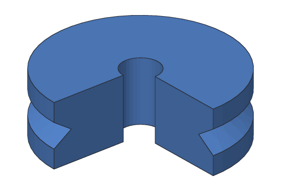
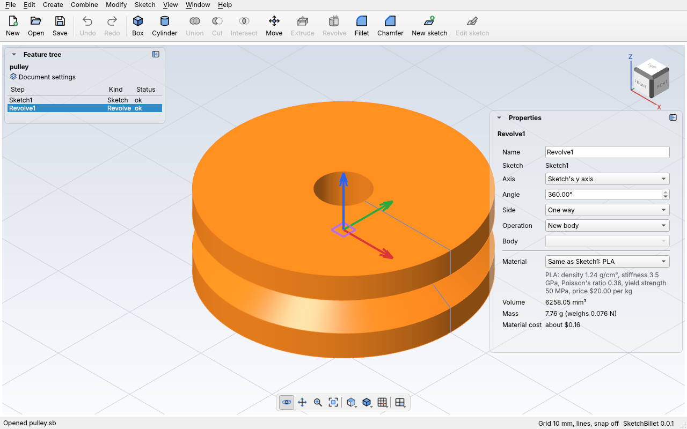

# Revolve

**Revolve** turns a [sketch](sketches.md)'s closed shapes around a line into a
solid, like a part made on a lathe or a pot on a potter's wheel. Draw half of
the part's side view, from the middle out, and Revolve makes the whole round
part: a washer, a knob, a wheel, a vase, a spinning top.



The line it turns about is the **axis**. It can be the sketch's y axis (the
usual), its x axis, or any line in the sketch: a helper line, or a side of the
shape itself. The shape may touch the axis, but it must not cross it, or it would
turn through itself. A shape that doesn't reach the axis leaves a hole up the
middle, like the pulley's.

The sketch stays in the design as its own step, and the revolve uses it. Change
the sketch and the round part rebuilds to match.

## In the desktop app

1. Draw half of the part's side view in a sketch, and finish it. For a part that
   stands up, sketch on **XZ** or **YZ**, where the sketch's y axis is upright.
2. Pick the sketch in the feature tree.
3. Click **Revolve** on the toolbar, or **Create > Revolve**. It's grey unless
   exactly one sketch is picked.

SketchBillet adds `Revolve1`, turned all the way round (360°) the sketch's y
axis, or round its helper line if it has just one. Pick it to change it in
**Properties**:



| Setting | What it does |
| --- | --- |
| **Axis** | The line it turns about: **Sketch's y axis**, **Sketch's x axis**, or any line of the sketch, by name. |
| **Angle** | How far it turns, in degrees: 360 is all the way round. Less leaves two flat ends, which is handy for seeing inside. |
| **Side** | For less than 360°: **One way** turns the right-hand way about the axis; **Flipped** the other way; **Both ways**, half the angle each way. |
| **Operation** | **New body**, **Join** (added to a body) or **Cut** (taken out of a body, like a groove). It works like [Extrude's](extrude.md#join-and-cut). |
| **Body** | For Join or Cut: which body. |

Each change is one undo step.

## Example with sketchbillet_cli

A pulley for a belt: a 10 mm thick ring, 30 mm across, with a 6 mm hole and a
V-shaped groove round the outside. On XZ, the sketch's y axis stands up. The
outline is half the pulley's side view, 3 to 15 mm out from the axis:

<!-- cli-example -->
```console
$ sketchbillet_cli run --save pulley.sb feature.add_sketch plane=xz
pulley: 1 step
  Sketch1      ok  empty
wrote pulley.sb
$ sketchbillet_cli run --open pulley.sb --save pulley.sb sketch.add_line sketch=Sketch1 from=3,0 to=15,0
pulley: 1 step
  Sketch1      ok  1 line, 0 constraints, free to move 4 ways
wrote pulley.sb
$ sketchbillet_cli run --open pulley.sb --save pulley.sb sketch.add_line sketch=Sketch1 from=15,0 to=15,3
pulley: 1 step
  Sketch1      ok  2 lines, 0 constraints, free to move 8 ways
wrote pulley.sb
$ sketchbillet_cli run --open pulley.sb --save pulley.sb sketch.add_line sketch=Sketch1 from=15,3 to=12,5
pulley: 1 step
  Sketch1      ok  3 lines, 0 constraints, free to move 12 ways
wrote pulley.sb
$ sketchbillet_cli run --open pulley.sb --save pulley.sb sketch.add_line sketch=Sketch1 from=12,5 to=15,7
pulley: 1 step
  Sketch1      ok  4 lines, 0 constraints, free to move 16 ways
wrote pulley.sb
$ sketchbillet_cli run --open pulley.sb --save pulley.sb sketch.add_line sketch=Sketch1 from=15,7 to=15,10
pulley: 1 step
  Sketch1      ok  5 lines, 0 constraints, free to move 20 ways
wrote pulley.sb
$ sketchbillet_cli run --open pulley.sb --save pulley.sb sketch.add_line sketch=Sketch1 from=15,10 to=3,10
pulley: 1 step
  Sketch1      ok  6 lines, 0 constraints, free to move 24 ways
wrote pulley.sb
$ sketchbillet_cli run --open pulley.sb --save pulley.sb sketch.add_line sketch=Sketch1 from=3,10 to=3,0
pulley: 1 step
  Sketch1      ok  7 lines, 0 constraints, free to move 28 ways
wrote pulley.sb
$ sketchbillet_cli run --open pulley.sb --save pulley.sb feature.add_revolve sketch=Sketch1
pulley: 2 steps
  Sketch1      ok  7 lines, 0 constraints, free to move 28 ways
  Revolve1     ok  volume 6258.05 mm^3  mass 7.76 g (PLA)
wrote pulley.sb
```

Check it: a ring 3 to 15 mm out and 10 mm tall is π × (15² − 3²) × 10 = 2160π.
The groove is a triangle of area 6 mm² whose middle is 14 mm out, so turning it
takes away 6 × 2π × 14 = 168π. That leaves 1992π = 6258.05 mm³.

Turn it 270° (`angle=270`) to see the shape inside, as in the picture at the
top. See [`feature.add_revolve`](../cli/commands.md#featureadd_revolve) for every
setting, and [Tutorial 4](../tutorials/04-spinning-top.md) for a whole part made
this way.

## Turning about another line

`axis=x` turns about the sketch's x axis instead. `axis=Line5` turns about a line
of the sketch. A **helper line** (one drawn with `construction=true`) is never
part of the shape, so it's the usual way to put the axis anywhere you like; with
just one helper line in the sketch, Revolve uses it without being told. A side of
the shape works too: a rectangle turned about one of its own sides makes a solid
cylinder.

## Cut a groove

With **Cut**, the round shape is taken out of a body: a groove round a shaft, a
recess in a knob. Sketch the groove's shape beside the shaft's middle line, and
cut it from the shaft. [`feature.add_revolve`](../cli/commands.md#featureadd_revolve)
has an example: a 2 mm deep groove round a rod.

## Tips

- Draw only **half** the side view, on one side of the axis. The other half comes
  from turning it.
- Put the axis where the part's middle is, usually the sketch's y axis at x = 0.
- A shape that crosses the axis is refused: "The shape crosses the line it turns
  about". Move the shape to one side, or pick another axis.
- If its axis line is deleted from the sketch, Revolve stops and asks you to pick
  another axis in Properties.
- Rounding a corner of the sketch rounds a whole ring of the part.
