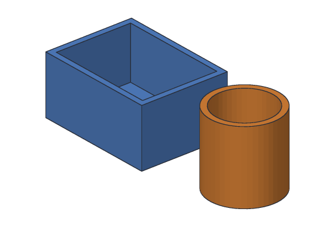
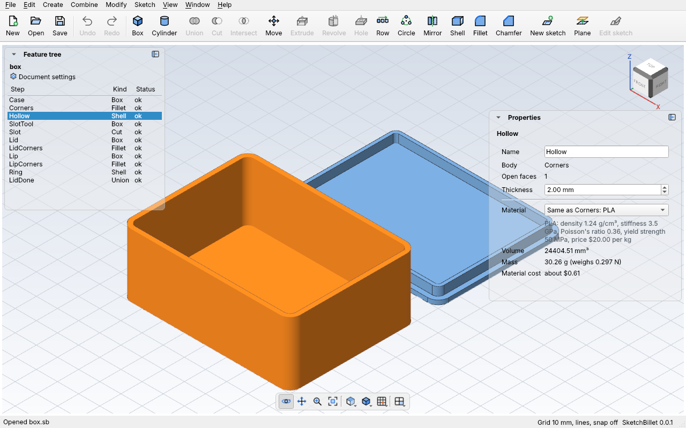

# Shell

**Shell** hollows a body out, leaving thin walls, with the faces you pick left
open. A box becomes a tray, a cylinder becomes a cup. The outside stays the same
size: the walls grow inward, so the part still fits where you planned.



It's how you make enclosures, boxes, cups, trays and plant pots: model the
solid outside first, round its corners, then shell it. Shelling also saves
plastic and print time.

- **Open faces:** the faces you pick become the openings. Pick one (a box's top)
  for a tray, two (the top and bottom) for a tube.
- **Thickness:** how thick the walls are, in mm. The bottom and every side get the
  same thickness.
- **Rounded corners stay round:** a 5 mm fillet outside becomes a 3 mm curve
  inside, with 2 mm walls.

## In the desktop app

1. Click **Shell** on the toolbar (**Modify > Shell**). SketchBillet starts
   picking faces and tells you so at the bottom of the window.
2. Click the face to leave open in the 3D view, like the top. Ctrl-click to pick
   more.
3. Click **Shell** again. The walls are 2 mm thick.
4. Change it in **Properties**:



| Setting | What it does |
| --- | --- |
| **Body** | The body it hollows. |
| **Open faces** | How many faces are left open. To change which ones, delete the step and add it again with the faces picked. |
| **Thickness** | How thick the walls are, in mm. |

## Example with sketchbillet_cli

A box 40 × 30 × 20 mm, shelled with its top (face 6) open. The inside is
36 × 26 × 18 mm, so the tray is 24000 − 16848 = 7152 mm³:

<!-- cli-example -->
```console
$ sketchbillet_cli run --save tray.sb feature.add_box size=40,30,20
tray: 1 step
  Box1         ok  volume 24000.00 mm^3  mass 29.76 g (PLA)
wrote tray.sb
$ sketchbillet_cli run --open tray.sb --save tray.sb feature.add_shell body=Box1 faces=6
tray: 2 steps
  Box1         ok  volume 24000.00 mm^3
  Shell1       ok  volume 7152.00 mm^3  mass 8.87 g (PLA)
wrote tray.sb
```

Find a face's number with `sketchbillet_cli open tray.sb --faces Box1`. Make the
walls 3 mm thick:

<!-- cli-example -->
```console
$ sketchbillet_cli run --open tray.sb feature.set_value feature=Shell1 setting=thickness value=3
tray: 2 steps
  Box1         ok  volume 24000.00 mm^3
  Shell1       ok  volume 10128.00 mm^3  mass 12.56 g (PLA)
```

See [`feature.add_shell`](../cli/commands.md#featureadd_shell) for every setting,
and [Tutorial 9](../tutorials/09-project-box.md) for a box with a lid.

## The inside walls' names

Each inside wall is named after the outside face it's the inside of, like
"inside of bottom of Box1 (Shell1)". A step after the shell, like a fillet on an
inside edge or a sketch on the inside floor, keeps finding it when you change
the thickness or the box's size.

## Tips

- Round the outside corners **before** you shell. The inside corners come out
  round too.
- Walls must fit inside the body: 16 mm walls in a box 30 mm wide meet in the
  middle. The step stops and says to try thinner ones.
- For 3D printing, make walls at least 2 or 3 times your nozzle's width (for a
  0.4 mm nozzle, 0.8 or 1.2 mm), so they print solidly.
- Cut holes and slots in the walls after the shell, so the shell doesn't try to
  wrap walls around them.
