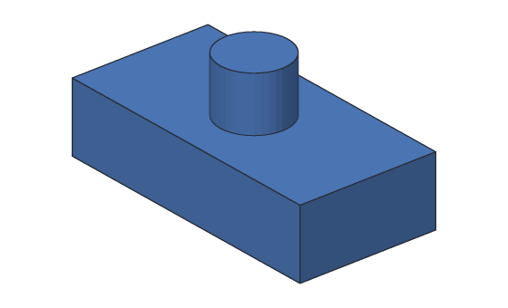
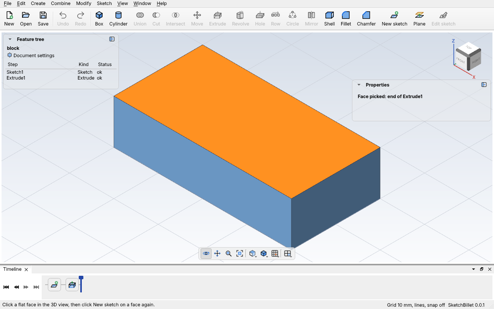
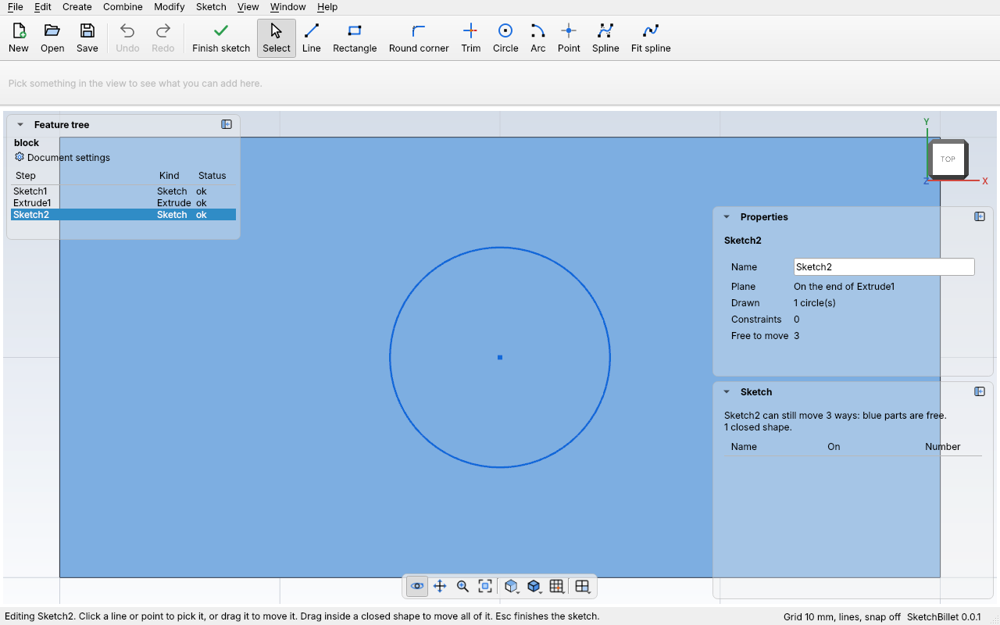

# Sketching on a face

A sketch can be drawn on a flat face of a body, like the top of a block, as well
as on the ground or a standing plane. Extrude it to add a boss, a tab or a peg
right where it belongs, or to cut a pocket or a hole: the extrude joins the
body, or cuts into it, in one step.



The sketch **stays on the face**. Make the block taller, and the sketch (and the
peg made from it) moves up with the top. Its x and y match the design's on a top
face, so a circle at 20, 10 sits above the point 20, 10 of the ground.

## In the desktop app

1. Click **Sketch > New sketch on a face**. The 3D view now picks faces, and the
   bar at the bottom says so.
2. Click the face to draw on. It turns orange, and Properties says which face
   it is. It must be flat: a sketch can't go on a round face, like the side of a
   cylinder.

   

3. Click **New sketch on a face** again. SketchBillet adds the sketch, turns the
   view to look straight at the face, and you draw as in any
   [sketch](sketches.md). Properties shows where the sketch is: **On the end of
   Extrude1**.

   

Shortcut: with a flat face picked, the toolbar's **New sketch** button draws on
that face too.

To move a sketch to another face, or to pick its face again when the sketch says
it can't find it: pick the sketch in the feature tree, click **Sketch > Move to a
face**, click the face, then click **Move to a face** again.

## Example with sketchbillet_cli

`sketchbillet_cli open --faces` lists a body's faces, numbered from the bottom
up, with what each one is:

<!-- cli-example -->
```console
$ sketchbillet_cli run --save peg.sb feature.add_box size=40,20,10
peg: 1 step
  Box1         ok  volume 8000.00 mm^3  mass 9.92 g (PLA)
wrote peg.sb
$ sketchbillet_cli open peg.sb --faces Box1
peg: 1 step
  Box1         ok  volume 8000.00 mm^3  mass 9.92 g (PLA)
faces of Box1: 6
   1  flat        800.00 mm^2  at 20.00,10.00,0.00  bottom of Box1
   2  flat        400.00 mm^2  at 20.00,0.00,5.00  front side of Box1
   3  flat        200.00 mm^2  at 0.00,10.00,5.00  left side of Box1
   4  flat        200.00 mm^2  at 40.00,10.00,5.00  right side of Box1
   5  flat        400.00 mm^2  at 20.00,20.00,5.00  back side of Box1
   6  flat        800.00 mm^2  at 20.00,10.00,10.00  top of Box1
```

The top is face 6. Draw a circle on it and extrude it 8 mm:

<!-- cli-example -->
```console
$ sketchbillet_cli run --open peg.sb --save peg.sb feature.add_sketch body=Box1 face=6
peg: 2 steps
  Box1         ok  volume 8000.00 mm^3  mass 9.92 g (PLA)
  Sketch1      ok  empty
wrote peg.sb
$ sketchbillet_cli run --open peg.sb --save peg.sb sketch.add_circle sketch=Sketch1 center=20,10 radius=5
peg: 2 steps
  Box1         ok  volume 8000.00 mm^3  mass 9.92 g (PLA)
  Sketch1      ok  1 circle, 0 constraints, free to move 3 ways
wrote peg.sb
$ sketchbillet_cli run --open peg.sb --save peg.sb feature.add_extrude sketch=Sketch1 distance=8
peg: 3 steps
  Box1         ok  volume 8000.00 mm^3
  Sketch1      ok  1 circle, 0 constraints, free to move 3 ways
  Extrude1     ok  volume 8628.32 mm^3  mass 10.70 g (PLA)
wrote peg.sb
```

Because the sketch is on the block, the peg **joins** the block: Extrude1 is the
whole part, 8000 + π × 5² × 8 = 8628.32 mm³, and Box1 is no longer a body of its
own (it has no mass). To cut a pocket instead, see
[Extrude: join and cut](extrude.md#join-and-cut).

Now make the block 25 mm tall. The peg moves up with the top, and the part grows
by 20 × 40 × 15 = 12000 mm³:

<!-- cli-example -->
```console
$ sketchbillet_cli run --open peg.sb --save peg.sb feature.set_value feature=Box1 setting=size_z value=25
peg: 3 steps
  Box1         ok  volume 20000.00 mm^3
  Sketch1      ok  1 circle, 0 constraints, free to move 3 ways
  Extrude1     ok  volume 20628.32 mm^3  mass 25.58 g (PLA)
wrote peg.sb
```

## When the face is gone

If a change takes the face away (say, a cut removes the top), the sketch stops
and says so, and the steps made from it wait:

```text
Sketch1 can't find the face it's on: an earlier change took it away. Pick a flat face for it again: pick the sketch, then Sketch > Move to a face.
```

Do what it says, or use [`feature.set_sketch_face`](../cli/commands.md#featureset_sketch_face)
with `sketchbillet_cli`.

## Tips

- **Which face is which?** In the app, Properties names the face you picked. On
  the command line, `open --faces` lists them all, with where each one's middle is.
- **Cut a pocket:** sketch on the top, extrude it, and set its **Operation** to
  **Cut** in Properties. A cut from a face goes into the body.
- **Copies bring their face along.** Duplicating a peg also duplicates the block
  it's sketched on, so the copy has a face to stand on.
