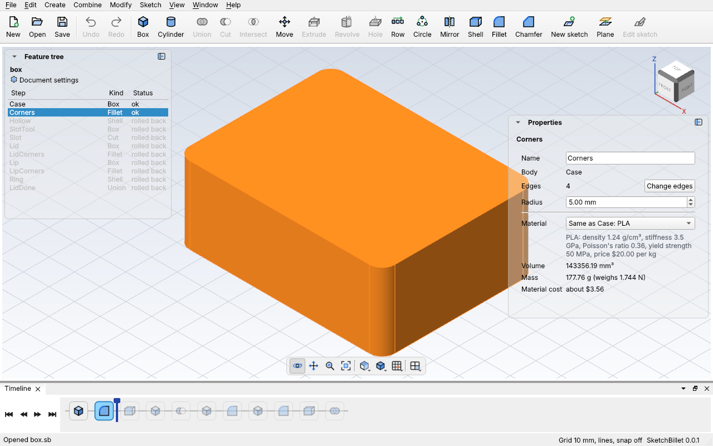
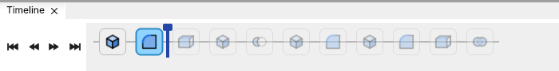

# The timeline

The **timeline** is the bar along the bottom of the window. It shows every step of
your design in the order it's built, left to right, each as its toolbar picture. The
blue line with a flag on top is the **rollback marker**: the steps before it are
built, and the steps after it are kept but not built.



Rolling the marker back lets you go back in time: see the part as it was, and
add a step in the middle, like a rounding before a shell, instead of at the end.

## The bar



| Part | What it does |
| --- | --- |
| **⏮ ◀ ▶ ⏭** | Roll back to the start, back one step, forward one step, or forward to the end. |
| **A step** | Click it to pick it (Properties shows its settings). Ctrl-click picks more. Point at it to see its name and whether it built. A faded step is after the marker; a red outline means it has a problem; a line through it means it's turned off. |
| **The marker** | Drag the flag left or right to roll back or forward. |
| **Right-click a step** | **Roll back to here**, **Turn off** or **Turn on**, **Delete**, or **Roll forward to the end**. |

The feature tree shows the same thing: the steps after the marker are grey, with
"rolled back" in the Status column.

## Adding a step before others

With the marker rolled back, a new step goes in at the marker, not at the end, and
the marker moves past it. If later steps used the same body, they use the new step
instead: a fillet added on Box1 before Shell1 makes Shell1 hollow the rounded box.
Roll forward to the end, and every step after it is built again on top.

Here's a tray, a box 40 × 30 × 20 mm shelled with its top open, getting its
corners rounded after the fact:

<!-- cli-example -->
```console
$ sketchbillet_cli run --save tray.sb feature.add_box size=40,30,20
tray: 1 step
  Box1         ok  volume 24000.00 mm^3  mass 29.76 g (PLA)
wrote tray.sb
$ sketchbillet_cli run --open tray.sb --save tray.sb feature.add_shell body=Box1 faces=6
tray: 2 steps
  Box1         ok  volume 24000.00 mm^3
  Shell1       ok  volume 7152.00 mm^3  mass 8.87 g (PLA)
wrote tray.sb
$ sketchbillet_cli run --open tray.sb --save tray.sb timeline.rollback after=Box1
tray: 2 steps
  Box1         ok  volume 24000.00 mm^3  mass 29.76 g (PLA)
  -- rolled back to here: the steps below aren't built --
  Shell1       rolled back
wrote tray.sb
$ sketchbillet_cli run --open tray.sb --save tray.sb feature.add_fillet body=Box1 edges=5,6,7,8 radius=5
tray: 3 steps
  Box1         ok  volume 24000.00 mm^3
  Fillet1      ok  volume 23570.80 mm^3  mass 29.23 g (PLA)
  -- rolled back to here: the steps below aren't built --
  Shell1       rolled back
wrote tray.sb
$ sketchbillet_cli run --open tray.sb --save tray.sb timeline.rollback to=end
tray: 3 steps
  Box1         ok  volume 24000.00 mm^3
  Fillet1      ok  volume 23570.80 mm^3
  Shell1       ok  volume 6861.86 mm^3  mass 8.51 g (PLA)
wrote tray.sb
```

Shell1 now hollows the rounded box, and its inside corners are round too. See
[`timeline.rollback`](../cli/commands.md#timelinerollback) for the numbers.

## Changing the order

Drag a step left or right in the bar, and drop it where it should go. A blue line
shows where it'll land. A step must come after the steps it uses, and before the
steps that use it; if it can't go there, nothing moves, and the status bar says
why. With [`sketchbillet_cli`](../cli/commands.md#timelinemove):

<!-- cli-example -->
```console
$ sketchbillet_cli run --open tray.sb --save tray.sb feature.add_cylinder radius=4 height=10 base=60,0,0 name=Peg
tray: 4 steps
  Box1         ok  volume 24000.00 mm^3
  Fillet1      ok  volume 23570.80 mm^3
  Shell1       ok  volume 6861.86 mm^3  mass 8.51 g (PLA)
  Peg          ok  volume 502.65 mm^3  mass 0.62 g (PLA)
wrote tray.sb
$ sketchbillet_cli run --open tray.sb --save tray.sb timeline.move feature=Peg to=start
tray: 4 steps
  Peg          ok  volume 502.65 mm^3  mass 0.62 g (PLA)
  Box1         ok  volume 24000.00 mm^3
  Fillet1      ok  volume 23570.80 mm^3
  Shell1       ok  volume 6861.86 mm^3  mass 8.51 g (PLA)
wrote tray.sb
```

A step moved out of a [folder](desktop-app.md#folders) leaves it, and a step dropped
between two steps of a folder joins it.

## Tips

- The marker is saved with the design. If a design opens with faded steps, it was
  saved rolled back: click **⏭** to build everything.
- Rolling back and moving steps are each one step of **Edit > Undo**.
- Exporting STL or STEP saves what's built, so roll forward to the end first.
- Rolled back, the part in the 3D view is the part as it was. Faces and edges you
  pick are on that part.
